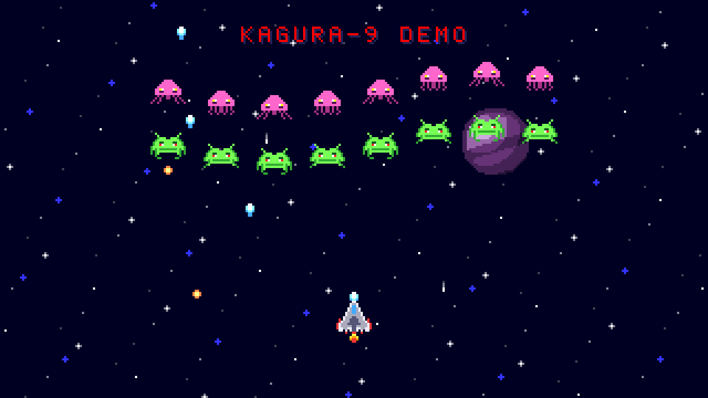
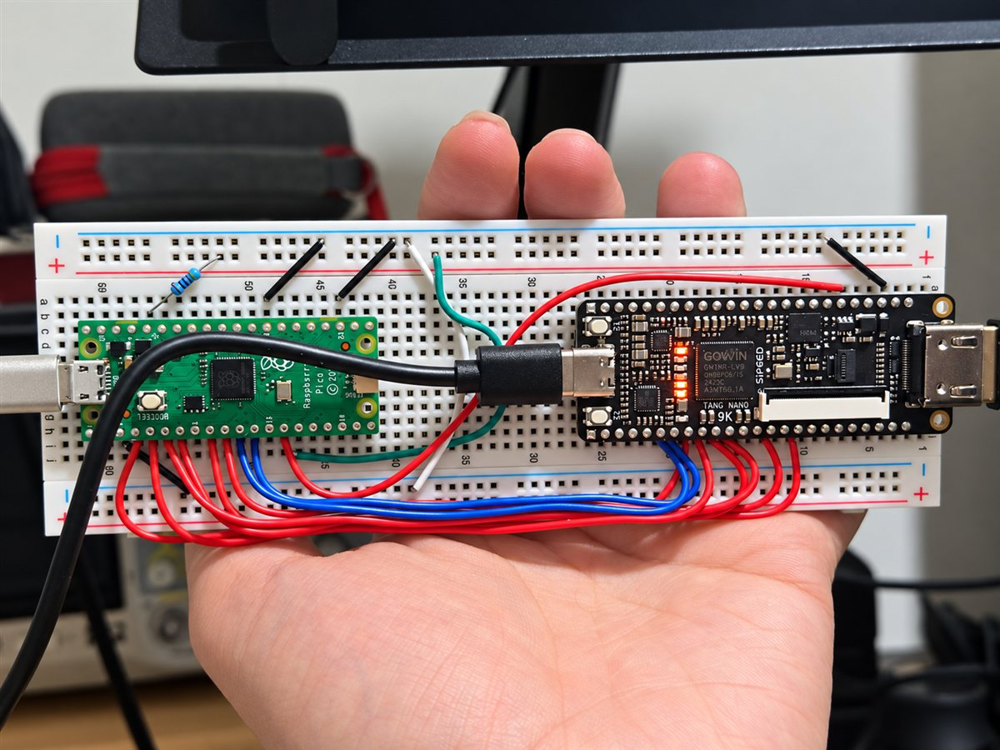

# 

Kinetic Audio & Graphics Unified Rendering Architecture。
W65C02SまたはSPI/QSPIホストから制御するTang Nano 9K向けHDMI VDP・6ch音源です。現在は実機検証中です。

**背景・スプライトに加え、6ch音源とレジスタ・波形RAM・HDMI出力を統合しています。**



*720pデモのRTLシミュレーション出力（論理320×180を1280×720へ4倍表示）。実機モニターの撮影ではありません。[画像の生成元](docs/images/README.md)。*

デモ動画（YouTube）: [KAGURA-9: Custom HDMI Video & 6-Channel Sound Chip](https://www.youtube.com/shorts/ZjfHmth6I0A)



*実機構成: Raspberry Pi Pico（SPI/QSPIホスト）とTang Nano 9K。配線は[Pico firmware](software/pico/README.md)を参照。*

現行版（`bfd2178`時点）はABI 0.2に対応し、320×240を640×480へ2倍表示、または320×180を1280×720へ4倍表示します。CPU不要のシューティングデモは背景・スプライトを動かしながら6ch音源で曲を再生します。両表示モードの映像・音声と、720p版の自機配置をモニター1台で確認済みです。[16:9実装・検証記録](docs/wide-mode.md)を参照してください。

起動時RAM初期化、AUDIO_COMMITの順序制御、波形RAMのbank交換、FIFOエラー通知を実装済みです。6ch音源は34770 stereo samplesの参照モデル比較に合格しています。確認範囲と未完了項目は[検証状況](docs/validation-status.md)、HDMI復号試験は[音声packet統合評価](docs/audio-packet-integration.md)に記録しています。

W65C02SとSPI/QSPIのadapterはsimulation済みで、外部ホストとの実機接続試験は未実施です。複数sink互換性・長時間試験も未完了です。720p版はOSER10 RESETのrecovery/removal経路をSTA対象外としており、違反0はその経路を含む保証ではありません。[タイミング仕様](docs/timing.md)を参照してください。

## 読む順序

まず[ビルド・テスト手順](docs/build-and-test.md)と[検証状況・既知の制約](docs/validation-status.md)を参照してください。目的別の一覧は[ドキュメント案内](docs/README.md)にあります。設計の詳細は以下の順序で読めます。

1. [成立性評価・リスク](docs/hardware-feasibility.md)
2. [推奨仕様とアーキテクチャ](docs/architecture.md)
3. [メモリ配置](docs/memory-map.md) / [アクセススケジュール](docs/memory-access-schedule.md)
4. [クロック・CPUバスタイミング](docs/timing.md)
5. [レジスタABI 0.2](docs/register-map.md) / [音源仕様](docs/audio-spec.md)
6. [HDMI設計判断](docs/hdmi-design-decision.md) / [リソース予算](docs/resource-budget.md)
7. [検証計画](docs/verification-plan.md) / [ロードマップ](docs/implementation-roadmap.md)
8. 追加モード: [SPI/QSPIホストインターフェース](docs/host-interface.md) / [16:9（320×180）モード](docs/wide-mode.md)

## 推奨v0.1

320×240を640×480/60Hzへ2倍表示。背景1面、64×32マップ、1024タイル、RGB444の256色パレット、64スプライト登録・16個/ラインを設計目標とします。パルス3＋ノイズ1＋波形メモリ2、48kHz/16bitステレオをHDMI出力します。CPUは3.3V/3.375MHz、RDYなし、FIFO空き確認と明示的エラー通知を採用します。PSRAM、PCM、COPY、DMAは後続フェーズです。

メモリは**25/26 BSRAMの設計予算**、描画は**最悪2633 system cycles/論理ラインの設計上限**です。これらは実測値ではありません。現行のP&R結果はCPU/ホスト版が24/26 BSRAM、art ROMを含むデモ版が26/26です。構成ごとの資源・タイミング実測は[検証状況](docs/validation-status.md)と[16:9記録](docs/wide-mode.md)を参照してください。製品の設計範囲「v0.1」とレジスタABI「0.2」は別のバージョンです。

## リポジトリと実行

- `rtl/`: CPU register/queue、VRAM、背景/sprite renderer、6ch音源、HDMI。Phase 1単体topは固定テスト音を使用。
- `boards/tang-nano-9k/`: ボード依存情報と未確定事項。
- `sim/`: SystemVerilogの単体・統合試験と、testbench内の参照モデル・HDMI decoder。
- `software/w65c02/`: 後続ca65サンプルの配置先。
- `spec/`: 機械可読の設計予算。
- `tools/check-design.ps1`: BSRAMとサイクル予算、文書リンクの整合性確認。
- `.github/workflows/phase0.yml`: 設計資料の整合性チェック。RTLテストを実行したと誤認させない専用ジョブ。

```powershell
powershell -NoProfile -ExecutionPolicy Bypass -File tools/check-design.ps1
```

ビルド環境とGowin CLIの実行手順は[ビルド・テスト手順](docs/build-and-test.md)。同手順で`tools/build-nano9k.tcl`に`demo`を渡すとCPU不要のシューティングデモ、`demo720`で16:9版を生成します。`bash tools/test-verilator.sh`でRTL試験を実行します。

オリジナル成果物はApache-2.0。固定した第三者HDMI RTLとライセンスは`third_party/`に保存しています。[依存IP方針](THIRD_PARTY.md)を参照してください。
