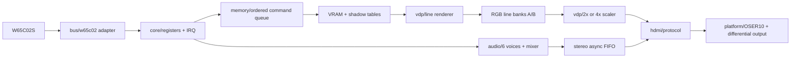

# Architecture Specification / ABI 0.2

## 推奨v0.1

【設計】320×240、640×480/60Hz出力、背景1面、64×32の8×8タイルマップ、4bppの1024パターン共用、16色×16パレット、RGB444。64スプライト登録・最大16個/ライン。6音源ch、48kHz/16bitステレオ。3.3V W65C02S/3.375MHz、32byte I/O窓、RDYなし。PSRAM/PCM/DMA/COPY/ビットマップ/ラスタ書換えはv0.1の対象外。

上記は製品v0.1の設計ベースライン。現行ABIは0.2で、[16:9モード](wide-mode.md)では320×180を1280×720へ4倍表示する。実装・測定状況は[README](../README.md)から各検証記録を参照する。数値変更時はABIとCAPSを更新する。16個/ラインは[スケジュール](memory-access-schedule.md)の条件を満たす場合のみ採用し、不足時の8個版は別capabilityとして通知する。

## モジュール境界

| ブロック | クロック | 契約 |
|---|---|---|
| CPU adapter | system 54MHz | 外部バスを1アクセス1要求に変換、上位層へCPU固有信号を渡さない |
| register/IRQ/command | system | レジスタ副作用・受付順序を管理 |
| VRAM/renderer | system | 1回の描画要求で1論理ラインを完成、所有権を返す |
| line banks | A:system RW、B:pixel R | 2個のTDP RAM。所有権により同一bankの同時読書きを禁止 |
| scaler/HDMI protocol | pixel 25.2MHz / 74.25MHz | 2×2 / 4×4ピクセル複製。RGB444各成分を17倍してRGB888化 |
| audio | system、48kHz enable | サンプル単位の更新。低速fabric clockを増やさない |
| audio FIFO | system→pixel | 32bit L/Rペアを不可分に送る |
| serializer | pixel + 126MHz / 371.25MHz | プラットフォーム専用、LSB firstを検証。VIC4のreset例外は[timing](timing.md)を参照 |

## CPU非依存内部インターフェース

`req_valid, req_ready, req_write, req_addr[4:0], req_wdata[7:0]`、`rsp_valid, rsp_ready, rsp_rdata[7:0], rsp_error`。
system立上りのvalid&&readyでちょうど1回受付。validはreadyまでpayload固定。最大1未応答、応答は受付順、読書きとも応答あり。応答はreadyまで保持。CPU adapterは読出し結果をバス時間内に取得するため、レジスタ処理を最大2 system cyclesに制限する。VRAMアクセス自体はキュー経由の非同期操作とする。

レジスタ要求のreadyはcommand組立中などに一時的に下がる。W65C02Sの1アクセス16 system cyclesの間隔ではRDYなしで処理できる設計とし、SPI/QSPI adapterは要求が受理されるまで保持する。キュー満杯等による投入拒否は`rsp_error`とsticky errorを返し、ホストはSTATUS/ERROR_CODEで検出する。将来のZ80/6809/RISC-V adapterもこの契約へ変換する。

## 画素・スプライト規約

- パターンは行優先、1byteに左画素をbits7:4、右画素をbits3:0で格納。
- 背景マップはlittle endian 16bit。bits9:0 tile、13:10 palette、14 H flip、15 V flip。
- 背景画素0はBACKDROP色に置換し、背景不透明フラグを0にする。その他は`palette*16+pixel`。
- スプライト画素0は透明。透明画素は優先順位の権利を取得しない。
- スプライト同士は小さい登録番号を優先。先に最上位の不透明スプライトを決め、そのbehind属性と背景不透明を比較する。背景に隠れた上位スプライトの下から下位スプライトを透過表示しない。
- behind=0なら背景の前、behind=1なら背景が画素0の時だけ表示。
- 座標は符号付き10bit、-512..511。幅・高さ計算は11bit以上、画面範囲[0,319]×[0,LINES−1]（LINES=240または180）でクリップ。符号なしwrapは禁止。
- 16×16は連続する4タイルを2×2配置。基底番号の下位2bitを無視し、base=tile&0x3FC。参照はbase+2*(localY/8)+localX/8。反転は16×16全体へ先に適用。
- line selectionはenableかつYが重なることだけでカウント。Xが完全に画面外でも16個枠を消費する。17個目以降を描画せず、最初の超過をsticky記録。

## 属性の更新とフレーム

CPUはOAM/パレットのshadow領域を更新する。COMMITは順序付きコマンドで、先行書込み完了後、次のVBlank開始でshadow→activeをコピーする。コピー中は関連CPUメモリアクセスを止める。後続VRAMコマンドはCOMMIT完了まで進めない。小規模display/scroll/backdrop/raster設定はCOMMIT受付時にスナップショットする。

COMMIT待ちは最大1件。active OAM/パレットはフレーム中不変。パターンと背景マップは単一バンクなので書換えのティアリングは防げない。必要な更新はVBlank中に行うか未使用タイルへ書いてマップを切り替える。全VRAMを二重化したとの保証はしない。

VBlankは物理y=480（16:9版は720）のx=0でイベント発生。active更新とline0の先読みをVBlank内に完了する。ラスタIRQは比較値0..LINES−1（240または180）に対し最初の複製行y=SCALE*RASTER（SCALE=2または4）、x=0で1回。LINES..255は無効。IRQ自体は既に描画された当該ラインを変更できない。将来のラスタ更新は「どの将来ラインの描画要求へ適用するか」を別ABIで定義する。

期限超過時は未完成bankを表示しない。その論理ラインのSCALE個のコピー（2または4）を黒にし、LINE_UNDERRUNをセットする。line tagが一致しない古い完了通知は廃棄し、次の要求で再同期する。
