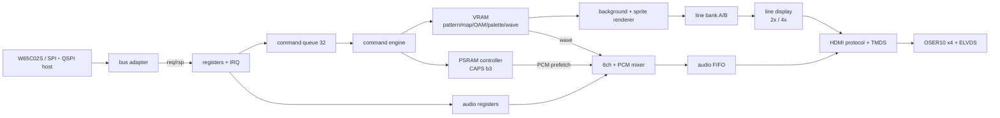

# アーキテクチャ

KAGURA-9はTang Nano 9K（GW1NR-9C）1枚で動く、外部ホスト制御型のビデオ・サウンドチップである。ホストは32 byteのレジスタ窓だけを操作し、FPGAが背景・spriteの描画、6ch音源とPCM 2chの合成、HDMI（映像＋48kHz音声）出力を行う。

## 仕様の概要

| 分野 | 仕様 |
|---|---|
| 画面 | 320×240を640×480p60へ2倍、または320×180を1280×720p60へ4倍（bitstreamで選択） |
| 背景 | 1面、64×32 mapの8×8 tile、1200 pattern（4bpp）、scroll X/Y、ライン別scroll表8 entry |
| sprite | 256個登録、16個/line、8×8または16×16、反転、behind、小番号優先 |
| 色 | RGB444、16色×16 palette（256色） |
| 音源 | pulse 3、noise 1、wavetable 2（各最大256 sample）。PSRAM版はsigned 8bit PCM 2chを追加 |
| 音声出力 | 48kHz・16bitステレオ、HDMI audio sample packet |
| メモリ | VRAM 約49KiB（BSRAM）。PSRAM版は内蔵PSRAM 4MiBを公開し、PCMとCOPYの元に使う |
| ホスト | W65C02S（3.3V、3.375MHz、RDYなし）、またはSPI/QSPI（実測5MHz） |
| ABI | 0.5（[レジスタ仕様](register-map.md)） |

## ブロック構成



| ブロック | clock | 役割 | 主なRTL |
|---|---|---|---|
| bus adapter | system | 外部バスを1アクセス1要求の`req/rsp`へ変換 | `rtl/bus/` |
| registers | system | 32 byte窓、EXT、IRQ、error、commandの検査と投入 | `rtl/core/kagura_registers.sv` |
| command queue / engine | system | 64bit descriptor 32件を順に実行（WRITE/READ/FILL/FENCE/COMMIT/AUDIO_COMMIT/COPY） | `kagura_command_queue.sv`、`kagura_vram_engine.sv` |
| VRAM | system | BSRAM群。描画器とcommandを時分割 | `rtl/vdp/kagura_vram.sv` |
| renderer | system | 1論理ラインの背景→sprite合成 | `kagura_bg_renderer.sv`、`kagura_sprite_*.sv`、`kagura_raster_scroll.sv` |
| line display | system→pixel | line bankの受渡し、拡大、VBlank・ラスタ通知 | `kagura_line_display.sv` |
| audio | system（48kHz enable） | shadow/snapshot、6ch＋PCMの合成 | `rtl/audio/` |
| PSRAM | system | HyperBus型controller、PHY、host/PCMの仲裁 | `rtl/memory/kagura_hyperram_*.sv`、`kagura_psram_*.sv` |
| HDMI | pixel、serial | 音声packet、ACR、InfoFrame、TMDS、serializer | `rtl/hdmi/`、`rtl/platform/` |
| boot | system | ROM-less boot（`phase2boot`のみ） | `rtl/boot/` |

## clockとreset

| domain | 周波数 | 生成 |
|---|---|---|
| reference | 27MHz | 基板の発振器（pin 52） |
| system | 54MHz | PLL（27×2）。PSRAM版はCLKOUTP（67.5°）をPSRAMのCKに使う |
| TMDS serial | 126MHz / 371.25MHz | video PLL（27×14/3、または27×55/4） |
| pixel | 25.2MHz / 74.25MHz | serialのCLKDIV /5 |
| CPU PHI2 | 3.375MHz | systemの16分周。registerから出力し、内部をPHI2でclockしない |
| 音声sample | 48kHz | systemの1125分周のclock enable |

systemとpixelは同じ発振器由来でも位相関係を仮定せず、CDCとして扱う（line要求・完了はtoggle＋保持payload、音声はGray pointerの非同期FIFO）。外部reset（S2、pin 4）またはPLLのlock喪失でchip GSRを直ちにassertし、両PLLのlock後に解除する。その後、pixel/systemの各domainが4段の同期器でresetを解除する。詳細は[クロック・リセット・CPUバス](timing.md)。

## CPU非依存インターフェース

bus adapterとレジスタブロックの間は、CPUに依存しない次の信号で接続する。

```text
req_valid, req_ready, req_write, req_addr[4:0], req_wdata[7:0]
rsp_valid, rsp_ready, rsp_rdata[7:0], rsp_error
```

- system clockの立上りで`valid && ready`のとき1要求を受け付ける。validは受理されるまでpayloadを保持する。
- 未応答は最大1件。応答は受付順で、readにもwriteにも返し、`rsp_ready`まで保持する。応答は受付から2 cycle後。
- 直前のwriteの内部検査（address範囲、FILL範囲、ラスタ表、音源register）が反映されるまで、`req_ready`は数cycle下がる。W65C02Sの1アクセス16 cycleやSPI/QSPIのbyte間隔はこれより長い。
- 拒否（queue満杯など）は`rsp_error`とsticky ERROR_CODEで返す。hostはSTATUS・ERROR_CODEで検出する。

別のCPU（Z80、6809、8080型バス等）もこの契約へ変換するadapterを追加すれば接続できる。

## ビルド構成とCAPS

`tools/build-nano9k.tcl <構成>`で選ぶ。`720`を付けると16:9版（dvi・bootprobe・magicprobeを除く）。

| 構成 | 内容 | host | CAPS（480p / 720p） | 出力basename |
|---|---|---|---|---|
| `hdmi` | カラーバー＋左1kHz／右500Hz固定音 | なし | 窓なし | `kagura_phase1` / `kagura_hdmi720` |
| `dvi` | 音声なしの比較用 | なし | 窓なし | `kagura_phase1_dvi` |
| `demo`（deprecated） | 旧・内蔵sequencerのシューティングデモ＋6ch演奏 | なし（内蔵） | 0x53 / 0x73 | `kagura_demo` |
| `phase2` | VDP＋音源、W65C02S接続 | W65C02S | 0x53 / 0x73 | `kagura_phase2` |
| `phase2boot` | `phase2`＋SPI FlashからのROM-less boot | W65C02S | 0x53 / 0x73 | `kagura_phase2boot` |
| `spi` / `qspi` | VDP＋音源、SPI/QSPI接続 | SPI/QSPI | 0x53 / 0x73 | `kagura_spi` / `kagura_qspi` |
| `spipsram` / `qspipsram` | 上記＋PSRAM・PCM 2ch・COPY | SPI/QSPI | 0x5B / 0x7B | `kagura_spi_psram` / `kagura_qspi_psram` |
| `bootprobe` | Flash読出し・boot image検査だけ（LED表示） | なし | 窓なし | `kagura_boot_probe` |
| `magicprobe` | FlashのJEDEC IDと0x100000の`K9BT`の読出し確認（LED表示） | なし | 窓なし | `kagura_flash_magic_probe` |

`demo`／`demo720`はdeprecated。ソースは保持するが既定のP&R対象から外し、1,200パターン版の資源・動作の受入条件には含めない。ホストからのデモ・診断はPico版を使う。`hdmi`／`dvi`等の信号確認構成は継続する。

CAPSのbit: b0 HDMI_AUDIO、b1 WAVE、b3 PSRAM、b4 SPR16、b5 WIDE、b6 RSCROLL（b2 RDYは常に0）。W65C02S版にPSRAM構成はない。

## LED

LEDはactive low（`led_n[0]`がpin 10の基板LED1、`led_n[5]`がpin 16のLED6）。

| LED | `hdmi` | `demo` | `phase2`・ホスト版 | `phase2boot` |
|---|---|---|---|---|
| 1 | reset解除 | reset解除 | reset解除 | boot ready |
| 2 | mute | 表示frameで点滅 | adapter `late`（期限違反） | adapter `late` |
| 3 | audio underflow | pattern/palette読戻し不一致 | audio underflow | boot error code b0 |
| 4 | audio overflow | map不一致またはsprite 16個/line超過 | audio overflow | boot error |
| 5 | system PLL lock | system PLL lock | system PLL lock | system PLL lock |
| 6 | video PLL lock | video PLL lock | video PLL lock | video PLL lock |

underflow・overflow・`late`はresetまで点灯を保持する。demoのLED4はsceneの編隊がline上限を超える区間で点灯するのが正常。`bootprobe`の表示は[ROM-less boot](romless-boot.md#bootprobe)。

## ディレクトリ

| path | 内容 |
|---|---|
| `rtl/` | 合成対象のRTL（[RTL一覧](../rtl/README.md)） |
| `boards/tang-nano-9k/` | board top、CST、SDC、ピン一覧（[ボード資料](../boards/tang-nano-9k/README.md)） |
| `sim/` | SystemVerilog testbenchと参照モデル（[sim](../sim/README.md)） |
| `spec/` | レジスタ定義`registers.json`、設計予算`design-budget.json` |
| `software/` | 生成ヘッダ、Pico host firmware、W65C02S用include |
| `tools/` | ビルド・生成・検査・書込みのscript |
| `third_party/` | 固定revisionのhdl-util/hdmi（[第三者IP](../THIRD_PARTY.md)） |
