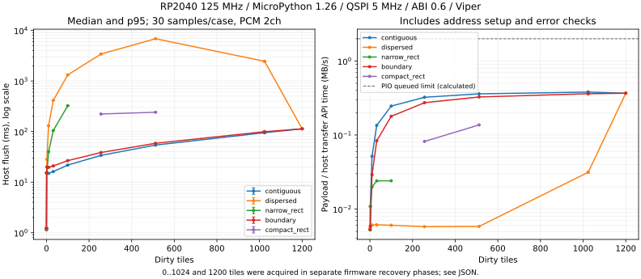

# TileFramebuffer通信・end-to-end性能調査

取得日: 2026-10-30。実機結果は[JSON](framebuffer-transport-results.json)、
再計測器は[framebuffer_transport_benchmark.py](../software/micropython/examples/framebuffer_transport_benchmark.py)。
本調査は計測・設計のみで、SDK本体、RTL、ABI、wire protocolを変更しない。

**取得可能範囲の計測・分析は完了。** dirty 0〜1200の52条件×30反復、4 scene、
詳細profile、既存DMA chunk 128/256/512、blit/ellipse/paintを含むCPU計測、
全VRAM読戻し、実機Python/Viper差分検証を実施した。
独立38400byte sourceの全画面blitも追加取得。純BUSY待ち、FPGA内部処理、物理表示頻度は未測定として残す。
ABI0.6を許可に基づきFlashへ保存・再ロードし、0.6 console復帰とERROR_CODE=0を確認。
ただしFlash programmerはexit0でも`Verify Failed`を出しており、Flashの書込照合成功とは扱わない。
USB復旧のため、追加許可に基づき元のバナーに一致するv1.26.0 UF2をfirmware領域へ書き戻した。
先行0〜1024計測時のfirmware binary hashは未記録なので、書戻し後と完全同一binaryだったとは断定しない。
今後の取得値はログ単位で取得phaseを区別する。

## 基準と再現条件

- 開始時の作業ツリーはclean、branchはmain、HEADは`a105f59`。
  PR #38後にPR #39（blit/ellipse/paint）がマージされた状態を使用。
  `feat/framebuffer-primitives`はローカル・originの既存ref一覧になかった。
  checkout/reset/stashで既存状態を変更していない。
- Raspberry Pi Pico RP2040、125MHz、custom MicroPython v1.26.0 `KAGURA_PICO`。
- Tang Nano 9K、ABI 0.6、480p HDMI、論理画面320×240、4bpp、1200タイル。
- QSPI baudrate引数5,000,000、Viper framebuffer、Viper FIFO、Viper DMA pack32、
  基準DMA chunk128 byte。DMA実験は既存の128/256/512オプションだけを使用。
- 過去の実機受入と一致するbitstream SHA-256:
  `2d00ee52dcff0edb7ad22c3d7910358ca1fe4221619bc0b2332b774ee8f133d9`。
  実ファイルは別作業ツリー`Kagura-tile1200/build/baseline/qspipsram/impl/pnr/kagura_qspi_psram.fs`。
  このmain作業ツリーの同名buildファイルは異なるhashなので使わない。
- `/lib/kagurafbx`と`/fbx`の既存16ファイルを現在のsourceおよび過去deploymentの
  SHA-256と照合。計測器自身はraw REPLからRAMで実行。
  `/lib/kagura`は上書きしない。firmwareの保持条件は後述の追加許可で変更。
  root fallback native helperのhashも取得した: `/kagura_dma_pack_viper.mpy` 628byte、
  `/kagura_fifo_xfer_viper.mpy` 1453byte。exact SHA-256はJSONの`native_helpers`と保全ログに収録。
- 全計測条件でPSRAM上の4096byte周期波形をPCM 2chでループ再生。
  これはPSRAM読み出しとの競合試験であり、ホストからPCMを逐次ストリーミングする負荷ではない。

Flash保持は開始時の条件だったが、作業途中でユーザーからABI 0.6のFlash保存が
明示的に許可された。最終構成・コンソール復帰結果は実機ログ節に記録する。

## 計測の読み方

各micro条件はwarmup3回を除き30回。対象タイル数は
0/1/2/10/32/100/256/512/1023/1024/1200。
全raw sample、平均、中央値、nearest-rank p95、最大値をJSONへ保存する。
小さいnのp95を精密なtail推定とは扱わない。

- contiguous: タイル0からの連続範囲。
- dispersed: `(n*599)%1200`をソート。599と1200は互いに素で、重複なく指定数を選ぶ。
  高密度では隣接するため、dirty数とrun数は同じでない。実際のrun数を併記する。
- narrow_rect: 幅4タイル。30行を超える条件は明示的skip。
- wide_rect: 幅40タイル。端数は最終行の一部だけを使用。
  したがって指定数が幅で割り切れない条件は厳密な矩形ではない。
- boundary: 1023/1024境界付近。2タイル条件は1023と1024を跨ぐ。
  連続runでも2 public VRAM regionへ分割され、pattern writeが2になる。

microは各反復の前にGCを独立計時し、pixel更新のCPU時間とflushを分離する。
小さいpixel呼出しのループを含むため、このdraw時間を塗り潰しプリミティブの性能へ
一般化しない。各条件の最終反復のregister transaction数・payload数を記録する。
既存`Counter`のPython呼出しと加算のコストはbaselineにも含む。

通常計測中に関数ごとの計時やログ出力は追加しない。sample用arrayは条件ごとに確保し、
ログのJSON化とUSB送信はtimed regionの外。`flush()`の既存内部計時は維持する。
外側flush計時は`_stats()`生成などを含み、既存`total_us`より長い。
`total_us-transfer_us-wait_us`はdirty走査・確定・ループ等の**残差**であり、
純粋なdirty走査時間とは呼ばない。

詳細Profileは別パス。Python wrapper、時刻取得、カウンタ、dirty proxy、
既存`dma_profile.py`と同方式のDMA handshake計時を使う。
これらは侵襲的な観測値であり通常baselineへ混ぜない。
親区間（FENCE/DMA/transaction）と子区間（begin/end/pack等）は包含関係にあるので加算しない。
DMA profileはpack、RX/TX config、RX active待ちを分けるが、計時によってDMAとCPUの
重なり方も変わる。厳密な補正済みのexclusive時間ではない。

## 実装を追跡した通信経路

### Framebuffer → Video → Device

`framebuffer.py::_flush`はbytearray.findで1の開始と0の終端を探し、連続runを構築する。
各runごとに`Video.tiles`、FENCE、追加check_errorsを実施した後にdirtyをゼロ化する。
確認前にdirtyを確定しない。timeout時は未確認run全体がdirtyのまま残る。

`video.py::tiles`は1024番境界で転送を分割する。
0..1023は`tile*32`、1024..1199は`0xB000+(tile-1024)*32`。
`device.py::write_memory`の各region書込みは:

1. INC_Lへ2byteのincrement設定（auto increment register transaction）。
2. VRAM_ADDR_Lへ24bitアドレス設定（3byte）。
3. VRAM_WRITEへpayloadを同一register連続送信。
4. ERROR_CODE読出し。

VRAM_WRITEはCOMMANDをbyteごとに発行する方式ではない。
レジスタ側が各accepted byteを順序付きWRITE descriptorへ変換する。
FENCEは別途FENCE_TAG設定とCOMMAND=`CMD_FENCE`で発行する。

`device.py::fence`は現DONE_TAGを読み、異なるtagを選び、TAG/COMMANDを書き、
ERROR_CODEを読み、DONE_TAGをpollし、再度ERROR_CODEを読む。
さらにflushがcheck_errorsを行う。
DONE_TAGが最初のpollで一致する場合、1 region/1 runは計5 write transactionと6 read transaction、
境界を跨ぐ1 runは8 writeと7 readになる。pollが増えた場合はこの数を超える。

よって既存`wait_us`は「FENCEを発行し、ホストから完了を観測し、errorを確認する時間」。
FPGA内部の実行時間や純粋なqueue drain時間ではない。
FENCEはHDMIのVBlankやscanout完了を保証しない。

### Transport / PIO / DMA

`transport_rp2.py`はStateMachine周波数を`baudrate*12`で設定。
QSPIは1 byteを2 nibbleで送り、各nibbleはout5cycle + in1cycle + high6cycle。
PIOのpull/out flag/jump/BUSY wait等はそれとは別に実行される。

| 条件 | PIO instruction cycles / byte | 60MHz要求時の連続上限（計算） |
|---|---:|---:|
| queued byte、BUSY low、FIFO供給切れなし | 30 | 2,000,000 B/s |
| unqueued byte、FIFO供給切れなし | 29 | 約2,068,966 B/s |
| 単純な5MHz×4bitの換算 | 対象外 | 2,500,000 B/s |

queued byteの内訳はpull1 + out x1 + jmp1 + wait1 + out y1 +
out5 + in1 + nop6 + out5 + in1 + nop6 + jmp1 = 30。
byte間のSCK lowが延びるため、同一byte内のSCKが5MHzでも連続平均は同じにならない。
これはFIFO/DMA供給が十分な場合の**計算上限**であって、実測帯域ではない。
SM_CLKDIVの実レジスタも取得し、RP2040の分数分周による要求値との差を保持する。

PIOは送信1byteにつき32bit TX wordを1つ受け、write-onlyでもRX wordを1つ生成する。
RX autopushは最後のSCK立上りより前なので、RX完了だけではCSを上げられず、
`_end`はtail待機を残す。
header、payload、read turnaround/dummyも別に処理される。

長い固定register書込み（16byte以上）はDMAへ入り、標準chunkは128byte。
byte列をPIO用word列へViper展開し、RX discard DMAを先に、TX DMAを後に起動。
RX DMA完了を待って次chunkをpackするため、chunk間はCPU pack/config等で供給が途切れる。
TX/RXは別channel、DREQは該当SMのTXとRX。ワークスペースはsynchronous completionまで保持。
短いregister transactionは既存AccelerationのViper FIFO pumpが使われ、
32 spinごとに`sleep_ms(0)`でCtrl-C等のpending処理を許す。

`_begin/_end`のCS/pindirs操作・1µs sleep、Python関数呼出し、buffer/view生成、
レジスタ設定・status読出しは大転送のwire時間と別の固定費。
DMA active待ちはwire転送、BUSY、FIFOの進行、ホストpoll粒度が重なる区間であり、
BUSYだけの待機時間とはみなせない。

### FPGA queue / BUSY / FENCE

`kagura_command_queue.sv`は32個の64bit descriptorを保持し、4cycle stagingを持つ。
`kagura_spi_adapter.sv`はqueue_freeがBUSY_MARGIN=3未満でBUSYをassertする。
BUSYは「FPGAが全体として処理中」の意味ではなく受入余裕のbackpressure。
queued flag付きのVRAM_WRITE/READ_REQUEST/COMMAND byteだけがPIOでBUSY lowを待つ。
headerや通常registerアクセスはそのwaitをskipする。

engineは順序通りdescriptorを実行し、FENCE headでpsram_idleを確認した後にfence_done/tagを返す。
register blockがDONE_TAGへ反映する。PCMの全再生完了や画面表示完了を待つ命令ではない。
core/queue/PSRAMの内部cycleを今回のホスト計時から逆算して「実測」とはしない。

## End-to-endの定義

- A GUI: 64×48 windowの移動、消去、枠、16×16 keyed blit、テキスト更新、カーソル点滅。
- B Game: 6個の16×16 keyed object、前位置の単色背景復元、部分更新、PCM 2ch。
- C Paint: 256×176領域消去、LINE/RECT/ELLIPSE/PAINT、操作ごとflush。
- D Full: fill、画面内スクロール＋端部のblit、全面fill_rectを順番に実行。
  追加960byteで最左列を退避し、312×240 self-blitと8×240のwrap blitで全画面を実コピーする。
  stripe生成・列退避もdraw計時に含む。これは単一call・独立sourceの320×240 blitとは区別する。
  独立38400byte sourceはconsole起動後にはFramebufferの前/後どちらに確保してもMemoryErrorとなった。追加試験では一回だけconsole起動を抑止したclean VMで確保できた。元のboot bytesは試験後にSHA-256一致を確認して復元済み。
  SDKやallocatorを変更せず、当該条件は未測定として記録する。

画面はシーン開始時だけ全消去・flush。warmup3回を除外。
描画、flush、明示GC、loopを別記し、dirty数・bytes・register transactionsを毎反復保存。
最終scene baselineのloopにはPCM/error telemetryも含め、GCとメモリsampleは32操作ごと。
Scene revision 1は毎操作4回のheap API走査を含む観測負荷付き値として別記する。
revision 2はsampleあたり3回に減らし、計時も分ける。旧値を差引き補正して実測値へ置き換えない。
初回workloadには毎操作GC・telemetry除外の探索scene定義があったが、
microの1200タイル準備でMemoryErrorとなりsceneには到達していない。
保全した初回workloadと、修正後のworkloadは別hashで保存する。
自動GCがdraw/flush内で発生した場合、その停止時間だけを分離する仕組みはない。
明示GC値と自動GC未分離を区別する。dirty proxyのconfirm計時はslice代入のみで、
呼出し前の`bytes(count)`確保は含まず、通常flushの残差に残る。

application updates/sは実際に計時したloopの合計から算出し、USBログ・readbackは含めない。
HDMIの約60Hzとも、物理的に表示へ反映された更新回数とも異なる。
後者はカメラ/photodiode等で測定していないためnull。
PCM telemetryはsticky fault bitsとACTIVEを検査するが、音声の主観評価・アナログ波形計測ではない。

## ロジックアナライザとの照合設計（未実施）

IO0..3/SCK/CS/BUSYを同時取得（最低7ch、50〜100MS/s以上を目安）。
別の空きGPIOを使える場合はflush、run、DMA chunk境界をmarkerにするが、
markerあり/なしのflush時間を比較して観測負荷を記録する。
追加GPIOの利用前に配線・他機能との重複を確認する。

1. CS lowからheader/queued payloadをdecodeし、実際のpayload byte数とtransaction数を照合。
2. SCKのintra-byte周期、byte間low、128byteごとのgap、CS high区間を別histogramへ。
3. BUSY highとqueued byte開始前の停止の重なりを積算。
   BUSYがhighでも非queued transferは待たないので、BUSY high総量をそのまま差し引かない。
4. DMA gapとPIO pull stallが疑われる箇所をタイムラインで分類。
   信号だけでCPU pack/configを一意に区別できなければhost markerで照合する。
5. FENCE COMMAND終了からDONE_TAG応答までのhost observable上限を確認。
   poll間隔の間に完了するので内部実行時間は区間推定まで。RTL signalを追加しない限り直接値ではない。
6. 1/2/100/1024/1200連続、100離散、PCM有無で同一刺激を取得。

## 改善案と安全条件

採用判断には今回の実測を使い、理論上限を達成予測に置き換えない。

| 優先候補 | 変更対象・原因 | 期待効果の見積り方 | 難易度・互換性 | リスクと検証 |
|---|---|---|---|---|
| run間FENCEの限定的バッチ化 | Python framebuffer。各runの固定同期費 | 現状R runからG groupなら概ね(R−G)×実測FENCE host費が削減可能な上限。追加queue待ちを引く。全面1 runにはほぼ効果なし | 中。API/ABIを維持可能、dirty確定の内部単位が変わる | group全体をFENCE/error確認までdirty保持。timeoutで部分成功扱い・自動再送をしない。故障注入、境界readback、PCM最大負荷、Ctrl-C |
| 短いregister transactionの固定費削減 | Python transport/Device。INC/ADDR/TAG/STATUSを繰り返す | begin/end/native packet/error-read profileで対象の上限を算出。未計測の倍率は付けない | 低〜中。buffer再利用はABI不変 | readonly buffer、ownership、失敗後abortを維持。error確認回数は省略しない |
| 128→256/512 chunk選択 | 既存DMA設定。pack/config/待ちをchunkごと反復 | 同一payloadの実機A/B差を採用。大転送と小転送を別評価 | 低。既存オプション、ABI不変 | 追加workspace512/1536byte、長い連続占有、timeout。readback/PCM/中断を各chunkで検証 |
| dirty間の小gapを含めて転送 | Python framebuffer/app。離散runの固定費 | gap tile×32×実測byte slope < 省けるrun固定費を閾値とする。モデル外挿せず実測で確認 | 中。ABI不変、dirtyでないVRAM byteも送る | planeの唯一所有者が前提。PCM公平性と最大group長を制限し、readback |
| dirty走査・確定の割当削減 | Python。find、slice、bytes(count)、stats生成 | profileのscan/confirmと外側flush残差が上限。native packに比べ小さければ後順位 | 低〜中。API維持 | clean flush無I/O、失敗runのdirty保持、既存参照テスト |
| DMA二重buffer/連続供給 | DMA/PIO host。chunk間gap | pack/config/gapの重なる部分が削減上限。wire/BUSY支配なら効果が小さい | 高。ABI不変に設計可能 | buffer寿命、RX discard、abort両channel、progress timeout、公平性。LAと切断/再接続試験 |
| GUI/text cache・flush batching | アプリ。描画/小変更の多重flush | scene別draw/flushの比率、同一最終画像のtile/run減少から評価 | 低〜中。SDK API/ABI不変 | 入力latencyを測定。cacheと消去領域の整合、機能テスト |
| SCK/PIO命令列・protocol/RTL拡張 | 独立提案。計算上のbyte間cycle、descriptor固定費 | LAで供給gap/BUSYと命令列の寄与を分けてから判断 | 高。protocol/RTL案はABI検討が必要 | setup/hold/turnaround、queue overflow、PSRAM/PCM。今回は変更しない |

FENCEの意味、全error check、DMA/PIOの単一所有権、timeoutの保守的completed、
PCMへの公平性を維持することを全案の前提とする。
単にDONE_TAG poll・ERROR_CODE読出しを削って速く見せる案は採用しない。

## 再実行

1. `git status --short`とsource/bitstream hash、firmware/CPU clock/ABIを保存。
2. 元consoleをcloseし、単独ownerにする。必要なら検証済みABI 0.6をSRAMへ一時構成。
3. `python3 tools/prepare-framebuffer-transport.py --repetitions 30`
   で既存隔離SDKのsource一致を検査してRAM用コードを生成。
4. 標準mpremoteのraw-pasteでRAM実行し、TILEFB出力を保存する。
   今回はWindows管理者PowerShellのmpremote1.29.0/pyserial3.5で復旧・実行した。
   `framebuffer-transport-upload.ps1`のblock ACK方式も準備したが、最初のcleanup送信で
   .NET SerialPortが停止したため、成功した計測の実行経路には採用していない。
5. 完了後、`python3 tools/analyze-framebuffer-transport.py --log build/transport-analysis/hardware.log`。
   中断ログでもpartialとして保存し、complete markerなしを成功扱いしない。
6. scene補足パスを実施した場合、同じTILEFB形式で結合し、取得順を維持する。
7. `Session.close()`で音源停止・acceleration復元・PIO解放。
   0.6対応へ移行済みのbootをsoft resetで再実行し、そのconsole所有deviceでABI/error/activeを確認。
   再計測だけのためにFlashやbootを書き直す必要はない。

ホストテスト時間やRTLシミュレーションのwall timeはPicoの性能値に使わない。

## 初回microの確定値

以下はCPU描画・事前明示GCを除く外側flush平均、各30反復。0〜1024条件は
[保全rawログ](framebuffer-transport-logs/micro-0-1024.log)から取得。
中央値・p95・最大値・全sampleおよび矩形/境界条件はJSONを参照。

| dirty tiles | 連続 ms | 離散 ms | 離散run数 |
|---:|---:|---:|---:|
| 0 | 1.135 | 1.186 | 0 |
| 1 | 15.427 | 15.217 | 1 |
| 2 | 15.121 | 28.079 | 2 |
| 10 | 14.902 | 130.116 | 10 |
| 32 | 16.203 | 413.865 | 32 |
| 100 | 21.737 | 1319.816 | 100 |
| 256 | 33.886 | 3409.827 | 256 |
| 512 | 54.088 | 6844.064 | 512 |
| 1023 | 95.004 | 2450.023 | 178 |
| 1024 | 95.047 | 2437.025 | 177 |
| 1200 | 113.398 | 113.282 | 1 |

グラフは中央値とp95、帯域はpayload/transfer API平均時間。
物理SCKの帯域測定ではない。生成器は[plot-framebuffer-transport.py](../tools/plot-framebuffer-transport.py)。
今回の描画環境はhost Python3.12、matplotlib3.11.2。hostでの実行時間は性能データに含めない。

1200タイルと以下のsceneはFW書戻し後の別phaseで取得。
firmwareは同じv1.26.0バナーだが先行phaseのbinary hashは未採録。
全phaseでABI0.6、125MHz、QSPI5MHz、SDK16ファイルのhash一致を確認した。

離散1023/1024が512より速いのは、同じpermutationでも高密度ではrunが結合するため。
タイル数だけの一次式では離散更新を説明できない。
連続1〜1024の平均9条件を`T=a+b*payload_bytes`でOLSすると、
`a=14.280ms`、`b=2.459µs/byte`。最大絶対残差は約1.07ms。
小転送の1/2/10タイルは順に単調増加しておらず、固定費を不変の定数と断定しない。
この回帰はclean flush・1024境界分割・離散runへ外挿しない。

SM_CLKDIV=136448、divider=2.08203125から、報告CPU125MHzに基づくPIOクロックは
60.037523MHz、intra-byte SCKは5.003127MHz、queued上限は2.001251MB/sと計算される。
LAによる周波数実測ではない。連続1024のpayload/transfer APIは約0.381MB/s、
payload/外側flushは約0.345MB/s。wire上限との差はホスト処理・供給gap・BUSY等を含み、
後続の詳細profileで分解する。

512離散の平均はtransfer API 2815.835ms、FENCE host区間3870.917ms、
内部残差約156.7ms。host同期区間だけで外側flushの約56.6%を占める。
その3870.917msをFPGA内部待機の実測値へ読み替えない。

## Scene revision 1（観測負荷付き、保全値）

各30反復、warmup3、PCM2ch、GC32操作ごと。
メモリAPIを毎操作4回呼んでおり、その走査費用を含むため、最小観測負荷のアプリ性能とは扱わない。

| Scene | CPU draw平均 ms | flush平均 ms | wall application updates/s |
|---|---:|---:|---:|
| A GUI | 11.218 | 137.503 | 5.387 |
| B Game | 18.850 | 199.458 | 3.907 |
| C Paint | 11.421 | 1008.899 | 0.946 |

3 sceneともFPGA ERROR_CODE=0、audio FIFO fault=0、PCM2ch ACTIVE・faultなし。
各scene後のmap4096byte・upper256byte・代表pattern512byteのreadback照合は成功。
このphaseの代表照合を全pattern照合の代用にはしない。
後続phaseで全pattern38400byte、map4096byte、upper256byteの照合も成功した。

## 最終scene baseline（revision 2）

採取条件は30反復＋warmup3、Viper、DMA128、PCM2ch、GC/heap sampleは32操作ごと。
wall updates/sには描画、flush、telemetry、GC、memory sample、sample格納の負荷を含む。
ログ送信とreadbackは計時外。sampled heap値は全期間の真の最大使用量ではない。

| Scene | draw平均 ms | flush平均 ms | dirty tiles範囲 | register transactions平均 | application updates/s |
|---|---:|---:|---:|---:|---:|
| A GUI | 11.583 | 137.930 | 62〜68 | 110.0 | 6.215 |
| B Game | 18.659 | 202.091 | 40〜47 | 166.8 | 4.306 |
| C Paint | 11.733 | 1013.779 | 192 | 836.0 | 0.964 |
| D 比較用scroll blit | 26.265 | 499.385 | 1110〜1200 | 341.3 | 1.862 |
| D 独立source全画面blit | 9.816 | 115.264 | 1200 | 15.0 | 7.331 |

4 sceneと追加DともERROR_CODE=0、FIFO fault=0、PCM2ch ACTIVE・faultなし。
各sceneの平均・中央値・p95・最大と全sample、bytes、明示GC、memory sample時間はJSONに保存。
Scene Cのseed(160,120)は対角LINE上にあり、PAINTはその連結strokeの色替え。
大面積のPAINTは下記の独立CPU benchmarkで別に取得している。

**メモリ観測負荷の較正:** `mem_free, mem_alloc, mem_free, mem_free`の4回だけで
平均25.768ms。時計pairは平均12.53µsだった。revision 1はこのheap走査を毎操作含む。
revision 2ではheap読取りを32操作ごと3回にし、平均寄与約0.65ms/操作を別記した。
この変更は計測器の観測負荷削減であり、アプリ/SDKを高速化した結果とは呼ばない。
旧値から25.768msを引く補正は行わず、4 sceneを実際に取り直した。
自動GCはdraw/flush/loop内に含まれ、純停止時間の個別帰属は未測定。

追加Dはconsoleを起動しないclean VM、38400byte sourceをSDK初期化前に確保した別条件。
sourceはbank境界でも異なるpatternを事前生成し、fill→全画面blit→全面RECTを反復する。
毎回1200 tiles/1 runが変化する。以前のscroll版からの改善率とは扱わない。
flush中央値114.397ms、p95 117.177ms、最大136.454ms。自動GC等を含む外側値で、
突出sampleの原因をGCと断定しない。heap freeのsample最低25616byte、GC前最低14144byte。

### 全面描画でもrun分裂が支配する

Dはfill → stripe生成＋scroll/wrap blit → 全面fill_rectを反復する。
最後のfill_rectでは、既に同色の列がcleanに残るためdirtyは1110 tilesなのに90 runs、
994 register transactionsとなった。そのflushは平均1269.250ms。
一方、Dの1200 tiles/1 runのfill・scroll転送は平均114.453msだった。
**7.5%しか転送を省いていないケースの方が約11倍遅い。**
byte数を最小化するだけのdirty設計が通信時間を最小化しないことを実アプリ形状でも確認できた。

## 階層profileと観測負荷

以下は別パスの侵襲的な計測。各値は該当passの実測値で、通常baselineではない。
1200 tilesのprofile totalは159.297ms、通常外側flushは約113.4msで、
観測器が約41%の差を生んだ。全項目へ一律41%補正はしていない。
CPU wrapperとDMAとの重なり方も変わるため、次表を足して通常flushを再構成しない。

| 1200 tiles/1 run（2 region） | inclusive時間 ms | 回数/注記 |
|---|---:|---|
| VRAM address設定 | 3.546 | 2 |
| transaction begin | 2.819 | 15 |
| transaction end | 2.007 | 15 |
| native short packet | 4.195 | 13 |
| header FIFO pump | 0.752 | 2 |
| DMA親区間 | 131.405 | 2 region |
| DMA内pack計時 | 55.140 | 300 chunks |
| RX/TX config計時 | 25.009 | 300 pairs |
| RX active待ち計時 | 17.865 | wire/CPU観測/BUSY等が重なる |
| COMMAND発行 | 1.549 | 1。FENCE親区間内 |
| FENCE全体 | 9.784 | 1 |
| 完了poll | 1.584 | 1。FENCE内のDONE_TAG読出し |
| ERROR_CODE確認 | 7.935 | 5。FENCE内を含む |
| dirty find | 0.660 | proxy計時 |
| dirty slice確定 | 0.092 | bytes確保は含まない |

100離散のprofileはtotal2061.371ms（通常1319.816ms）、FENCE親984.520ms、
error-check親625.216ms、address213.802ms、dirty find15.920ms、slice確定8.440ms。
これらにも親子の重複があり、合計して割合を出さない。
dirty検出の高速化だけで支配的な同期・短transaction費用は解消しない。

### packingを外側timerで再計測

DMA/PIOをcloseした後、同じ38400byte/300×128byteの展開だけをCPUで30反復。
chunk内の個別時計・カウンタを置かず、batch外側を計時した。

| CPUのみ（wire/DMAなし） | 平均 ms/batch |
|---|---:|
| `dma_pack.pack32` wrapper経由 | 41.388 |
| 同じViper kernel直接呼出し | 30.212 |
| 300回の空loop | 1.519 |

各値はPythonのouter loopを含む。native kernelの純命令実行時間とは呼ばない。
個別timerを入れたpack55.140msとの差は、侵襲的な観測の影響を示す。
wrapperとnativeの差11.175msは、型確認等をchunkからtransaction単位へ移す候補の根拠。
そのままflushが11.175ms改善したという実測ではない。
非byte bufferの参照動作・fallbackを維持する設計と回帰が必要。

### 要求された12項目との対応

| 処理 | 取得方法と限界 |
|---|---|
| 1 描画 | 外側timer、sceneと独立primitiveで取得 |
| 2 dirty/run | 通常の残差と別passのfind proxy。run loop全体のpure時間ではない |
| 3 VRAM address | `_address` wrapper、上表 |
| 4 transaction準備 | begin/end/native packet。header/view等の確保は親区間にも残る |
| 5 PIO/DMA制御 | DMA config/parent、FIFO/native packet。exclusiveなC binding時間ではない |
| 6 QSPI data | API実効帯域を測定。wire時間そのものは未測定、19.188ms/38400byteはPIO式からの計算 |
| 7 BUSY待ち | DMA/FIFO区間に混在。pinの独立積算なし、null。FPGA不具合の根拠にしない |
| 8 command | COMMANDだけのwrapper、FENCE内 |
| 9 FENCE | 既存waitと別passのfence/poll。内部FPGA実行時間と区別 |
| 10 error/status | check_errorsと実transaction数。poll/telemetryもloopに含む |
| 11 dirty確定 | slice proxyと通常残差。成功FENCE/error確認後のみ |
| 12 GC | 明示GCを別timer。自動GCのpure pauseは未分離。heap API自身も較正 |

## DMA chunkの既存オプション比較（変更を残さないA/B）

各30反復＋warmup3、PCM2ch、同一source byte列、既存error/FENCE処理を維持。
ここだけは外側timerではなく既存`total_us`の比較なのでmicro表と厳密に混ぜない。

| tiles | chunk128 平均 ms | chunk256 平均 ms | chunk512 平均 ms |
|---:|---:|---:|---:|
| 1 | 13.914 | 13.879 | 13.892 |
| 100 | 21.590 | 19.459 | 18.398 |
| 1200 | 113.415 | 86.977 | 73.924 |

1200 tilesでは128→512で**flush時間34.82%短縮**。これは今回の既存設定間の実測差。
1 tileには効果がない。CPU描画、readback、console復帰、物理表示頻度を含む改善率ではない。
3 chunk設定ともVRAM代表照合・PCM fault確認を実施し、最後に全VRAM照合も成功。

2 region合計chunk数は300/150/75。
この3点をfitすると`T≈60.705ms + 0.175622ms×chunk数`、最大残差0.072ms。
0.175622msはpack呼出し・設定・loop・待ち方等を含む**集約chunk固定費**で、configだけではない。
60.705msも純粋な固定protocol費ではなく、byte比例処理、wire、FENCE、error等を含む。
未実装のchunk1024等へ外挿しない。

この結果とCPU pack batchから、5MHz×4bitとの大きな差の主因として
MicroPython側のbyte展開・chunkごとの制御と短transactionの固定費を特定できる。
PIOの30cycle/byteは理想24cycle/byteより約3.84ms/全面を増やす計算だが、
それだけでは約113msのflushを説明できない。BUSYの純寄与はLA待ちであり断定しない。

## 独立CPU primitive結果

各30反復＋warmup3。prepare/明示GCは計時外、Viper、flushは個別draw timer外。

| 呼出し | 平均 ms | p95 ms |
|---|---:|---:|
| 16×16 blit | 2.114 | 2.135 |
| 160×120 TILE4 blit | 4.387 | 4.406 |
| LINE | 1.725 | 1.738 |
| 256×176 RECT | 4.205 | 4.232 |
| 大ELLIPSE outline | 3.080 | 3.096 |
| 大ELLIPSE fill | 11.519 | 11.527 |
| 254×174 interior PAINT | 15.567 | 15.586 |

正確な全sampleとGC値はJSONを正とする。Sceneの描画合計と、prepare条件の異なる単独値を
単純加算してsceneを予測しない。

## 推奨する最初の改善と優先順位

**最初は、clean gapが1 tile程度のdirtyを追加でmarkし、既存flushへ渡すopt-inのrun統合を推奨する。**
現在のFENCE、error確認、失敗時dirty保持、PIO/DMA ownershipをそのまま使える。
`mark_dirty`/dirty bitmapで送信計画を変える案であり、今回production SDKへは実装していない。

具体例として100離散の同じpermutationを1 tile gapまで統合すると、
100 runs/3200byteから3 runs/6304byteへ変わる。
通常baselineのbyte slopeと同条件のrun固定費13.108msを使ったモデルでは
flush約56ms（統合CPU除外）。**これは未実装の推定であり、改善後の実測ではない。**
Scene Dのrectangleも1110 dirty/90 runsから1199 sent/1 runへまとまり、
既存の同scene全転送値を参照したflush見積りは約114ms（統合CPU除外）。
現在の同rectangleは1269msだが、予測倍率を達成保証にはしない。

| 順位 | 具体案 | 根拠・期待効果 | 難易度/互換性 | リスク・必要な検証 |
|---:|---|---|---|---|
| 1 | Python/appの小gap dirty統合、dense時の全面dirty化 | 上記3 runs/1 runモデル。送信byteを多少増やして固定費を削る | 低〜中。既存flush利用、ABI不変。初期はopt-in | plane単一所有。追加tileもFENCEまでdirty保持。timeout自動再送なし。clear/noop・1024境界・故障注入・全VRAM・PCM回帰。sent/dirty統計の意味を明示 |
| 2 | 既存DMA512を大転送へ選択 | 全面34.82%短縮の実測。最小変更で始めるならこの既存設定 | 低。API/ABI不変、workspace追加1536byte | 小転送に効果なし。memory減少、Ctrl-C/timeout、host PCM streaming公平性は追加試験。今回はloop PCMを検証 |
| 3 | packer型guardをtransactionごとにhoist、buffer/view再利用 | wrapper/native batch差11.175ms/全面が上限目安 | 低〜中。API/ABI不変に設計可能 | multi-byte buffer fallbackと所有権を維持。非byte・readonly・境界・native未搭載の回帰 |
| 4 | bounded groupごとFENCE | 離散のFENCE host費が支配的。gap統合できない離れたrunにも適用 | 中。ABI不変、内部確定単位が変わる | group全体を未確定dirtyに保持。write/error/FENCE確認を維持。timeout・tag・再接続・PCMの検証が必要 |
| 5 | GUI/text cache、flush回数・更新頻度の制御 | GUI描画11.6msに対してflush137.9ms。locality/run減少を優先 | 低〜中。appのみ | cache/背景復元/入力latencyを比較。単純なCPU draw高速化の効果は小さい |
| 6 | dirty検出・stats確保の最適化 | dirty処理は支配項ではない。clean flush1.1msには意味がある | 低〜中。return statsのfreshness等を維持 | no-I/O clean、error後dirty、計測off/on比較。可変dict再利用による観測API変更に注意 |
| 7 | double-buffer DMA、PIO raw byte供給、短packet native化 | packing/chunk gapを削る余地。wire改善のみは全面約3.84msの差 | 高。PIO/transport変更、ABI不変案とprotocol変更案を分離 | FIFO/RX discard、BUSY、turnaround、buffer寿命、abort。LA＋実PIO timing＋PCM streamingで検証 |
| 別提案 | RTL/command queue/protocolのbulk化 | 現時点ではhost固定費を先に削る根拠が強い | 高。ABI検討を含む | 本調査では変更なし。独立設計・回帰・実機計測が必要 |

## 検証・最終状態

- 既存SDK hostは196件中194成功・2 skip。公式PIO assembler/timingを指定したdriver60件成功。
  計測刺激/統計の追加2件を含む最終再実行は198件中196成功・2 skip。重複を総数として足さない。
- Verilator5.032全61 testbench成功。register生成一致、設計/link検査、依存12hashも成功。
- 実機はPython/Viper各1090操作のrolling CRCをPC referenceと照合。
  buffer/dirty/text/paint stress一致、guard intact、native kernel counters増加を確認。
- PCM2ch中の全VRAM38400byte・map4096byte・upper256byteのreadback成功。
  micro/scene/chunkのtelemetryでERROR_CODE=0、PCM fault/underrun検出なし。
- RTL、ABI、wire protocol、SDK本体、canonical `/lib/kagura`に変更なし。
  firmwareのみ追加許可で元バナーに一致するUF2を書戻した。初期binaryとの完全一致は未確認。
- FPGA Flashは追加許可でABI0.6へ書込み、`--run1`で再ロード。
  programmerはexit0だが`Verify Failed`。照合成功とはせず、Flash再ロード後の
  ABI0.6・height240・QSPI5MHz・clock125MHz・SM_CLKDIV136448・console active・ERROR_CODE0を確認。
- `/boot.py`は既存`/lib/kagura1200`を起動する1行に変更し、
  元のbytesを`/boot.pre-transport-20261030.py`へ保全・照合した。
  PCM停止・acceleration解除・PIO解放後にconsoleを開始。UART0 RX GP1 115200は維持。
- HDMIの物理映像・音声・表示頻度は今回直接観測していない。

詳細操作・COM7事象は[実機ログ](framebuffer-transport-hardware-log.md)、
raw値とexact workloadは[artifact一覧](framebuffer-transport-logs/README.md)を参照。

## clean VMでの追加矩形計測

256 tilesの16×16矩形と512 tilesの32×16矩形を各30反復＋warmup3で追加。
どちらも16 runs/16 FENCE、DMA128、PCM2ch、ERROR/FIFO fault0。
flush平均/中央値/p95/最大は、256 tilesで222.511/222.543/222.721/222.790ms、
512 tilesで241.105/241.131/241.333/241.346ms。byte量が倍でもrun数が同じなら差は18.594msだった。
単一runの256/512 tiles（33.886/54.088ms）との比較は取得phase・heap条件も異なる。
追加計測のpixel毎変更loopはdrawに含み、アプリprimitive描画時間とは区別する。

追加Dの全pattern38400byte・map4096byte・upper256byte照合も成功。
追加計測後のboot SHAは`301d9cc8067d001cb812be43f9bccbd183abeacd514d21347f725a7989c497f0`で復元一致、
soft reset後にABI0.6 console active・ERROR_CODE0を再確認した。
