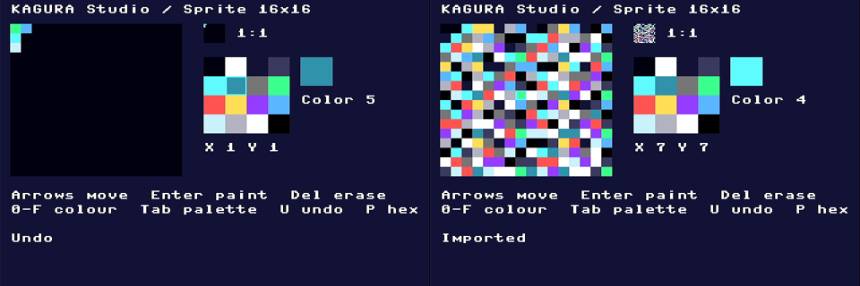

# KAGURA Studio sprite editor

2026-11-02 JST。[Canvas/SpriteCanvas](kagura-ui-canvas.md)を使う、最初のKAGURA Studioの機能。
`examples/ui_sprite_editor.py`の例であり、汎用のCanvas APIは変えていない。

## 画面

| 部品 | 位置 | 内容 |
| --- | --- | --- |
| 編集格子 | (8,20)、128×128 | 16×16、zoom 8。`SpriteCanvas`のsubclass |
| 1:1 preview | (152,20)、16×16 | zoom 1の`SpriteCanvas`。格子と同じ`Sprite4`を共有し、focusしない |
| palette | (152,48)、64×64 | 16色の4×4 `Canvas`のsubclass |
| 選択色 | (224,48)のswatchと`Color N` | 色0は`(clear)`と表示する |
| cursor座標 | (152,120) | `X n Y n` |
| 状態行 | (8,196) | Undo、import、hexの出力の結果 |

画素値0は透明で、UIの色0で表示する。

## 操作

| key | 動作 |
| --- | --- |
| 矢印 | 格子またはpaletteのcursorを移動 |
| Enter/Space | 格子: 選択色で塗る。palette: その色を選ぶ |
| Delete/Backspace | 消す（0、透明） |
| `0`〜`9`、`A`〜`F` | 色の選択（paletteのcursorも追従） |
| Tab | 格子とpaletteの間でfocusを移す |
| `U` | 1段のUndo。もう一度押すとRedo |
| `P` | `SPRITE_HEX <256桁>`をREPL（USB）へ出力 |
| Escape | 終了 |

- **Undo:** 直前の変更（塗る、消す、import）の前のdataを1つだけ保持する。変化のない操作では、記録を更新しない。

## hexの読込みと書出し

128 Bの`Sprite4`（[TILE4配置](kagura-ui.md#sprite4の配置tile4)）を、256桁のhexで受け渡す。

```python
import ui_sprite_editor
from kagura.ui import StdinInput
ui_sprite_editor.run(console=kagura_console, input_adapter=StdinInput())
text = ui_sprite_editor.editor.export_hex()     # Escapeで終了した後
ui_sprite_editor.run(data_hex=text, console=kagura_console, input_adapter=StdinInput())
```

- `export_hex()`は、小文字256桁のhexを返す。
- `import_hex(text)`は、空白と改行を無視し、大文字も受け付ける。Undoできる。
- 不正なhex（長さ、文字）は`ValueError`になり、spriteは変わらない。
- 16×16の128 Bは、16×16 hardware spriteの4 pattern（左上、右上、左下、右下）と同じ並びである。

## 再描画

- 塗る・消す・Undo・importでは、値が変わった画素についてだけ、格子のcellとpreviewの1画素を再描画する。
  - 同じbyteにある隣の画素でも、値が変わっていなければ描かない。
- Appの`damage_limit`を4にする。
  - 格子のcell、previewの画素、labelは、離れた小さい矩形のまま描かれる。
  - 1矩形に結合すると、画面の大半を描き直すことになる。
- 通常の編集では、画面全体を描き直さない。

## PC検証

| 確認 | 結果 |
| --- | --- |
| `test_ui.py` | 58件PASS（sprite editor 5件） |
| 配置・初期表示 | 格子とpreviewの画素がTILE4 dataと一致。paletteの16色、swatch、label |
| key操作 | 塗る、消す、色0、hexとpaletteでの選択、cursor座標 |
| Undo | 1段のUndo/Redo。変化のない消去で記録を上書きしない |
| hex | 長さ・文字の誤りを拒否。空白・大文字を受け付ける。Undoできる。`P`の出力。`run(data_hex=...)`相当の読込み |
| 再描画の範囲 | 塗る・消す・移動・色選択・Undo・1画素のimportで、1 stepに塗る面積が4000 px未満。同じbyteの隣の画素は描かない。逐次の描画は全体の再描画と一致 |
| mutation | 10件中9件を検出。残る1件（hexの長さ検査）は、`Sprite4.load`が同じ入力を拒否する等価な変更 |
| `ui_sprite_editor_runtime.py` | 300 eventの操作列で、CPythonとunix MicroPython v1.26の出力が一致（sprite CRC 2883309786） |
| ARM `mpy-cross` | PASS |

## RP2040受入（RAMのみ）

`tools/kagura-ui-sprite-editor.py`を使った。

- **条件:**
  - firmwareは最終Phase 2 UF2（`9ebfa459…`）のまま。#62の高速経路は入っていない。
  - branchの`render.py`/`app.py`/`canvas.py`/`ui_sprite_editor.py`をsourceとしてRAMへ送った。他のUIとSDKはfrozenのものを使った。
  - fontはTheme既定（MicroPython内蔵ASCII）。
  - Flashとfilesystemへは書き込んでいない。
- **回数:** CIを通ったcommit `780ac7c`で2回実行した。

### 正しさ

| 確認 | 結果 |
| --- | --- |
| 操作列 | `ui_sprite_editor_runtime.py`と同じ300 eventで、cursor (1,2)、色2、sprite CRC `2883309786`。PC（CPython・unix MicroPython）と一致 |
| 逐次と全体 | 逐次描画の後のbuffer CRCが、全体の再描画と一致 |
| 画素 | 格子（各cellの中心）と1:1 previewの全256画素を、`Sprite4`の値と照合した。不一致0件を4回確認（操作列の後、hexの往復の後、全画素のimportの後、終了前） |
| hex | `import_hex`→`undo`で`export_hex`が元に戻る |
| FPGA | `ERROR_CODE 0`。consoleは復帰した |

### 時間

1 frameの`App.step()`の時間で、2回の実行の差は1.3%以内だった。値はrun1。

| 操作 | n | frame p50 | p95 | cpu p50 | flush p50 |
| --- | --- | --- | --- | --- | --- |
| 塗る | 16 | 21.9 ms | 34.2 ms | 19.5 ms | 2.4 ms |
| 消す | 16 | 21.7 ms | 40.6 ms | 19.3 ms | 2.4 ms |
| cursorの移動（座標labelを含む） | 32 | 39.5 ms | 53.4 ms | 35.8 ms | 3.7 ms |
| 色の選択（hex。swatch、label、palette） | 32 | 46.5 ms | 63.3 ms | 41.5 ms | 5.0 ms |
| Undo/Redo（1画素） | 32 | 23.3 ms | 40.8 ms | 20.9 ms | 2.4 ms |
| previewの1画素 | 16 | 8.4 ms | 8.9 ms | 6.8 ms | 1.6 ms |
| preview全体（16×16） | 16 | 77.9 ms | 96.8 ms | 75.5 ms | 2.5 ms |
| import（1画素だけ変化） | 16 | 14.4 ms | 25.0 ms | 11.9 ms | 2.4 ms |
| import（全256画素が変化）※`import_hex()`を含まないframeのみ。下記「計測の訂正」 | 8 | 726 ms | 816 ms | 711 ms | 14.8 ms |
| 画面全体の再描画 | 8 | 271 ms | 293 ms | 233 ms | 38.3 ms |
| paletteのcursor移動 | 16 | 17.8 ms | 28.3 ms | 15.5 ms | 2.2 ms |
| paletteで選択 | 16 | 13.5 ms | 34.8 ms | 10.9 ms | 2.6 ms |

- **通常の編集（塗る、消す、Undo、1画素のimport）:** 14〜23 msだった。画面全体は描き直していない。
- **cursorの移動と色の選択:** 40〜47 msかかる。
  - 座標・色のlabelの書換え（`set_text`がlayoutを要求する）と、swatchとpaletteのcursorの再描画を含むため。
  - Canvasだけの移動（[Canvas記録](kagura-ui-canvas.md)の13.5 ms）より遅い。
- **全画素のimport:** 0.73 sかかる。
  - 変化した512か所（格子256、preview 256）を1つずつ無効化している。damage矩形の結合処理が大半を占めると推測している（内訳は未計測）。
  - 変化の多いimportだけ、格子とpreviewをまとめて無効化すれば短くなる見込みである。未実施。
- **heap:** 計測中のfree heapは、126736 Bから最低40448 Bまで減り、GCで回収された。
- **max:** p95と最大値には、自動GCが含まれる。



UGREEN 15390による1 fpsのHDMIキャプチャ。

- 左: 編集中（Undoの後、色5、cursor (1,1)）。
- 右: 全画素のimportの後。格子と1:1 previewは同じ画素を示している。

log: [run1](kagura-ui-logs/sprite-editor-rp2040-run1.txt)、[run2](kagura-ui-logs/sprite-editor-rp2040-run2.txt)

## 既知の制約

- 実機のfirmwareには、Canvasとこのeditorが入っていない。使うには、#64を含むSDK/UIをRAMへ送るか、新しい候補UF2を作る必要がある。新しい候補は、固定した`a5166d79…`とは別のものとして作る。
- 保存はhexの受渡しだけで、filesystemへの保存はない。
- Undoは1段だけで、Redoは直前のUndoの取消しだけである。
- 画素値0（透明）は、UIの色0で表示する。市松模様などの区別はない。
- unix MicroPython（x86-64）の`blit`の不具合は #65 で扱う。editorは`blit`を使わない。

## 再描画の改善（2026-11-02）

### 計測の訂正

- 上の表の「import（全256画素が変化）726 ms」は、`import_hex()`の後の1 frameだけの時間だった。`import_hex()`自体（差分の計算と再描画範囲の登録）を含んでいない。
- 同じ処理を含めると、main（`8954340`）では約1.6 sかかる。
- 計測toolは、importの時間に`import_hex()`を含めるように直した。

### 原因の特定

RAMに作ったapp・renderer・editorのinstanceに、時間計測の包み関数を付けて調べた。frozenのclassは変えていない。

- log: [段階別](kagura-ui-logs/sprite-editor-profile-phases.txt)、[GC](kagura-ui-logs/sprite-editor-profile-gc.txt)、[import](kagura-ui-logs/sprite-editor-profile-import.txt)
- 包み関数の負荷を含むので、絶対値ではなく内訳として使う。

| 操作 | 時間の大部分 |
| --- | --- |
| 全画素のimport | `import_hex()`が約1.3 s。512画素を1つずつ無効化し、そのたびにdamage矩形の結合処理（`_add_damage`、約500回）が走る。1回で約63 KBの一時objectを作る。frameでは、previewを256回の1画素fillで描いていた（約0.4 s） |
| cursorの移動 | 座標labelの`set_text`が、木全体のlayout（約13 ms）を起こしていた |
| 色の選択（hex） | 同じlayout（約13 ms）に加えて、focusのないpaletteで2 cellを再描画していた。cursor枠は見えないので、結果の画素は変わらない |
| GC | 塗る・移動・色の選択では、自動GCは起きなかった（1回あたり2.7〜4.3 KBを確保）。1回のGCは約8.5 ms |

- **段階別の記録の不一致:** この記録の`import_hex()`（4回の平均で約0.51 s）は、import単独の診断（1.33 s）とA/B toolの結果より短い。理由は分かっていない。数値はA/Bの結果を基準にする。
- **profile中に起きた`MemoryError`:**
  - GCを止めた計測で、heapが尽きた。
  - さらに、GCが有効でもfreeが127 KBあるのに、512 Bの確保が1回失敗した。断片化の可能性があるが、原因は分かっていない。
  - どちらの場合も、soft reset（Flashへの書込みなし）で回復した。consoleとERROR_CODE 0を確認した。
  - 下記のA/Bでは、各session 32回の連続importで1件も起きていない。

### 変更（例の中だけ）

| 変更 | 内容 |
| --- | --- |
| 大量変更の一括無効化 | 変化した画素が16を超えたら、格子とpreviewをそれぞれ1回で無効化する。16以下は、従来どおり画素ごとに無効化する。数える処理は1回の走査で、閾値を超えた時点で止める |
| previewの全体描画 | previewが全体で再描画範囲に入っていて、backendが`TileFramebuffer`を持つときは、同じTILE4 dataを`blit`で1回で描く。画素値0は色0で、`backdrop` 0と同じ結果になる。1画素だけの再描画やMock backendでは、従来のCanvasの描画を使う |
| 固定sizeのlabel | 座標・色・状態のlabelは`text`を代入して`invalidate()`する。layoutは要求しない（`kagura-ui.md`が認める直接変更） |
| paletteのcursor同期 | paletteにfocusがないときは、cursor位置を記録するだけで再描画しない。focusを得たときにpalette全体が再描画される |

汎用のCanvas、Label、App、SDKのAPIは変えていない。描画結果も変わらない。

### 検証

| 確認 | 結果 |
| --- | --- |
| `test_ui.py` | 61件PASS（新規3件） |
| SDK backendでの一致 | SDKの`TileFramebuffer`（`blit`によるpreview）とMockの参照画面が、編集・import・Undo・focus移動・全体の再描画の各stepで画素単位で一致 |
| layoutとpalette | 編集中にlayoutを要求しない。focusのないpaletteを描かない。focusを得るとcursorが選択色の位置に出る |
| 一括無効化 | 256画素の変化では、格子・preview・状態の3回だけ無効化する。閾値は画素数で数える（16画素は画素ごと、17画素は一括） |
| mutation | 11件すべてを検出（blitの範囲・位置・key、labelの扱い、paletteの同期、閾値の有無と数え方、画素ごとの差分） |
| `ui_sprite_editor_runtime.py` | CPython＝unix MicroPython。画面CRCはmainと同一（initial 685511179、edited 2769245142、final 2769245142） |

### RP2040 A/B（RAMのみ、ABBA）

- 比較対象: A＝main `8954340`、B＝このbranch。
- toolは同じ版を使った（importの時間は`import_hex()`を含む）。
- firmwareは最終Phase 2 UF2のままで、Flashとfilesystemへは書き込んでいない。

frame p50（AはA1/A2、BはB1/B2の平均）:

| 操作 | A | B | 差 |
| --- | --- | --- | --- |
| 全256画素のimport（`import_hex()`を含む） | 1607 ms | 323 ms | −80% |
| 色の選択（hex） | 46.8 ms | 21.4 ms | −54% |
| cursorの移動 | 39.5 ms | 26.5 ms | −33% |
| preview全体 | 78.1 ms | 10.5 ms | −87% |
| 画面全体の再描画 | 277.5 ms | 213.5 ms | −23% |
| paletteで選択 | 13.5 ms | 13.6 ms | 0 |
| 塗る | 21.9 ms | 22.2 ms | +1% |
| Undo（1画素） | 23.2 ms | 23.6 ms | +2% |
| 1画素のimport | 18.4 ms | 18.9 ms | +3% |
| 消す | 21.7 ms | 22.5 ms | +3% |
| paletteのcursor移動 | 17.5 ms | 18.5 ms | +6% |

- A1とA2、B1とB2の差は、それぞれ0.3%以内だった。
- **小さい悪化（0.4〜1.0 ms）:**
  - 消す・Undo・1画素のimportは、previewの描画の分岐（`_Preview.paint`）と差分の走査が増えたためと考えている。
  - paletteのcursor移動は、変更した処理を通らない。原因は分かっていない。
- **正しさ（4 sessionすべて）:**
  - 操作列のsprite CRC 2883309786がPCと一致した。
  - 逐次描画が全体の再描画と一致した。
  - 格子・previewの画素の不一致は、全確認点で0件だった。
  - hexの往復が一致した。
  - 32回の連続importで`MemoryError`は0件だった。
  - `ERROR_CODE 0`で、consoleは復帰した。
- HDMIでは、import後の格子とpreviewがmainと同じ画面になった。
- log: [A1](kagura-ui-logs/sprite-editor-perf-A1.txt)、[B1](kagura-ui-logs/sprite-editor-perf-B1.txt)、[B2](kagura-ui-logs/sprite-editor-perf-B2.txt)、[A2](kagura-ui-logs/sprite-editor-perf-A2.txt)
