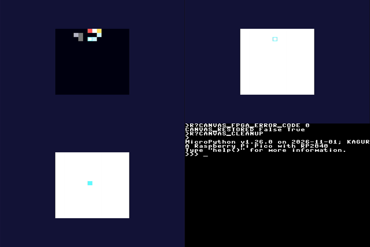

# KAGURA-UI Canvas / SpriteCanvas

2026-11-02 JST。KAGURA Studioの最初の段階。APIと4bppの配置は[KAGURA-UI](kagura-ui.md#sprite4の配置tile4)に記載。

## 構成

| class | 役割 |
| --- | --- |
| `Canvas` | 汎用のcell格子。座標の対応、cursor、入力の振り分け、cell単位の再描画、clip内だけの描画 |
| `Sprite4` | `TILE4`配置の4bpp画素。UIに依存しない |
| `SpriteCanvas` | `Sprite4`をその場で編集する`Canvas`のsubclass |

- 既存の所有モデル（App/Backend）と描画API（`Renderer.fill_rect`/`rect`）だけを使う。
- SDK、RTL、ABIは変えていない。

## RP2040受入（RAMのみ）

`tools/kagura-ui-canvas.py`を使った。

- **条件:**
  - firmwareは最終Phase 2 UF2のまま。
  - branchの`render.py`/`app.py`/`canvas.py`をsourceとしてRAMへ送った。他のUIとSDKはfrozenのものを使った。
  - frozenの古い`Widget`/`Panel`には、data属性`opaque`だけを設定した（logに記録）。
  - Flashとfilesystemへは書き込んでいない。
- **配置:** canvasは(96,56)、zoom 8（128×128画素）。
- **回数:** 同じ版で2回実行し、両方の結果を記録した。

### 正しさ

| 確認 | 結果 |
| --- | --- |
| 編集列 | `ui_canvas_runtime.py`と同じ200 eventで、変化41回、cursor (7,2)、色14、sprite CRC `314165072`。PC（CPython・unix MicroPython）と一致 |
| 逐次と全体 | 逐次描画の後のbuffer CRCが、全体の再描画と一致 |
| `blit` | `Sprite4.source()`を4か所へ`key=0`で描いた結果が、Python `(319211327, 815970630)`、native（Viper）でも同じ値で、PCとも一致。8 px境界にない描画先を含む |
| HDMI | 編集列の後の画素（位置と色）が、PCで計算した9画素と一致。cursor枠はcell (7,2)。console復帰を確認 |
| FPGA | `ERROR_CODE 0`。consoleは復帰した |

### 時間

各値は、1 frameの`App.step()`の時間（入力処理、描画、flush）である。cpuは、frame時間からflush時間を引いた値。

| 操作 | n | frame p50 | p95 | 最大 | cpu p50 | flush p50 |
| --- | --- | --- | --- | --- | --- | --- |
| canvas全体の再描画（空、1行1 fill） | 16 | 87.3 ms | 96.6 ms | 96.6 ms | 74.6 ms | 12.7 ms |
| canvas全体の再描画（縞、1 cell 1 fill） | 16 | 374.9〜376.7 ms | 678〜680 ms | 680 ms | 362〜364 ms | 13.0 ms |
| 1画素の編集（cursor位置） | 32 | 12.6〜12.7 ms | 18.4 ms | 19.6 ms | 11.0 ms | 1.7 ms |
| cursorの移動 | 32 | 13.5 ms | 14.4〜14.5 ms | 15.3 ms | 11.8 ms | 1.7 ms |

- 2回の実行の差は0.5%以内だった。
- **全体の再描画は、事前の見積り（約0.1 s）より遅い。**
  - 縞の最悪例は、1 cellにつき1回のfillで256回となり、約0.37 sかかった。最大値には自動GCが含まれる。
  - 空のspriteでも87 msかかった。fillは16回だが、cellの読出しが256回ある（`Sprite4.get`の検査を含む）。
- 1画素の編集とcursorの移動は、約13 msだった。内訳は、背景、cell、cursor枠（4回）のfillと、入力処理である。
- heap: 1画素の編集32回で、free heapは132896 Bから最低87472 Bまで減り、GCで回収された。
- 改善の候補（未実施）:
  - `cell()`の読出しの費用を減らす。
  - 全体の再描画を`TileFramebuffer.blit`で行う（zoom 1のみ）。
- SDKの`fill_rect`/`glyph8`の高速経路（#62）は、mainにmerge済み（`c520412`）である。
  - 実機のfirmware（最終Phase 2 UF2 `9ebfa459…`）には、まだ入っていない。
  - 固定した候補UF2 `a5166d79…`（`d219778`）にも入っていない。
  - 上の時間は、高速経路のないfrozen SDKでの値である。#62を含むUF2は、別の候補として作り、測り直す。

UGREEN 15390による1 fpsのHDMIキャプチャ。

- 左上: 編集列の後のsprite（cursorは(7,2)）。
- 右上: 縞の再描画。色1と14は、UIのpaletteではどちらもほぼ白。
- 左下: 1画素の編集。
- 右下: 終了後のconsole復帰。

log: [run1](kagura-ui-logs/canvas-rp2040-run1.txt)、[run2](kagura-ui-logs/canvas-rp2040-run2.txt)

## 既知の制約

- unix MicroPython（x86-64）では、Viperの`blit`が、8 px境界にない描画先で異常終了する。mainでも再現し、このPRとは無関係である。RP2040のnativeは上記のとおり正しく動く。
- sprite editorの画面（palette、1:1 preview、undo、hex export/import）は次のPRで作る。
