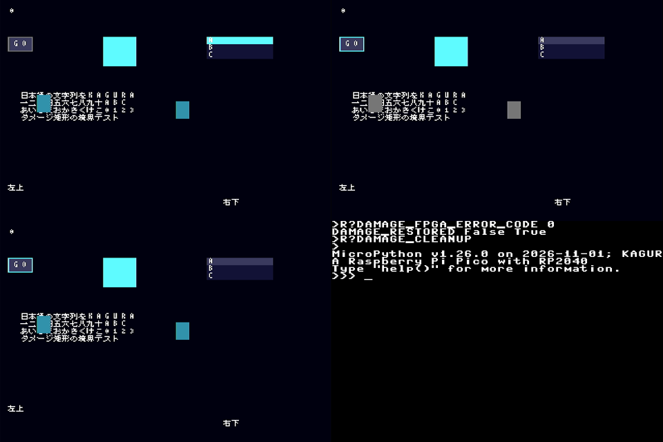

# KAGURA-UI 複数damage矩形

2026-11-02、main `b02a6ef`から`feat/kagura-ui-damage-rects`で実施。
引き継ぎロードマップ（`docs/claude-handoff`の`docs/KAGURA_ROADMAP.md`）のP1「damage領域最適化」。
RP2040実機で比較した結果、**既定は`damage_limit=1`（従来の単一外接矩形）のまま**とし、複数矩形はopt-inにした。

## 変更

`App._damage`は単一外接矩形から、最大`damage_limit`個（既定1）の矩形listになった。
`App(..., damage_limit=4)`または`app.damage_limit = 4`で複数矩形を使う。

- 重なる矩形、または辺を共有する矩形は結合する。角だけ接する矩形は結合しない。
- 上限を超えたら、新しい矩形を面積増加が最小の既存矩形へ結合し、再度重なりを判定する。
- stepは各矩形をclipにして背景fillと木全体の再合成を行い、flushはframe当たり1回のまま。
- 描画用と受付用の二つのlistを交換し、描画中のinvalidateは次frameへ残す。
- 描画・flushで例外が出た場合、そのframeの全矩形をdamageへ戻して伝播する。SDK dirtyも従来どおり保持。
- `damage_limit=1`は従来の単一外接矩形と同じ動作。
- rootが不透明（`Screen`/`Panel`、`opaque=True`）で矩形を覆う場合、Appの背景fillを省く。
  rootのpaintが同じ画素を必ず塗るため結果は同一で、SDK呼出しが矩形ごとに1回減る。limitに関係なく効く。

SDKのdirty tile tracker、Framebuffer、転送、FENCE、RTL、ABIは変更していない。
tile trackerを複製せず、UI側は矩形のclipだけを増やした。

### 代償

- 矩形数だけ再描画passが増える。RP2040では1矩形あたり約2.4 msの固定費（rootのfillとtree走査）がある。
- 矩形境界で字形が部分clipになると、従来の行単位描画になる（測定時点）。
  後続の変更でmaskしたrowsによる1回のglyph8になった（[glyph cache記録](kagura-ui-glyph-cache.md#部分clipの字形)）。
- `_add_damage`は矩形tupleを生成する。allocation回数は従来どおり未計測で、allocation-freeとは主張しない。

## 検証（PC）

| 項目 | 結果 |
| --- | --- |
| `test_ui.py` | 39件PASS（既存33＋新規6、うち1件は実機benchmarkのPC実行、1件は背景fill省略）。既存の`_damage`参照はlist形式へ更新 |
| 新規: 離れた2 widget | 間のsentinel pixelを描き直さない。`damage_limit=1`では描き直す |
| 新規: 結合規則 | 重なり/辺共有/角接触/上限超過/画面clipの各期待値 |
| 新規: 40操作の乱数列 | 移動/非表示/日本語Label/Tab/List操作とflush失敗再試行で、limit 4とlimit 1の全pixelが毎step一致。最後に全画面再描画しても不変 |
| 新規: SDK dirty | 実TileFramebuffer（register model）で離れた2 Label更新のtile数がlimit 1より少なく、decode結果は一致 |
| mutation確認 | 先頭矩形だけ描画する改変で、新規2件がFAILすることを確認後に復元 |
| `ui_runtime.py` | CPythonとunix MicroPython v1.26（`4ce2dd2`）のCRCが一致。origin/mainの出力とも同一（4231501191/2117273149/26039419） |
| `ui_glyph_runtime.py` | CPython/unix MicroPython一致（288, 2456019654, 1936776583） |
| ARM | `mpy-cross -march=armv6m`でui/*.pyとtest_ui.pyをcompile |
| 他回帰 | framebuffer/frozen_alignment/link、`tools/test-ci-changes.sh` PASS |

### dirty tile比較

`python -I tools/compare-ui-damage.py`。既存`ui_benchmark`のworkload各32 samplesを
register model上で実行し、SDKが転送したtile数とpattern payload byteを比較する。
決定的な数で、時間ではない。CIでも実行し、最終bufferのCRCが異なれば失敗する。

| workload | limit 1 tiles / B | limit 4 tiles / B |
| --- | --- | --- |
| idle | 0 / 0 | 0 / 0 |
| label | 53 / 1696 | 53 / 1696 |
| button | 287 / 9184 | 272 / 8704 |
| focus | 1440 / 46080 | 960 / 30720 |
| move | 620 / 19840 | 620 / 19840 |
| scroll | 786 / 25152 | 774 / 24768 |
| screen | 38400 / 1228800 | 38400 / 1228800 |

最終buffer CRC32は両方2644429476。focusはButton（x=8）とListView（x=200）の間にある
Panelと空白を再描画しなくなり、tile数が約33%減った。
label/move/screenは元々単一矩形なので変化しない。静止の転送ゼロは維持。

## RP2040実測

2026-11-02 JST、RP2040 125 MHz、MicroPython v1.26.0（#51のKAGURA_PICO firmware、変更なし）、
ABI 0.6、CAPS 0x5B、QSPI 4 lanes / 5 MHz、Viper有効。各workload 32 samples × 4 rounds（limit順はABBA）。
firmware、Flash、ファイルシステムへの書込みなし。

| run | 送信したapp.py | log |
| --- | --- | --- |
| 1 | `a6ad952`（背景fill省略なし）、sha256 `512f1ddd…` | [damage-rp2040-run1.txt](kagura-ui-logs/damage-rp2040-run1.txt) |
| 2 | 背景fill省略を追加した作業tree、sha256 `c44030e9…` | [damage-rp2040-run2.txt](kagura-ui-logs/damage-rp2040-run2.txt) |

run 2のapp.pyは最終commitと既定値・コメントだけが異なる（benchmarkはlimitを明示するため動作は同一）。
frozenの`Widget`/`Panel`には`opaque`がないため、toolがデータ属性を設定したことをlogに記録している。

run 2のframe p50（各roundのp50の範囲、µs）:

| workload | limit 1 | limit 4 | 差 | 内訳 |
| --- | --- | --- | --- | --- |
| idle | 402..415 | 401..405 | 0 | 転送0 |
| label | 21503..21519 | 21492..21535 | 0 | 単一矩形 |
| button | 38959..39032 | 41321..41361 | **+6.1%** | tile同数、CPU +2.4 ms |
| focus | 42389..42661 | 42154..42410 | −0.6% | tile −33%、flush 5.3→4.0 ms、CPU +1.0 ms |
| labels | 45791..45893 | 48342..48453 | **+5.6%** | tile同数、CPU +2.5 ms |
| glyphcut | 341126..342794 | 79024..79122 | **−77%** | tile −71%、GC観測 28→8 |

- 全workloadでCRC一致（incremental＝全画面再描画、limit 1＝limit 4）。Viper/Pythonの全画面CRCも一致（3228843279）。
- `DAMAGE_FPGA_ERROR_CODE 0`、console復帰（paused=False / attached=True）。
- 背景fill省略（run 1→2）で、limit 1でもlabel −0.9 ms、button −1.4 ms、focus −1.6 ms、labels −1.7 ms。
- heap/step p50はlimit 4が256〜640 B多い（label/glyphcut以外）。glyphcutはlimit 4が23.6 KB少ない。
  GC観測は「step前後でfree増加」した数で、VMのGC回数ではない。
- p95/p99は32 samplesの値であり、長期の最悪値ではない。



run 1中にUGREEN 15390で1 fps取得したHDMI（左上・右上・左下が測定シーン、右下が終了後のconsole復帰）。
字形・badge・focus枠の崩れはない。run 2のHDMI取得はffmpeg起動引数の誤りで0枚だった。

### 原因と判断

診断（同条件、9回の中央値）では、1×1の空矩形でも再描画に5.7 ms、
SDK `fill_rect`は96×16で1.16 ms、304×32で1.41 msと、呼出しごとの固定費が大きい。
字形の取得は1文字1.9 ms（ファイル内binary search）。
そのため、離れた2か所の安い更新では、間の背景を塗るより矩形を分ける方が遅い（button/labels）。
矩形が字形を部分clipする場合は、単一外接矩形の方が大幅に遅い（glyphcut）。

よくあるbutton押下＋Label更新で6%悪化するため、既定は1とした。
字形に重なる小さな更新が多い画面では`damage_limit=4`が有効。
既定値を上げるには、結合時に「間に描画内容があるか」を考慮する規則、
またはSDK呼出しの固定費の削減が必要（未着手）。

## 方法

`tools/kagura-ui-damage.py run`と`examples/ui_damage_benchmark.py`を使う。

- 既存firmware（#51以降、glyph8あり）のまま実行する。firmware、Flash、ファイルシステムには書き込まない。
- このcheckoutの`kagura/ui/app.py`だけを、相対importを絶対importに変えてraw REPLでsource送信する。
  RAM上の`App`を**limit 1と4の両方**で使うため、frozenとRAMの差は比較に入らない。
  他のUI moduleとSDKはfrozenのまま。本変更でapp.py以外に変わったのは`Widget`/`Panel`の`opaque`データ属性だけで、
  frozenのclassに無ければtoolが同じ値を設定し、logへ記録する。
- SDKクラスへのpatchは行わない。Phase 2で停止した補助診断は、SDKクラスを一時patchする方式だった。
- 1つのApp、1つのFramebuffer（38400 Bの確保は1回）、1つのwidget木を使う。各（round, limit, workload）は
  同じreset状態から始める。roundごとにlimitの順を入れ替え（1,4 / 4,1）、時間経過による偏りを分散させる。
- workload:

| workload | 内容 |
| --- | --- |
| idle | 変更なし（転送0を確認） |
| label | 1 Label（単一矩形の対照） |
| button | Enterで押下し、離れたLabelを更新 |
| focus | Tabで、x=8のButtonとx=200のListViewを往復する |
| labels | 画面の対角にある日本語Label 2個（text-heavy、離れた矩形） |
| glyphcut | 8 px格子からずれたbadge 2個が日本語4行のblockと重なる。limit 4では矩形境界が字形を切り、行単位描画になる |

- sampleごとの測定値:
  - frame: `App.step`全体
  - flush: SDKの`total_us`
  - cpu: frame − flush（入力・layout・描画を含む）
  - tiles、pattern payload byte
  - heap: step前後の`gc.mem_free()`差。増加したstepはGC観測として数え、差分から除く。VMのGC回数やallocation回数は取得できない。
- 各workloadの後に落ち着くまでstepし、CRC32を取る。続けて全画面を再描画し、同じCRCであることを確認する。
  limit 1と4のCRCも一致を確認する。最後にViperとPythonで全画面のCRC一致を確認する。
- 終了時に`REG_ERROR_CODE`を読み、`check_errors()`、console復帰（paused=False / attached=True）を検査する。
- PCでは`test_ui.py`がregister model上で同じmoduleを実行し、CRC一致、focus/glyphcutのtile減少、集計を検査する。

## 再現手順

Windows venvに`python -m pip install mpremote==1.29.0 pyserial`を用意する。他のUSB端末は閉じる。
COMとUSB serialは実物と照合し、localで入力する（実値をcommitしない）。

```powershell
python -m serial.tools.list_ports -v
$picoPort = Read-Host '実物と照合した対象PicoのCOMポート'
$picoSerial = Read-Host '実物と照合した対象PicoのUSB serial'
python tools/kagura-ui-damage.py run --port $picoPort --expected-serial $picoSerial --samples 32 --rounds 4 --log build/ui-damage/device.txt
python tools/kagura-ui-damage.py summarize build/ui-damage/device.txt
```

logの`HOST_SOURCE`には、送信したapp.pyとbenchmarkのSHA256、git commitが記録される。
run中はUSB COMとHDMIを占有する。異常時は実行中のloopを中断し、App.closeでconsoleを戻す。

## 判断基準と結果

| 基準（測定前に設定） | 結果 |
| --- | --- |
| 全workloadでCRC一致、ERROR_CODE 0、console復帰 | 満たした |
| focusのframe p50が全roundで明確に短縮 | 満たさない（−0.6%、round範囲と重なる） |
| 他workloadのp50/p95がround範囲を超えて悪化しない | button/labelsで満たさない |

このため既定値は1とし、4はopt-inにした。背景fill省略は全limitで効き、既定のままでmainより遅くなるworkloadはない。

## 未確認の事項

- SPI 1-lane等、flushが重い構成での比較（tile減少の効果が大きくなる可能性）。
- 長時間soak、Pico 2/2 W、UART/HIDは本変更でも未検証。
