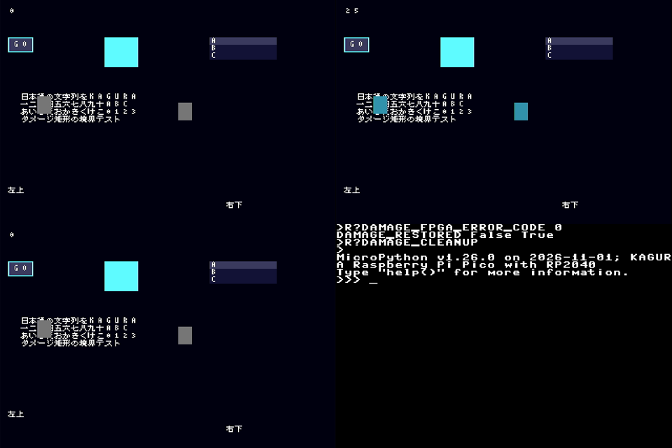

# KAGURA-UI glyph cache

2026-11-02 JST。引き継ぎロードマップP1「Font cache」。
[focus候補走査](kagura-ui-focus.md)の後続で、同じRP2040ベンチマークで測った。

## 問題

`kagura_ja.Font.glyph()`は、KJ8Fの固定長record（美咲 約7000字）をファイル上でbinary searchする。
1回あたり約13回のseek/readintoが必要になる。

RP2040の診断では1文字1.9 msかかっていた（[damage記録](kagura-ui-damage.md)の診断と同条件）。
`BitmapFont8.draw`は描画のたびに全字形を取得し直すため、短いLabelの更新でもframe時間の大半を占めていた。

## 変更

- `BitmapFont8(source, cache=64)`は、ファイル由来の字形rowsを直接マップのcacheに保持する。
  - slot数は0か2のべき乗。0で無効になる。
  - 衝突したcodeは、そのslotを置き換える（固定容量で、増えない）。
- cacheに当たった場合は、保持しているrows（`bytes`、読取り専用）をそのまま返す。ファイルI/Oも割当も発生しない。
- 字形がない場合の`?`の代替rowsも、要求されたcodeで保持する。
- Fontを閉じた後は、cacheに当たる場合でも`ValueError('font is closed')`になる（従来どおり）。
- 内蔵ASCII（sourceなし）の経路は変えていない。SDKの`kagura_ja`も変えていない。
- 字形・描画結果は変わらない。PC/unix MicroPythonのCRC（ui_runtime、glyph 288操作）はmainと同一。

## RP2040実測

RP2040 125 MHz、#51のfirmware（変更なし）、QSPI 4 lanes / 5 MHz、Viper有効。
`tools/kagura-ui-damage.py run --font-cache 0`と`--font-cache 64`を別sessionで続けて実行した。
送信したapp.py/fonts.py/benchmarkは同一で、cache容量だけが違う。32 samples × 4 rounds。
logの`git=`はmainへのrebase前のcommit。送信したapp.py/fonts.pyのsha256は、このbranchのファイルと一致する。

| run | log |
| --- | --- |
| cache 0 | [glyph-cache-rp2040-off.txt](kagura-ui-logs/glyph-cache-rp2040-off.txt) |
| cache 64 | [glyph-cache-rp2040-64.txt](kagura-ui-logs/glyph-cache-rp2040-64.txt) |

frame p50（各roundのp50の範囲。差は範囲の中央で計算）:

| workload | damage_limit | cache 0 | cache 64 | 差 |
| --- | --- | --- | --- | --- |
| label | 1 | 21.2 ms | 16.1〜16.2 ms | −24% |
| button | 1 | 37.7 ms | 27.8 ms | −26% |
| focus | 1 | 38.6〜38.8 ms | 26.7〜26.8 ms | −31% |
| labels | 1 | 45.4 ms | 23.9〜24.8 ms | −46% |
| glyphcut | 1 | 330〜338 ms | 272〜279 ms | −18% |
| glyphcut | 4 | 78.0 ms | 63.8 ms | −18% |
| idle | 1 | 0.3〜0.4 ms | 0.3〜0.4 ms | 0 |

- p95/p99の最大値も、idle以外の全workloadで下がった（例: focus 44.3 → 37.0 ms）。
  idleはp99最大が427 → 435 µsで、字形を描かないため差は測定ばらつきの範囲と見ている。
- cpu（frame − flush）の短縮がほとんどを占める。tile数とpayloadは同一。
- RAM（GCで見えるfree）:
  - 空のcache（64 slot × 2 list）は608 B。
  - 測定終了時の差は合計1920 B（cacheが埋まった状態、cache 0とのsession終了時free差）。
  - heap/step p50は128〜1792 B少ない。
- 全workloadでCRC一致（incremental＝全画面再描画、limit 1＝4、Viper＝Python 3228843279）、
  `ERROR_CODE 0`、console復帰。

UGREEN 15390による1 fpsのHDMIキャプチャ。左上・右上・左下が測定中のシーン、右下が終了後のconsole復帰。字形は崩れていない。

## 部分clipの字形

cache導入後も、glyphcut（limit 1）は約275 msと遅かった。
clipに一部だけ入る字形は、1のbitの横runごとに`renderer.fill_rect`を呼んでおり、
SDK `fill_rect`は1呼出しあたり約1 msかかる。

SDKの`glyph8`は、1のbitだけを書き、画素ごとに画面内かを判定し、値が変わった場合だけdirtyにする。
そこで`Renderer.glyph8`が、clip外の行と列のbitを再利用する8 B bufferで0にし、1回の`glyph8`で描くようにした。
`glyph8`を持たないbackend（MockBackend、旧SDK）は、従来の独立した行単位描画を使う。
PCテストでは、この参照経路とPython/Viperの結果を、上下左右・両端・画面端・1×1のclipで比較している。

同じtool版で、Aを`--ref feat/kagura-ui-glyph-cache`、Bをこの変更として、続けて測った（cache 64、32 samples × 4 rounds）。

| workload | limit | 変更前 | 変更後 | heap/step p50 | GC観測 |
| --- | --- | --- | --- | --- | --- |
| glyphcut | 1 | 275.8〜278.2 ms | 102.7〜102.9 ms（−63%） | 30208 → 9920 B | 28 → 8 |
| glyphcut | 4 | 65.1〜65.2 ms | 29.2 ms（−55%） | 7968 → 2448 B | 8 → 0 |

- 他のworkloadの差は+0.6%以内。label/labels/idleはround間の範囲が重なる。
  focus（26.86〜26.94 → 27.00〜27.10 ms、+0.5%）とbutton（+0.15%）は範囲がわずかに重ならない。
  これらは部分clipの字形を描かないため、別sessionの差と見ているが、原因は確認していない。
- tile数・payloadは同一。CRC一致、`ERROR_CODE 0`、console復帰。
- 送信sourceのsha256は各branchのファイルと一致する（maskedのfonts.pyは測定後にコメントだけ変更したため`0b32cc78…`→`90c31e0e…`）。
  logの`git=`はrebase前のcommit。
- log: [clipped-glyph-rp2040-base.txt](kagura-ui-logs/clipped-glyph-rp2040-base.txt)、
  [clipped-glyph-rp2040-masked.txt](kagura-ui-logs/clipped-glyph-rp2040-masked.txt)

## 範囲と残る課題

- 64 slotでは、多数の異なる字形を同時に表示する画面ではhit率が下がる。容量は`cache=`で選べる。
  hit率は測っておらず、benchmarkの字形は64種類未満。
- SDK `fill_rect`の呼出しあたり約1 msの固定費は、SDK側の課題として残る。
- 長時間soak、Pico 2/2 W、UART/HIDは未検証。
