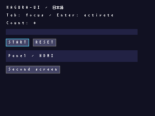
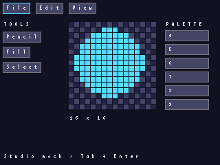
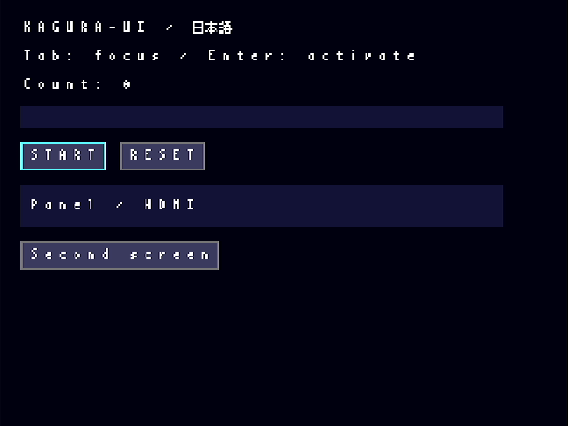

# KAGURA-UI

MicroPython v1.26向けGUI。公開APIは`kagura.ui`。既存SDKの描画・通信処理を再利用する。
Phase 1の実装とRP2040での受入状況を記録する。Phase 2ではSDKの公開`glyph8()`を追加し、
既存のViper文字kernelへ日本語bitmapも渡す。RTL・ABI・既存APIの呼出し方法は変更しない。
Phase 3のエディタ機能は別開発。




画像は美咲fontを使用したPC MockBackend出力。実機HDMIの撮影ではない。
`python tools/render-kagura-ui.py build/ui-previews`で3種類を再生成できる。



こちらは実機HDMI出力。PC参照描画、実機Python、実機Viperのtile buffer CRC32は
`2036752175`で一致した。[実機の計測・画像・再現手順](kagura-ui-validation.md)も参照。

## Phase 0: ソース監査と設計判断

2026-11-01、`origin/main`をfetchして`45e490b`を確認。
`gh pr list --repo siska-tech/kagura --state open`は`[]`。
以前の作業ブランチ`codex/micropython-showcase`の変更はmainに取り込まれており、
新ブランチ`feat/kagura-ui-phase1`をmainから作成した。既存の未追跡ファイルは変更しない。
GitHub connectorのPR検索はissueを返したため、PR一覧の判断にはCLIを使った。

監査は以下の実装・テストを対象とした。

| 対象 | ソースで確認した制約・再利用方針 |
| --- | --- |
| `kagura/framebuffer.py` | 320×240、4bpp、RAM 38400 B、dirty 1200 B。initializeで1200パターン/BGマップ/上位bit表を上書きし、スプライトを無効化。セルパレット設定はinitializeで失われる。空のraster_scrollでもCAPS_RSCROLLが必要なためUI側でI/O前に検査 |
| `framebuffer_viper.py` | Pythonと同じtile配置。UIは`fill_rect`と、clip内に収まる内蔵ASCIIの`text`経由で既存Viperを使う。独自のnative raster/transportを作らない |
| `video.py` | patterns 0..1199、BG 64×32、OAM 256 records、palette 256色。1023/1024のRAM境界は`Video.tiles`が処理 |
| `kagura_ja/__init__.py` | 美咲KJ8Fはbinary searchで8行だけ返す。全フォントをRAMに読まない。TextLayerは独自のpattern範囲とBGマップを使用するためFramebufferと併用できない |
| `terminal.py`, `console.py` | コンソールはASCII/cursorと日本語パターンを使用。pauseだけではUARTのdupterm readerは止まらない。GUI中はdetachして単一入力readerを保証し、closeでresume→attach |
| `__init__.py`, `device.py` | connectは裸のKaguraを返す。所有権registryは無い。`Session`は`examples/framebuffer_diagnostic.py`の診断用クラスであり、公開SDK APIではない |
| `transport_rp2.py`, `link.py`, `link_viper.py` | SPI/QSPI PIO、FIFOとDMA、既存accelerate経路をそのまま使う。`busy`はsoft console timerのcompound command干渉を防ぐが資源leaseではない |
| `framebuffer.flush` | 連続dirty run、pattern境界分割、FENCE成功後にdirty解除。例外は伝播。UI側も損傷領域を保持して再試行する |
| `spec/registers.json`, `kagura/regs.py` | ABI 0.6、pattern count 0x04B0=1200。通常pattern RAM 0x0000..0x7fff、拡張0xb000..0xc5ff、BG 0x8000、上位bit 0x9000、palette shadow 0x9400、OAM shadow 0xa000 |
| boards/manifest/CI | KAGURA_PICOとKAGURA_PICO_Wが既存対応。Pico 2/2 W用ボード定義・実機検証はない。UIがRP2350動作を保証するものではない |
| tests/benchmarks/docs | SDKの独立参照描画、Viper PCエミュレータ、PIO timing、fault recovery、実機診断を再利用。既存性能値をUIの性能として転載しない |

生成済みレジスタは`tools/gen-registers.ps1 -Check`でspec/文書との整合を確認。
説明から誤解しやすい点: COMMITはpattern RAMやBGマップのatomic swapではない。
FENCEは転送の処理完了を確認するが、画面全体の原子的更新を提供しない。
画面切替えや部分更新中に、新旧描画が混在して表示され得る。
MicroPython実行試験では`bytearray.clear()`とitem deletionが未対応と判明し、slice代入へ変更した。
SDK README冒頭には現行ABIを0.5とする古い記述が残っていたため0.6へ修正し、過去の0.5測定記録は保持した。
実機では旧Kaguraと新Framebufferの混在による`_link`不足も検出した。
UIはこの既知の混在をI/O前に拒否する。ABI番号だけでSDKソフトウェアの版一致を判定できないため、
SDK/UIは同じ配布一式を使用する。全種類の混在を自動検出するものではない。

## Backend比較と所有権

| | A: Framebuffer（今回） | B: Tile/Sprite（将来） |
| --- | --- | --- |
| RAM | 38400 B + dirty 1200 B + SDK作業領域 | 小さい画面モデル＋glyph/cache/allocator。未計測 |
| FPGA資源 | 全1200 patterns、BG、OAM/display制御、palette bank 0を排他所有 | pattern範囲・BG領域・OAM slot・paletteを明示割当 |
| 長所 | RAM内で重なり/clippingを処理、既存Viper/dirty転送を利用 | 同一グリフ/アイコンの再利用、hardware cursor |
| 制限 | console/TextLayer/独立spriteと同時使用不可。320×180も拒否 | eviction時の参照整合、cache枯渇・資源分割が必要 |

widgetはrendererの`fill_rect/rect`とfont APIだけを使用する。
rendererはbackendの`width/height/start(theme)/fill_rect/flush/close`に依存する。
将来Bは別backendとして追加し、資源割当APIを設計してから使用可能にする。
今回Bのダミー実装や資源競合を隠す共有APIは提供しない。

`App(device, exclusive=True)`は、呼出し元が既存の全graphics ownerを停止済みであるという
明示的な宣言。通常は`App(device, console=kagura_console)`を使う。
無指定なら拒否。consoleが別device/既にpause中、二つのUI ownerが同じdevice/transportを使う場合も拒否。
registryは協調的なleaseであり、別Kagura/transportインスタンスや生のSDK呼出しを横取りできない。
実行中にVideo/TextLayer/TileFramebuffer/別接続から描画しないこと。
SDKを書き換えずに強制検知できない競合を、この制約で明示する。

Framebuffer確保はconsole停止・FPGA I/Oより前。MemoryErrorは伝播する。
初期化後の失敗ではcloseを試みる。console復帰が失敗した場合はleaseを保持し、closeを再試行できる。
exclusiveでconsoleを渡さない場合のcloseはleaseだけを解放し、以前のVRAMを復元しない。
Appはdeviceや渡されたfontをdeinit/closeしない。これらの寿命は呼出し元が管理する。

## 最小の利用例

```python
from kagura.ui import App, VBox, Label, Button, Theme, BitmapFont8, StdinInput
from kagura_ja import Font

font = Font('/fonts/misaki8.kfnt')
app = App(kagura_console.screen.device, console=kagura_console,
          theme=Theme(BitmapFont8(font)), input_adapter=StdinInput())
root = VBox(spacing=6, padding=8)
root.add(Label('KAGURA-9 / 日本語'))
root.add(Button('START', on_click=lambda: print('Start!')))
app.set_root(root)
try:
    app.run()
finally:
    app.close()
    font.close()
```

提案APIへの変更は`exclusive=True`または`console=`の明示を必須とした点。
`kagura.connect()`だけでは既存ownerを特定できず、安全な資源共有を推測できないため。
日本語を使わない場合はTheme省略でMicroPython内蔵ASCII fontを使う。
この例はUSB端末用。UARTを使う場合は`input_adapter`を省略する。

## APIリファレンス

| API | 動作 |
| --- | --- |
| `App(device=None, backend=None, console=None, exclusive=False, theme=None, input_adapter=None, queue_capacity=32, damage_limit=1)` | 一つのUI owner。backend指定時はdevice/consoleを同時指定しない。damage_limitは正の整数（下記） |
| `set_root(widget)` | Screenまたは任意Widgetへ画面切替。旧rootをdetach、focus再選択、全画面をinvalidate |
| `start()`, `step()`, `run(idle_ms=10)`, `stop()`, `close()` | stepは入力→layout→再描画→最大1回flush。runはfinallyでclose。context managerも使用可能。外部loopからstepできる |
| `Widget(x=0,y=0,width=None,height=None,visible=True,enabled=True)` | 親相対座標。子は追加順に描画し、後の子が手前。親の矩形でclip |
| `add(child)`, `remove(child)` | 単一parent、cycle/二重attach拒否。子を直接別parentへ渡す前にremove |
| `set_bounds(x,y,width=None,height=None)` | 移動/resize後、旧領域と新領域を再描画 |
| `set_visible(bool)`, `set_enabled(bool)` | hiddenはlayout/focus対象外。disabledの子孫はfocus対象外。表示自体は残る |
| `invalidate()`, `relayout()` | 描画内容変更/サイズ要求変更を通知。色などの直接変更はinvalidate、geometry/focus候補の直接変更はrelayoutも呼ぶ。推奨はsetter |
| `Screen`, `Panel(color=None,...)` | 背景色を持つcontainer。Panelの自動サイズは0、明示サイズを指定 |
| `VBox/HBox(spacing=0,padding=0,...)` | 非負の均一padding/spacing、固定または内容サイズ。子のサイズ超過は縮小せずclip。flex/wrapなし |
| `Label(text='',color=None,...)`, `set_text(str)` | UTF-8のPython str、改行、missing glyphは`?`。文字列変更でlayoutと旧領域を更新 |
| `Button(text='',on_click=None,...)` | Enter/Space pressで引数なしcallback。次stepで押下表示解除。releaseを扱えるadapterにも対応 |
| `ProgressBar(value=0,maximum=100,width=120,height=12,...)`, `set_value(n)` | 0..maximumへclamp。maximumは正値 |
| `ListView(items,on_select=None,width=120,height=64,...)`, `set_items(sequence)` | 可視行のみ描画。上下で選択/scroll、Enterでcallback(index,text)。itemsはcaller所有。set_itemsで選択範囲を補正して再描画 |
| `Theme(font=None)` | palette 16色と描画色indexを設定。実行中のpalette変更APIは未提供 |
| `BitmapFont8(source=None)` | sourceは既存kagura_ja.Font。height/advance/measure/glyph/drawを提供。fileを所有しない |
| `Event(key,text='',shift=False,kind='press',repeat=False)` | key: up/down/left/right/enter/escape/tab/backspace/delete/text。timestampは生成時刻 |
| `EventQueue(capacity=32).post(event)` | 固定slot ring。満杯では最新eventを捨てFalse、dropped加算。popは空でNone |
| `TerminalInput(stream=None).feed(bytes,queue)`, `poll(queue)` | 非blocking readinto stream、分割CSI/UTF-8、Shift+Tab、Escape 30ms timeout。OS repeatを連続pressとして配送 |
| `StdinInput(stream=None,poller=None)` | USB CDC/stdin用。select.pollと1 byteの再利用バッファで、到着済みの最大32 Bだけ読む。UTF-8の残りや行末を待たない |

Font拡張は`height`, `advance(character)`, `measure(text)`, `draw(renderer,text,x,y,color)`を実装する。
既存8×8のglyph戻り値はMSB-first 8行。12/16/24px、可変幅、変換済TTF、
cache、AAは将来別fontのdrawへ実装できるが、現palette backendにAA機能はない。
実行時TTF parser/IME/SKKは未実装。
TextBox/CheckBox/Slider/Dialog/Menu/Canvas/Image/ChartはPhase 3以降。
Mini StudioはWidgetのpaint拡張例であり、Canvasや編集・保存機能の実装ではない。

## 更新・入力・メモリ

UI damageは最大`damage_limit`個（既定1）の矩形で保持し、SDKのdirty 1200 Bを複製しない。
重なる矩形と辺を共有する矩形は結合し、角だけ接する矩形は別に保つ。上限超過時は面積増加が
最小の矩形へ結合する。各矩形をclipとして背景から木全体を再合成し、flushはframe当たり1回。
既定の1は従来の単一外接矩形。RP2040では矩形ごとに約2.4 msの固定費があり、離れた安い更新では
4の方が約6%遅く、字形を切る更新では4が77%速かった（[実測](kagura-ui-damage.md)）。
不透明なroot（Screen/Panel）が覆う矩形では背景fillを省く。
上限超過や辺共有の結合では、離れた変更の間まで再描画する場合が残る。
奥から再合成するため重なりの残像は残さない。矩形間の境界で字形が部分clipになると
glyph8ではなく行単位描画になる。矩形数だけtree走査が増える。
静止時にはfocus候補も再走査しない。tree/layout/有効状態の変更時と入力配送時に再検証する。
同じeventでのTab/矢印移動は配送時の走査結果を再利用し、handlerがtree/有効状態を変えた場合だけ再走査する。
画面が静止しているstepではflushしない。描画中の新しいinvalidateも次frameへ保持する。
flush失敗時の再試行対象はSDK dirtyとUI damageの両方に残る。

キーボード→adapter→固定容量queue→FocusManager→widget→callback。
Tab/Shift+Tabはtree順、上下左右はwidgetが消費しなければ前後focus。
ListViewが上下を消費する。Escapeでrun停止。UARTにはphysical key-up情報がないので
Buttonを次stepで解除する。repeat flagは将来HID adapterが利用できる。
queue overflowはreleaseを失う可能性もあるが、Buttonはreleaseに依存しない。
UART consoleを渡すとduptermをdetachし、そのUARTを唯一のreaderとして使用する。
USBは共通のStdinInputでselect.poll。複数reader・スレッド・IRQからのUI変更は禁止。

callbackは同期処理。長時間処理は入力・描画・Ctrl-C応答を遅らせる。
アプリは小分けに処理してstepへ戻すこと。stepは開始時のqueue長だけ配送し、
callbackから追加されたeventは次stepへ送る。uasyncioは必須にしない。

予算: 38400 B framebuffer + 1200 B dirty + 384 B map作業領域 + SDK params/counters、
32 queue slots（RP2040では参照payload約128 B）、widget/font/module/VM overhead。
実際のheapはこれを上回る。既存SDKのconstructor実測は約40 KBだが、新UI全体の予算値ではない。
美咲ファイル71718 Bはstorageから逐次検索。glyph戻り値bytes、Event、矩形tuple、
SDK統計dict等のallocationは残る。focus候補の走査は再利用listへ整数clipで書き込む。
unix MicroPythonでは走査ごとの割当が0 B、Tab 1回の配送が約0.4〜0.6 KB（Eventを除き、主にdamage矩形）。
走査を再帰generatorで行っていた従来版では、同じ配送で7〜22 KBだった（`tests/ui_focus_alloc.py`）。
**allocation-freeではない**。heap正味増加ゼロからallocation回数ゼロを結論しない。
メモリ不足時は例外伝播、UI runはfinallyでconsole復帰。大規模treeの深い再帰も避ける。
RP2040実測ではApp/Theme/Gallery treeが3984 B、Framebuffer constructorが40544 B（各GC後差分、module/font openは除外）。
低heap環境では`.mpy`または凍結moduleを推奨する。大きいデータやtreeを作る前の`app.start()`も検討する。
総空きheapが多くても38400 Bの連続領域が無ければ失敗する。標準配置・bulk linkを含む追加実測からPhase 2の目標を設定する。

## デモと検証

`examples/ui_gallery.py`, `ui_monitor.py`, `ui_studio_mock.py`と`ui_demo_common.py`をコピー。
美咲fontと`kagura_ja`も既存手順で導入する。

```python
import ui_gallery
from kagura.ui import StdinInput
ui_gallery.run(console=kagura_console, input_adapter=StdinInput())
# ui_monitor.run(console=kagura_console, input_adapter=StdinInput())
# ui_studio_mock.run(console=kagura_console, input_adapter=StdinInput())
```

USBシリアル端末のREPLから起動し、Tab/Shift+Tab/矢印、Enter/Space、Escapeで操作する。
console無しでは`run(exclusive=True, mode='qspi')`等を明示する。
System Monitorの更新数はUI updates/sであり、HDMI refresh FPSではない。
転送byte数はSDKのpattern payload（SPI framingやFENCE等を含まない）。
GC回数は標準VMにcounterがないためn/a。未取得値は推測しない。

PC試験: `python -I software/micropython/tests/test_ui.py`。
MockBackendのlinear pixel surfaceを、実SDKのtile-native bufferと比較。
PC側ではThemeへBitmapFont8と同梱KJ8FのFontを渡す。内蔵ASCIIのframebufはMicroPython専用。
日本語の部分clipは独立bit参照でgolden照合。ViperはPC上ではsource emulationでありnative実行ではない。
同じ`tests/ui_runtime.py FONT_PATH`をCPythonとMicroPythonで動かしCRC比較する。
MicroPython CIへUI tests/ARM compilationとfirmware manifestを追加した。

実測結果・実機受入状況は[検証記録](kagura-ui-validation.md)を参照。
UART入力、Pico 2系は未検証。1時間のbitmap UI試験は[Phase 2記録](kagura-ui-phase2.md)を参照。

## Phase 2: ビットマップ文字の描画経路

Rendererは`glyph8(rows,x,y,color)`という任意のbackend高速経路を持つ。
backendの実装は描画できたらTrue、未対応の場合はFalseを返す。
8×8全体が現在のclip内にある場合だけ呼び、FramebufferBackendはSDKの
`TileFramebuffer.glyph8()`へ転送する。日本語fontも内蔵ASCIIと同じViper kernelを使い、
fontの行ごとに多数のfill_rectを呼ぶ負担を減らす。glyph cacheや追加framebufferは作らない。
部分clip、旧SDKでのglyph8未提供、bytes/bytearray以外の行sequence、MockBackendは
既存のclipped run描画を使う。フォントの字形、改行、重なりの復元、dirty tileの責任分担は同じ。

`ui_benchmark.run(app,widgets,samples=32,cycles=2,seconds=3600,profile='glyph8')`は
固定長sample配列を使い、指定巡数と指定秒数の両方を満たすまで動作する。
長時間の経過判定にはms tickを使い、us tickの短い周回周期と混同しない。
heap開始値は初回stepの遅延確保後にGCして取得する。GC回数・allocation回数は未取得。
通常配置の再現toolは`tools/kagura-ui-standard.py`。実機試験中はUSB COMを占有する。
比較値・実行手順・検証範囲は[Phase 2記録](kagura-ui-phase2.md)を参照。
