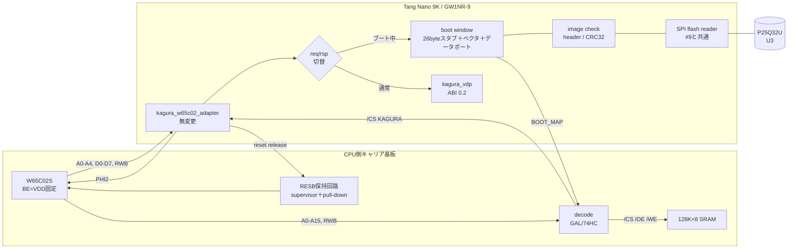

# ROM-less Boot 実現可能性調査

調査日: 2026-10-24。資源・STAの基準: `d501a1f`（P&R effort固定後。[タイミング仕様](timing.md)の「P&R effort固定」）。RTL・制約・CPUアダプタの内容は`443900a`以降変わっていない。**この文書は調査と設計案であり、RTL・ピン割当て・ABIは変更していない。** 実機試験・新しいP&Rは行っていない。

表記は次のとおり区別する。

| 表記 | 意味 |
|---|---|
| 【資料確認】 | メーカー資料・回路図を読んで確認した事実。実機で追試したものではない |
| 【RTL確認】 | このリポジトリのRTL・制約・スクリプトを読んで確認した事実 |
| 【実測】 | リポジトリに記録済みの測定結果（出典を併記）。今回の新規測定ではない |
| 【算定】 | 明示した仮定からの計算 |
| 【推測】 | 根拠はあるが資料で確認していない見込み |
| 【未検証】 | 実機・P&R・simulationでの確認が必要な事項 |
| 【設計】 | この文書での提案 |

## 1. エグゼクティブサマリー

**判定: 推奨案Dについて Conditional Go。FPGAがSRAMバスを奪う方式（案A〜C）は No-Go。**

- 当初想定した「FPGAがBEでCPUを切り離し、SRAMへ直接書き込む」方式は、Tang Nano 9Kでは割に合わない。16bitアドレスの供給にはヘッダの空き3.3Vピン11本では足りない（BEを含めて12本必要）か、外付けラッチ・バッファが2〜4個必要になる。これでは外付けROM 1個を外す代わりに同数以上の部品が増え、さらにバスの所有権切替という新しい競合リスクを抱える。**ハードウェアは簡素にならない。**
- 推奨は**案D「32byte窓ブート」**。ブート中だけ外部decodeが`$FFE0–$FFFF`の**読出し**をKAGURAの既存32byte窓へ割り当てる。FPGAはそこに26byteのブートスタブ（6502コード）とリセットベクタを返し、スタブはSPI Flashの内容を1byteずつ読み出すデータポートを読んで、**CPU自身が**SRAMへ書き込む。完了するとFPGAが割当てを解除する。
  - 既存のCPUアダプタ（A0〜A4、/CS、RWB、D0〜D7）をそのまま使える。FPGAの追加ピンは1本（`BOOT_MAP`）とオンボードFlashの4本（ヘッダ外）だけ。
  - バスの所有権は常にCPUにある。BE・アドレス駆動・RWB駆動はどれも不要で、FPGAがデータバスを駆動するのは通常動作と同じ「選択された読出しサイクルだけ」になる。
  - BSRAMは使わない（ストリーム転送）。追加量は【推測】Logic 250〜350、FF 200〜250程度。
  - 32KiBの転送は【算定】約0.15秒。
- ROMを外すことによる簡素化の中身は、**ROM 1個と、ROM書込み器を使う書換え手順がなくなること**。6502プログラムはFPGAと同じUSBケーブルで、基板上のFlashへ書ける見込みである。decode回路の規模はROM方式とほぼ同じで、`BOOT_MAP`入力が1本増え、ROM選択の項が消える。
- Goの条件は次の5つ。
  1. MSPI兼用ピン59〜62を通常I/Oとして使い、ユーザーロジックからJEDEC IDと固定データを読めることを実機で確認する
  2. 外部Flashの固定オフセットへの書込みと、その照合の手順を確立する（programmerの「Verify」表示を照合の根拠にしない）
  3. ブート版構成のP&Rが WNS≥+0.10ns（後続拡張の開発中の下限。目標+0.20ns）・BSRAM増加0 になり、既存11構成は無変更のままであること
  4. スタブの全バスサイクル（ダミー読出しを含む）を、W65C02Sのサイクル表に従うモデルで検証する
  5. M4のCPU外部回路（decode・reset保持）を、最初から`BOOT_MAP`込みで設計する

## 2. 現行KAGURA-9との整合性

### 2.1 資源とSTA（現行値）

【実測】`d501a1f`、Gowin Education V1.9.11.03、GW1NR-LV9QN88PC6/I5、`place_option 1`・`route_option 1`（全構成の既定値）。全11構成でsetup/hold違反endpoint 0、TNS 0（[検証状況](validation-status.md)、[タイミング仕様](timing.md)の「P&R effort固定」）。最悪経路は`reports/d501a1f/`（Git管理外）のSTAレポートの1行目。デバイス総量はLUT4 8640、FF 6480、BSRAM 26（[資源予算](resource-budget.md)）。

| 構成 | Logic | Register | BSRAM | 最小setup slack | 最悪経路 |
|---|---:|---:|---:|---:|---|
| phase2（W65C02S, 480p） | 4329 | 3235 | 24/26 | +2.079ns | registers `q_addr` → 音源`capture_pending` |
| phase2720（W65C02S, 720p） | 4351 | 3236 | 24/26 | +0.377ns | packet_assembler counter → parity（pixel74、上流hdl-util） |
| spi / spi720 | 4405 / 4468 | 3268 / 3269 | 24/26 | +1.608 / +0.630ns | pattern RAM → sprite `visible_q` / packet_assembler |
| qspi / qspi720 | 4399 / 4450 | 3270 / 3271 | 24/26 | +0.142 / +0.192ns | `q_addr` → `capture_pending` / packet_assembler |
| demo / demo720 | 6268 / 6253 | 3624 / 3625 | 25/26 | +0.634 / +0.130ns | audio_synth state → sum / sequencer counter |

- 論理資源の余裕は大きい（phase2はLogicの約50%）。一方でBSRAMの空きは2個しかない。
- ブート版の元になるphase2/phase2720の余裕は+2.079/+0.377nsある。しかし全構成の最小値は+0.130ns（demo720）で、qspiも+0.142nsしかない。後続拡張の受入れは**全構成WNS≥+0.10nsが開発中の下限、+0.20nsが目標**である（[タイミング仕様](timing.md)）。
- この余裕は、RTLを直したのではなく配置配線の探索を改善して得たもので、機能を追加した後も同じ余裕が残る保証はない（同上）。#5の追加実験（`443900a`の時期）では、配置の揺れが±0.2〜0.4nsあった（[#5の記録](https://github.com/siska-tech/kagura/issues/5#issuecomment-6380014196)）。**制約になるのは資源量ではなく配置の揺れ**である。
- 720pではOSER10 RESETの経路をSTAから除外している（[タイミング仕様](timing.md)）。

### 2.2 GPIO

【RTL確認】`phase2-cpu.cst`と[pin-inventory.csv](../boards/tang-nano-9k/pin-inventory.csv)より。

| 区分 | package pin |
|---|---|
| CPUバスで使用（18本） | D0–D7: 28,29,30,33,34,40,35,41 / A0–A4: 31,32,36,37,38 / /CS 42 / RWB 48 / PHI2 25 / reset release 27 / /IRQ 39 |
| 共通で使用 | clk27 52、reset_n 4（S2、1.8V）、TMDS 68–75、LED 10,11,13–16（1.8V） |
| ヘッダ上の未使用3.3Vピン（**11本**） | 26（RDY候補）、49、51、53、54、55、56、57、63、76、77 |
| うちコンフィギュレーション兼用 | 53 DOUT/WE_N、54 DIN/CLKHOLD_N、55 SSPI_CS_N、56 SO、57 FASTRD_N（MSPI系） |
| ヘッダ外（基板上Flash U3） | 60 CS#、59 SCLK、61 SI/IO0、62 SO/IO1 |
| 使用禁止 | 1.8VのJ6-2〜9（79–86）、TMDSが出ているJ5-23/24・J6-12〜17 |

SPI/QSPI版（`host.cst`）は26をBUSY、27をREADYとして使う。ただしbitstream単位で選ぶ構成なので（[ホスト仕様](host-interface.md)）、W65C02S版のピン追加はSPI/QSPI版と競合しない。

### 2.3 CPUバス・クロック・リセット・IRQ

【RTL確認】`rtl/bus/kagura_w65c02_adapter.sv`、`boards/tang-nano-9k/kagura_phase2_top.sv`。

- **PHI2はFPGAが生成する**。system 54MHzの16分周で3.375MHz、レジスタ出力。したがってFPGAが未設定の間、CPUにはクロックが入らない。
- CPUから受けるのは**A0〜A4、/CS、RWBだけ**。`$9F00–$9F1F`のdecodeは外部回路の役目で、その回路はまだ存在しない（[機材一覧](equipment.md)のU2は未調達）。**現行の配線ではFPGAは16bitアドレスを見ることも駆動することもできない。**
- 読出しはphase 6で要求を出し、phase 8から駆動し、phase 1でOEを解除する。応答の期限はphase 10。
- RESBは、外部ゲートを`cpu_reset_release`（pin 27、CSTでpull-down）で制御する。条件`ready`が成立した後、PHI2の立上りを8回数えてから、phase 2（PHI2 low）で解除する。`ready`が落ちると即座にassertする。
- /IRQはopen-drainで、phase 3（PHI2 low）に更新する。
- **CPUが選択されたアクセスを受け付けるのは`cpu_reset_release=1`の間だけ**（`sel_q <= !cpu_cs_n && cpu_reset_release`）。リセット中にバス上に何が現れても、要求にはならない。

### 2.4 FPGAの起動・初期化

【RTL確認】`release_ok = reset_n && pixel_lock && system_lock`。各domainの4段同期器を解除し、VRAM/line初期化（2048 cycles）と最初のline 0を終えてから、`ready`をCPUアダプタへ渡す。【資料確認】GW1NR-9は内蔵FlashからAUTO BOOTする（UG290 §7、MODE=000）。【実測】内蔵Flashへ書き込み、電源再投入で起動できている（[ビルドガイド](build-and-test.md)）。

### 2.5 流用できる回路

| 既存回路 | 流用先 |
|---|---|
| `kagura_w65c02_adapter` | **無変更で流用**。ブート中は応答先をブート用モジュールへ切り替えるだけ |
| CPU非依存の`req/rsp`契約（[アーキテクチャ](architecture.md)） | ブート用モジュールの接続面。読出しは2 system cycles以内に応答する |
| reset release / 8 PHI2パルス | そのまま使う。`ready`にブートイメージ検査の合格を加える |
| 計画中の#9 SPI Flashアセットローダ | Flash読出し部（SPIマスタ）を共通化できる |

### 2.6 文書とRTLの不一致・注意点

1. **PLL unlock時のCPU reset（[タイミング仕様](timing.md)「即assert」）**: 【RTL確認】`release_ok`から`system_release`へは非同期にassertされる。しかしCPUアダプタのresetは`always @(posedge clk)`内の**同期reset**で、`cpu_reset_release`と`cpu_data_oe`をclockのedgeで0にする。PLLのunlock中にsystem clockが止まると、RESBは解除されたまま、PHI2は止まったままになり得る。CPUは静的設計なので停止するだけで、通常は危険ではない。ただし文書の「即assert」とは一致しない。【未検証】GW1NRのrPLLがunlock中もCLKOUTを出し続けるか。これはブート機能とは独立した既存の課題であり、M4で外部reset保持回路の設計と併せて扱う。
2. **CPUのメモリマップが未定義**: `$9F00`はSDKの既定値（`KAGURA_IO_BASE`で変更可）で、ROM/RAM配置は未定義（[software/w65c02](../software/w65c02/README.md)）。ROM-lessにするかどうかでM4の外部回路が変わるので、本件はM4の回路確定より前に決める必要がある。
3. [ボード資料](../boards/tang-nano-9k/README.md)はFlashのピンを「BL702/JTAG/Flash/MODE/DONEは転用しない」としている。一方[ロードマップ](implementation-roadmap.md)の#9はFlashのユーザー利用を予定している。これは矛盾ではない（転用しない＝CPUバスには使わない、という意味）が、Flashをユーザーロジックで使う場合はボード資料の記述を更新する必要がある。

## 3. ハードウェア制約と根拠

### 3.1 W65C02S（WDC W65C02Sデータシート 2022-04-08版）

| 項目 | 内容 | 区分 |
|---|---|---|
| BE | §3.2: BE=lowでAddress・Data・RWBのバッファがHi-Z。非同期信号。MLB・SYNC・VPBは対象外 | 【資料確認】 |
| RESB | §3.11: VDD安定後、少なくとも2 clock cyclesはlowに保つ。立上りを検出すると7 cyclesのリセットシーケンスを実行し、`$FFFC`（low）と`$FFFD`（high）からPCを読み込む。DとIはhardwareで初期化（D=0、I=1） | 【資料確認】 |
| RESB中のバス | §3.11にHi-Zの記述はなく、Hi-Zにする手段はBEだけ（§3.1/§3.2）。**RESB=lowでもA/RWBは駆動され続けると見なす** | 【資料確認】（Hi-Zでないことの直接記述はない） |
| PHI2 | §3.8: 完全静的設計で、PHI2はhigh・lowのどちらでも停止できる。表6-3注3: 最大cycle timeは無制限 | 【資料確認】 |
| 未使用入力 | 表7-1: 未使用の入力専用ピンとRDYはVDDへ接続する。RDYは最新のTSMC版では内部pull-upがない | 【資料確認】 |
| ページ跨ぎのダミー読出し | 表7-1: W65C02Sは「直前の命令byteを余分に読む」（NMOSは無効アドレスを読む） | 【資料確認】 |
| BRK | 2byte命令で、署名byteを読み飛ばす（表5注5） | 【資料確認】（署名byteのバスサイクルが発生するかは表5-7で要確認。発生する前提で設計する） |
| AC特性 | 3.3V列: tCYC≥125ns、PHI2 high/low≥62/63ns 等（既存の[タイミング仕様](timing.md)と同じ） | 【資料確認】 |

### 3.2 GW1NR-9のコンフィギュレーションとピン

| 項目 | 内容 | 区分 |
|---|---|---|
| 起動元 | UG290-2.8.1E 表5-1: MODE=000でAUTO BOOT（内蔵Flash）、101でMSPI（外部Flash）。注1: ボンディングされていないMODEピンは既定でGND | 【資料確認】 |
| Tang Nano 9Kの起動 | 内蔵Flash（`--run 6`）への書込みと電源再投入で起動している。pin-inventoryにMODEピンは出ていない | 【実測】。QN88でMODEがボンディングされていないことは【未検証】（UG114 pinoutで確認） |
| MSPIピンの再利用 | UG290 表4-2: 「MSPI PORT: Set as GPIO → FASTRD_N, MCLK, MCS_N, MO, MI are used as GPIO after configuration」。設定前は兼用ピンとして振る舞う | 【資料確認】 |
| 設定方法 | SUG100-4.4.2E: `set_option -use_mspi_as_gpio 1`（GUIでは「Use MSPI as regular IO」）。既定は0 | 【資料確認】。Gowin IDEの`multipurposeconfig.xml`にも同じ選択肢がある |
| 専用primitive | 通常I/Oとして使う範囲では不要の見込み（資料にMSPIユーザーアクセス用のprimitiveの記述は見当たらない） | 【推測】。P&Rで確認する |
| 設定前・設定中のI/O | GW1Nのユーザーピンの設定前の状態（weak pull-up等）は今回の資料で確認していない | 【未検証】。外付け抵抗で状態を決め、実測する |

### 3.3 Tang Nano 9K のSPI Flash（U3）

【資料確認】3674版回路図（[pin-inventory.csv](../boards/tang-nano-9k/pin-inventory.csv)のU3行）: PUYA P25Q32U、CS#=60（IOR12A_MCS）、SCLK=59（IOR12B_MCLK）、SI/IO0=61（IOR11B_MOSI）、SO/IO1=62（IOR11A_MISO）。Bank 1、3.3V。WP#/IO2とRESET#/IO3はFPGAに配線されず、4.7kΩで3.3Vへpull-upされている。SCLKのpull-down R3は未実装（NC）。

- 依頼文の表（CS 60 / SCLK 59 / MOSI 61 / MISO 62）は回路図の照合結果と一致する。
- ピン名はGowinのMSPI機能名（MCS_N、MCLK、MO、MI）と一致する。**このFlashはGW1NRのMSPI端子につながっている**。ただしTang Nano 9KはAUTO BOOTで起動するので、通常の電源投入時にFPGAがこのFlashを読むことはない【推測】（MODEピンの扱いに依存。§3.2）。
- IO2/IO3がFPGAにつながっていないので、QSPIは使えない。単線SPIか、dual output readに限られる（[ロードマップ](implementation-roadmap.md)の#9と同じ結論）。
- 【未検証】P25Q32Uのデータシートは今回入手できなかった（検索では同系統のP25Q32H/L/SHの資料しか見つからない）。JEDEC ID（PUYAのmanufacturer IDは0x85と見込まれる【推測】）、読出しコマンド`03h`の最大周波数、4KB sector erase（`20h`）、電源投入後のコマンド受付までの時間は、データシートと実機の読出しで確認する。

## 4. SPI Flashアクセスの実現可能性

| 論点 | 評価 |
|---|---|
| コンフィギュレーション用Flashか | **使われていない見込み**。起動はAUTO BOOT（内蔵Flash）であり、外部Flashは空き領域として扱える【実測+推測】 |
| 設定後のユーザーロジックからのアクセス | `-use_mspi_as_gpio 1`で59〜62を通常I/Oにできる【資料確認】。実際に読めるかは【未検証】（Stage 1） |
| 読出しプロトコル | `03h` READ＋24bitアドレスで連続読出し。CS#をlowにしたままSCLKを止めても続きから読める（SPI NOR共通の挙動【推測】）。SCLKはsystem 54MHzから作るFSM出力（例: /8で6.75MHz）とし、新しいclock domainを作らない |
| bitstreamとの共存 | 内蔵Flashへの書込み（`--run 5/6`）は外部Flashを書かない【資料確認: SUG502のembFlash操作とexFlash操作は別】。ただし外部Flash向けの操作（`--run 8/9/31/32/36〜39`）を誤って使えば、既定アドレスの領域を消去・上書きする |
| 消去・書込み・照合 | programmer_cliにexFlash操作（8/9: Erase,Program(,Verify)、11: Verify、31/32: C Bin、36〜39: GAO-Bridge経由、51: Detect ID）と`--spiaddr`がある【資料確認: SUG502 表4-3、`programmer_cli --help`】。Tang Nano 9K（BL702経由）での動作、任意のbinaryを書けるか、消去範囲が書込み範囲だけか、は【未検証】 |
| 固定オフセット配置 | 【設計】ブートイメージは`0x100000`に置く。`0x000000〜0x0FFFFF`は既定アドレス0への誤書込みとMSPI用途に備えて空けておき、アセット（#9）は`0x110000`以降とする。4KB sectorの境界に揃える |
| マルチイメージ | 外部FlashのMSPI/DUAL BOOTは使わない（Tang Nano 9KのMODE設定に依存するため）。複数のブートイメージを持つ必要はない |
| セキュリティ設定 | ビルドは`-bit_security 0`（readback許可）【RTL確認: build-nano9k.tcl】。外部Flashのユーザーデータには影響しない。programmerの「Set Flash QE」（`--run 75`）は使わない。QEを変更すると、IO2/IO3がpull-up固定の基板で予期しない動作になり得る【推測】 |
| 既知の不具合 | 内蔵Flashの書込みで`Verify Failed at 0`が未解決（[検証状況](validation-status.md)）。外部Flashでも、programmerの表示ではなく**FPGA側で計算したCRCの一致**を照合の根拠にする |

**判断**: 「基板上にFlashがある」ことは確認済みだが、「ユーザーRTLから安全に読める」ことと「その内容を手順として書き換えられる」ことは未検証。どちらもStage 1の合格をGoの前提とする。

## 5. W65C02Sの安全なバス制御

### 5.1 基本方針

RESB=lowはバスの解放ではない（§3.1）。BEでバスを奪う方式は、CPUのドライバ・FPGA（または外付けバッファ）・SRAMの3者の出力許可を、非同期のBEで切り替えることになる（BE→Hi-Zの時間はデータシートで「試験不能」とされている。表6-3注1）。

**推奨案Dでは、バスの所有権を一度も移さない。** BEはVDDへ固定し（未使用入力はVDDへ接続、表7-1）、アドレス・RWB・書込みデータは常にCPUが駆動する。FPGAがデータバスを駆動するのは、通常動作と同じく、decodeが選んだ読出しサイクルのphase 8〜phase 1だけである。

### 5.2 状態と信号（案D）

`BOOT_MAP`はFPGAの出力で、外付け抵抗でpull-down、active high。外部decodeは次の論理とする（§7.2）。

- `BOOT_MAP=1`のとき: `$FFE0–$FFFF`の**読出し**はKAGURAを選択し、SRAMは非選択にする。`$9F00`窓は無効。書込みは全域SRAMへ行く
- `BOOT_MAP=0`のとき: 通常のmap（`$9F00–$9F1F`がKAGURA、それ以外はSRAM）

| 状態 | RESB | BE | PHI2 | BOOT_MAP | SRAM /CS・/OE・/WE | FPGAのデータ出力 | 遷移条件 |
|---|---|---|---|---|---|---|---|
| POWER_OFF / FPGA_UNCONFIGURED | low（外部pull-down＋supervisor） | high固定 | 停止（外付けpull-downでlow） | 0（pull-down） | decode次第。PHI2がlowなので/OE・/WEは非活性 | Hi-Z（未設定） | FPGAの設定完了 |
| FPGA_INIT | low | high | 開始（アダプタはreset解除後に常時生成） | 1 | CPUがリセット中なので、選択されてもCPUは書かない。読出しの/OEは活性化し得る | off（`cpu_reset_release=0`の間は要求を出さない） | `release_ok`、VDP/line初期化完了 |
| CPU_HELD＋FLASH_READ（検査） | low | high | 動作 | 1 | 同上 | off | JEDEC ID、ヘッダ、ペイロードCRCの検査完了 |
| BOOT_ERROR | low（保持） | high | 動作 | 1 | 同上 | off | reset_n（S2）またはPLL再lockでFPGA_INITへ戻る |
| CPU_START | 8 PHI2の後にhigh | high | 動作 | 1 | `$FFE0–$FFFF`の読出しはSRAM非選択 | `$FFFC/D`の読出しにだけ応答 | ベクタ`$FFE0`を読み終えた |
| SRAM_WRITE（CPUがコピー） | high | high | 動作 | 1 | CPUの書込みサイクルで/WEが活性化 | 窓内の読出しにだけ応答（スタブ・データポート） | 全ページの転送が完了 |
| VERIFY | — | — | — | — | — | — | 案Dでは転送前のCRC検査だけ（§9.4） |
| BUS_ACQUIRE / BUS_RELEASE | — | — | — | — | — | — | **案Dには存在しない**（所有権を移さない） |
| NORMAL_OPERATION | high | high | 動作 | 0 | 通常のmap | `$9F00`窓の読出しだけ（ABI 0.2） | `$FFFF`（BRKベクタhigh）の読出しの後、次のPHI2 lowで`BOOT_MAP`を0にする |

### 5.3 異常系

| 事象 | 動作 |
|---|---|
| 電源投入 | RESBは外部回路でlow、PHI2はpull-downでlow、FPGAはHi-Z。SRAMの内容は不定でよい（毎回ロードし直す） |
| FPGAの再構成（JTAG書込み等） | FPGAのピンが設定前の状態に戻り、`cpu_reset_release`の外部pull-downでRESBがlowになる。PHI2は止まる。再構成後は電源投入と同じ手順になる。【未検証】設定中のピンの状態（§3.2） |
| PLL unlock | `ready`が落ちて、RESB assert・BOOT_MAP=1に戻り、ロック回復後に最初からブートする。§2.6の同期resetの課題が残る |
| Flash読出しの失敗（IDが0x00/0xFFなど） | BOOT_ERROR。RESBはlowのまま保持し、LEDでエラーコードを示す。HDMIは黒画面のまま動作を続ける |
| ヘッダ・CRCの不一致 | BOOT_ERROR。**CPUは一度も実行させない**（不正なイメージを実行しない） |
| CPU再起動 | reset_n（S2）でFPGA全体をresetし、最初からブートする。CPU側に独立したリセットボタンは設けない（設けるとBOOT_MAP=0のままリセットが解除され、SRAM上のベクタで温起動してしまう） |
| NMI | ブート中はNMIBをpull-upで非活性に保つ。ブート中にNMIが入ると、`$FFFA`（データポート）をベクタとして読んでしまう |
| IRQ | リセット後はI=1でマスクされる。VDPのIRQ_ENABLEのreset値は0（[レジスタABI](register-map.md)） |

## 6. SRAMアクセス方式の比較

前提: CPU側のSRAMは、64KiB空間の全体（I/O窓を除く）を覆う128K×8品（A16は固定）とする【設計】。ROMを外す以上、`$FFFA–$FFFF`のベクタもRAMに置く必要がある。

| 観点 | 案A: FPGAが直接駆動 | 案B: ラッチ（74HC573×2） | 案C: シフトレジスタ（74HC595×2） | **案D: 32byte窓ブート** |
|---|---|---|---|---|
| 方式 | BE=lowでFPGAがA0–A15/D/RWBを駆動 | FPGAがDバスで上位・下位アドレスをラッチへ送り、ラッチ出力をアドレスバスへ出す | FPGAが直列にアドレスを送り、595の3-state出力をアドレスバスへ出す | CPUがスタブを実行し、データポートからSRAMへコピーする |
| 追加GPIO | A5–A15で11本＋BE 1本＝**12本（空き11本を超える）**。A0–A4とRWBは双方向化（CST変更） | LE×2、ラッチOE、BEで3〜4本。RWBとD/A0–A4は双方向化 | SER、SRCLK、RCLK、OE、BEで4〜5本 | **BOOT_MAPの1本**（＋ヘッダ外のFlash 4本） |
| 外付け部品 | 0（ピンが足りない） | ラッチ2個＋ゲート1個程度 | 595×2個＋ゲート | 0（decodeの入力が1本増えるだけ） |
| 電気的な制御 | BE、FPGAのアドレス出力、SRAM /OEの3者が排他になるよう保証する必要がある | BEとラッチOEの切替が重なる時間を考える必要がある | 案Bと同じ | 通常動作と同じ読出しタイミングだけ |
| RTL資源【推測】 | 約250 LUT | 約300 LUT | 約300 LUT | 約250〜350 LUT |
| 書込み性能【算定】 | 約1MB/s以上 | 約1MB/s | 約0.3〜0.5MB/s | **約225KB/s**（15 CPU cycles/byte） |
| 競合・誤書込みのリスク | 高（BEの非同期切替。FPGAの出力がCPUアドレスバスにつながる） | 中〜高 | 中〜高 | **低**（所有権は常にCPU。誤書込みは毎回のロードで消える） |
| 製作難易度 | 不可（ピン不足。1.8Vピンを使うにはレベル変換が必要） | 中 | 中 | 低 |
| 通常動作への影響 | アドレス出力ドライバがバス負荷とリークになる | ラッチ出力がバス負荷になる | 同左 | なし（decodeの1項だけ） |
| 実機検証の難易度 | 高 | 高 | 高 | 中（スタブのサイクルをオシロ2chで追う） |
| ROMを外すことによる簡素化 | **なし**（実装できない） | **なし**（ROM 1個がIC 2〜3個に置き換わるだけ） | **なし** | **あり**（ROM 1個と書込み器を使う工程が消える） |

補足:

- 「アドレス上位をpull-upで固定し、狭い窓だけをFPGAが書く」変形（案A'）にすればピン数は減る。しかしBEによる所有権の切替は残り、利点は案Dに及ばない。
- 案A〜Cは、FPGAが書込み時に**RWBを駆動する**必要がある。RWBは現在、FPGAの入力ピン（pin 48、pull-up）である。CPU版のCSTの変更が避けられない。
- 74HC590等の3-stateカウンタでアドレスを生成する案も、BEの扱いと部品増は案B/Cと変わらない。

## 7. 推奨アーキテクチャ

### 7.1 ブロック図



### 7.2 外部decode（案）

【設計】`SEL_FFE0 = (A15..A5 == 11111111111)`、`SEL_9F00 = (A15..A5 == 10011111000)`。

```text
KAGURA_SEL  = BOOT_MAP ? (SEL_FFE0 & RWB) : SEL_9F00
KAGURA_CS_N = !KAGURA_SEL
SRAM_CS_N   = KAGURA_SEL            // KAGURA選択時は必ずSRAM非選択
SRAM_OE_N   = !( PHI2 & RWB )
SRAM_WE_N   = !( PHI2 & !RWB )
```

- KAGURAとSRAMの読出しが**同じ式の否定**になるので、両者が同時にデータバスを駆動しない。これをPLDの1つの式として実装し、ゲートを分けた場合の遅延差を作らない。
- SRAMの出力はPHI2 highの間だけ。FPGAの出力はphase 8〜phase 1（PHI2 falling後の18.5nsまで）。`BOOT_MAP`はphase 2で変わるので、どちらの出力区間とも重ならない。
- 入力はA5–A15、RWB、PHI2、BOOT_MAPの14本、出力は4本。ATF22V10級のPLD 1個に収まる【推測】。ROM方式でも`$9F00`の11bit decodeとROM/RAMの選択は必要なので、decodeの規模はほぼ同じ。
- 書込みは`BOOT_MAP`の値によらずSRAMへ行く（`$9F00`窓への書込みは、通常時だけKAGURA）。

### 7.3 FPGA内部の分離

- `rtl/boot/`（新設予定）: CPUに依存しないSPI Flash readerとimage checkをここに置く。#9のアセットローダと共用する。
- 6502固有のスタブを返すboot windowは`req/rsp`の接続面に置く。CPUアダプタとVDPはどちらも変更しない。
- board top: 新しいビルド構成（例: `phase2boot`/`phase2boot720`）として追加する。既存のphase2/spi/qspi/demoの11構成は**ソース・CST・SDCとも変更しない**。`-use_mspi_as_gpio 1`とFlash・BOOT_MAPのCST断片はこの構成だけに入れる。
- ABI: 通常動作（`BOOT_MAP=0`）でのレジスタ窓はABI 0.2のまま。ブートの状態をレジスタで公開するのは将来の別ABIとし、初版ではLEDだけで示す。

## 8. 推奨ブートシーケンス

1. 電源投入。RESBはlow（外部回路）、PHI2はlow（pull-down）、BOOT_MAPは0（pull-down）。FPGAは内蔵FlashからAUTO BOOTする。
2. 設定完了。PLLがlockし、各domainのresetが解除される。PHI2が出始め、BOOT_MAPを1にする。`cpu_reset_release`は0のまま。
3. Flash readerがFlashを起こし（`ABh`。必要なら`66h/99h` reset）、JEDEC IDを読む。
4. `0x100000`から32byteのヘッダを読み、検査する（§9）。
5. ペイロード全体を読み、CRC32を計算する。この間、Flashのデータはどこにも保存しない。
6. VDPの初期化完了・line 0の準備・CRC合格がそろったら`ready=1`にする。アダプタがPHI2を8周期出してから、phase 2でRESBを解除する。
7. CPUがリセットシーケンスの最後に`$FFFC/$FFFD`を読む。KAGURAが`$E0,$FF`を返す。**ベクタのhigh byteを読むまでは、データポートを読んでも内容を消費しない**（リセットシーケンス中の不定アドレスへのダミー読出し対策）。
8. スタブが`$FFFA`（データポート）から転送先のページ番号とページ数を読み、ページ単位でSRAMへコピーする。Flash readerはポートが読まれるたびに次のbyteを先読みする（8 SCLKで約1.2µs。次の読出しまでは4.4µs以上ある）。
9. 全byteを渡した後のポート読出しは0を返し、何も消費しない（BRKの署名byteの読出しに対応）。スタブは`BRK`を実行し、`$FFFE/$FFFF`のベクタとしてKAGURAがentry addressを返す。
10. `$FFFF`を読んだ後の最初のPHI2 low（phase 2）で`BOOT_MAP=0`にし、`req/rsp`の接続先をVDPへ切り替える。CPUはentryから実行を始める（このときI=1、D=0。SPはBRKで3つ減っている）。
11. 以後はKAGURA-9が通常のVDP・6ch音源として動く。

### 8.1 ブートスタブ（26byte＋ベクタ）

【設計】`$FFE0–$FFFF`の内容。KAGURAの窓のoffset `$00–$1F`に対応する。

```text
FFE0  64 00      STZ $00        ; 転送先ポインタ low = 0
FFE2  AD FA FF   LDA $FFFA      ; ポート: 転送先ページ
FFE5  85 01      STA $01
FFE7  AE FA FF   LDX $FFFA      ; ポート: ページ数（1以上）
FFEA  A0 00      LDY #$00
FFEC  AD FA FF   LDA $FFFA      ; ポート: データ
FFEF  91 00      STA ($00),Y
FFF1  C8         INY
FFF2  D0 F8      BNE $FFEC
FFF4  E6 01      INC $01
FFF6  CA         DEX
FFF7  D0 F3      BNE $FFEC
FFF9  00         BRK            ; $FFFE/$FFFF → entry
FFFA  (port)     データポート（NMIベクタの位置。ブート中のNMIは禁止）
FFFB  00
FFFC  E0 FF      RESETベクタ → $FFE0
FFFE  (entry)    BRKベクタ。KAGURAがヘッダのentry_addrを返す
```

- 【算定】1byteあたり LDA abs 4＋STA (zp),Y 6＋INY 2＋BNE 3 = 15 cycles。1ページで約3850 cycles、約1.14ms。最大157ページ（40,192B）でも約0.18秒。
- ダミー読出しの扱い。表7-1によれば、W65C02Sのダミー読出しは「直前の命令byte」を読むので、スタブのコード領域に当たり、副作用はない。仮にNMOSと同じく「桁上げ前のアドレス」を読む場合でも、転送先と同じページになるので、ロード範囲から`$FF`ページを除けばポートには当たらない（§9.3）。
- 使うRAMは`$0000–$0001`とスタックの3byte（`$01xx`）だけ。ロード範囲はここを避ける。
- スタブはca65のソースから生成し、RTLの定数とバイト列が一致することを検査する（`tools/test-headers.sh`と同様。CIではca65を導入済み）。

## 9. ブートイメージ形式案

### 9.1 ヘッダ（32byte、little endian）

依頼文の構造体（16byte）は、C言語の自然なアラインメントでもpaddingが入らない。ただしコンパイラやABIに依存しないよう、**byte offsetで定義**し、版・ヘッダ長・予約・ヘッダCRCを加える。

| offset | 型 | 名前 | 規則 |
|---:|---|---|---|
| 0 | u8[4] | magic | `"K9BT"`（0x4B 0x39 0x42 0x54） |
| 4 | u8 | format_version | 1 |
| 5 | u8 | header_size | 32。これ以外は拒否 |
| 6 | u8 | flags | 0（予約。0以外は拒否） |
| 7 | u8 | segment_count | 1（v1は1のみ） |
| 8 | u16 | load_addr | 下位byte=0（ページ境界） |
| 10 | u16 | entry_addr | `load_addr ≤ entry < load_addr+length` |
| 12 | u32 | length | 256の倍数、256以上 |
| 16 | u32 | payload_crc32 | offset 32からのlength byteについて計算 |
| 20 | u8[8] | reserved | すべて0。0以外は拒否 |
| 28 | u32 | header_crc32 | offset 0〜27について計算 |

- CRC: CRC-32/ISO-HDLC（反射多項式0xEDB88320、init 0xFFFFFFFF、xorout 0xFFFFFFFF。zlibの`crc32`と同じ）。FPGAではbit直列で計算する（FF 32個、LUT数十個【推測】）。
- 配置: Flashの`0x100000`にヘッダ、`0x100020`からペイロード。
- `u32 length`は将来の拡張のための幅で、v1では最大`0x9D00`に制限する。

### 9.2 メモリマップ（案）

| CPU address | 用途 |
|---|---|
| `$0000–$01FF` | zero page・stack。スタブが`$00/$01`とstackを使うので、ロード対象外 |
| `$0200–$9EFF` | SRAM。ロード範囲Lo（`$02`〜`$9E`の最大157ページ、40,192B。§9.1の`length`上限`0x9D00`と同じ） |
| `$9F00–$9F1F` | KAGURA窓（通常時）。SRAMは隠れる |
| `$9F20–$9FFF` | SRAM。ただしv1ではロード対象外（ページ単位で扱うため） |
| `$A000–$FEFF` | SRAM。ロード範囲Hi（最大95ページ） |
| `$FF00–$FFFF` | SRAM。ベクタはアプリケーションの初期化コード（crt0）が書く。v1ではロード対象外 |

- 「物理的に書けても読めない」問題の確認: `$9F00–$9F1F`のSRAMは通常のdecodeで常に隠れるので、ロード範囲から除外する。`$FFE0–$FFFF`はブート中だけ読出しが隠れるが、書込みはSRAMへ届き、`BOOT_MAP=0`の後は読める。v1では`$FF`ページ自体をロード対象外にする（§8.1のダミー読出し対策を保守的に取る）。
- 1つのsegmentは`$9F`ページを跨げない。両方の範囲を使うプログラムや`$FF`ページの初期値が必要な場合は、v2のLoader Boot（§9.5）で扱う。
- アプリケーションのcrt0の必須処理: `LDX #$FF / TXS`、`$FFFA–$FFFF`へのベクタ書込み、`CLI`の前にKAGURAの`STATUS.INIT_DONE`を確認。

### 9.3 FPGAでの検査

magic・version・header_size・flags・segment_count・reserved・header_crc32、`load_addr`のページ境界、長さが256の倍数、範囲がLoかHiの一方に完全に収まること、entryが範囲内であること、payload_crc32。**1つでも外れればBOOT_ERRORで、CPUを起動しない。**

### 9.4 CRC不一致・再起動時の扱い

- CRC検査は転送の前に、Flashの1回目の読出しで行う。転送（2回目の読出し）中のFlash読出しの誤りは検出できない。SRAMへの書込みを照合（読戻し）する機能は、26byteのスタブには入らない。
- 必要なら、アプリケーションのcrt0がペイロードのCRCを自分で再計算できる。そのためヘッダを`$0200`へ置く形式も将来の選択肢とする。
- 再起動時はSRAMの内容を信用せず、必ずロードし直す。

### 9.5 Direct Boot と Loader Boot

| 方式 | 内容 | 評価 |
|---|---|---|
| Direct Boot（v1） | 上記のとおり。Flashのイメージを直接SRAMへ転送して起動 | 初版の基本とする |
| Loader Boot（v2候補） | Direct Bootで小さなローダー（例: `$0200`へ1ページ）を起動する。ローダーは同じデータポート（`BOOT_MAP=1`の間は有効）から複数segmentを読み、読戻し照合とCRCを行い、最後に`JMP ($FFFE)`で通常モードへ移る | FPGAの変更なしで実現できる（ペイロードの解釈がCPU側に移るだけ）。UARTからの受信は、ローダーが別のI/Oを使う拡張になる。KAGURAには載せない |

## 10. FPGA資源・STAへの影響

### 10.1 構成方式の比較

| 観点 | 1: 単一bitstreamに統合（推奨） | 2: 単一bitstreamで資源を共有 | 3: ブート用と通常用のbitstreamを分けて再構成 |
|---|---|---|---|
| LUT/FF | 【推測】+250〜350 / +200〜250 | 共有用のmuxが増え、削減分を相殺する | 通常用は±0。ブート用は小さい |
| BSRAM | 0 | 0 | 0 |
| GPIO | +1（BOOT_MAP）＋Flash 4 | 同左 | 同左。再構成中はピンが不定 |
| PLL | 共用（追加なし） | 同左 | ブート用も2個を使うか、別構成 |
| 配置配線・Critical Path | 既存の経路とは論理的に独立。配置の揺れが主なリスク | VDP内部の資源と共有すると、高fanoutのBSRAM周辺へmuxが入る。**現在の最悪経路を悪化させる** | 通常用は無変化 |
| 起動時間 | +約0.2秒 | 同左 | 再構成（AUTO BOOT約数十〜数百ms【資料確認: UG290 §3.4の表から推測】）が2回 |
| 構成の複雑さ | 小 | 大 | 大。内蔵Flashの2つ目の領域（`embFlash 2nd`）の使い方、再構成の起点（RECONFIG_N）、設定中のCPUピンの扱いがすべて未確認 |
| 安全性 | 高（ピンが常に定義済み） | 中 | **低**（再構成のたびにFPGAのピンが設定前の状態になり、CPUバスとHDMIが止まる） |
| デバッグ | 容易 | 難 | 難 |

- **同時に動かないからといってLUT/FFが減るわけではない**。案2で共有の候補になるのはVRAM消去のFSM程度で、得られる削減は数十LUTにとどまる【推測】。そのためにBSRAMのCE/ADへのfanoutを増やすと、#5で観測した最悪経路をさらに悪化させる。採用しない。
- 案3は資源の問題を解決するものだが、本件は資源が問題ではない（Logic約50%）。安全性が下がるので採用しない。

### 10.2 STAの見込みと対策

- 追加回路はsystem 54MHzだけで動き、新しいclockを作らない。SCLKはFSM出力のデータ信号として扱う。
- I/O制約: SCLK・CS#・MOSIはIOBのレジスタから出し、MISOはIOBのレジスタで受ける。SCLKのN cycle後にサンプルするので、multicycleとして**実際の位相関係を記述**する。数値を良くするためだけのfalse pathは使わない。BOOT_MAPは`cpu_reset_release`と同じくphase 2でしか変わらない出力なので、同じ扱いとする（既存のSDCでfalse path）。
- リスクは配置の揺れ。ブート版の元になるphase2/phase2720の余裕（`d501a1f`で+2.079/+0.377ns）は下限の+0.10nsに対して大きい。ただし720pは、上流のpacket_assembler（pixel74）が最悪経路であり、追加回路の配置がこの経路を押しのける可能性がある。Stage 4では、P&R option（`place_option 1`/`route_option 1`、既定値）を変えずに既存構成と比較する。+0.10nsを下回った場合は、[タイミング仕様](timing.md)の方針に従い、optionの再探索ではなく経路の短縮か機能の分離を先に検討する（追加回路のpipeline化、配置領域の制約、ブート構成を480pに限る、など）。それでも下限に届かなければ、No-Goとして再評価する。

## 11. 未解決のリスクと検証方法

| ID | リスク | 重要度 | 検証・終了条件 |
|---|---|---|---|
| B01 | MSPIピンを通常I/Oにしたユーザーロジックから、Flashを読めない | 高 | Stage 1: JEDEC IDと固定パターンの読出しが期待値と一致する |
| B02 | 外部Flashの任意オフセットへの書込み手順がない、または他の領域を消してしまう | 高 | Stage 1: programmer_cliの各操作で書いた後、別の領域に置いた番兵データが残ることをFPGA側のCRCで確認する。不可ならopenFPGALoader等の代替【未検証】か、自作の書込み用bitstreamを用意する |
| B03 | 設定前・設定中のFPGAピンの状態（pull-up等）で、RESB・PHI2・BOOT_MAPが意図と違う値になる | 高 | 外付け抵抗の値を決め、電源投入をオシロで反復確認する（RESB・PHI2の2ch） |
| B04 | スタブ実行中のダミー読出しがデータポートに当たる | 中 | Stage 2: W65C02Sのサイクル表に従うモデルで、ポートの読出し回数が`2＋ページ数×256`と一致することを検査する。Stage 5で実機の転送内容をCRCで確認する |
| B05 | decodeの切替でKAGURAとSRAMが同時に駆動する | 高 | PLDの式のレビュー、全アドレス×RWB×BOOT_MAPの真理値検査、オシロでのbus turnaround確認 |
| B06 | 配置の揺れでSTAが不合格 | 中 | Stage 4 |
| B07 | PLL unlock時に同期resetが効かない（§2.6、既存の課題） | 中 | rPLLの挙動を資料と実機で確認し、必要なら`cpu_reset_release`を非同期resetにする（別issue） |
| B08 | P25Q32Uの仕様（ID・周波数・電源投入後の待ち時間）が想定と違う | 低 | データシートの入手とStage 1 |
| B09 | 3.3Vで使えるSRAM・PLDの入手性 | 低 | M4の部品選定で確認する（候補: 128K×8の3.3V品、ATF22V10相当のPLD） |

## 12. 段階的なPoC計画

| Stage | 内容 | 機材 | 合格条件 | 証拠の種類 |
|---|---|---|---|---|
| 1 Flash読出し単体 | `use_mspi_as_gpio`の評価用top（demo派生、CPU不要）。JEDEC IDをLEDへ表示、`0x100000`の固定パターンのCRC一致をLEDへ表示。書込みはprogrammer_cliのexFlash操作で行う | 手持ちで可（B1） | IDと読出しCRCの一致を電源投入10回で確認。他の領域の番兵データが保持される | 実機 |
| 2 Boot Controller単体 | Flashモデル・decodeモデル・SRAMモデル・6502のサイクルモデル（スタブで使う命令とリセットシーケンス、データシートの表5-7に従う）でブート全体をsimulationする | — | 正常イメージで全byteが一致しentryへ到達する。不正なmagic/版/範囲/CRCはすべてCPUを起動しない。ポートの読出し回数が一致する。KAGURAとSRAMが同時に選択されない | simulation |
| 3 CPUバス制御 | 実CPUとSRAMの基板。最初はFlashを使わず、RTLに埋め込んだ固定イメージ（LED点滅程度）で起動する。RESB/PHI2/BOOT_MAPの順序をオシロで確認 | U1, U2, M1 | 電源投入20回、S2 reset 20回で起動する。FPGA再構成中にRESBがlowを保つ | 実機 |
| 4 Gowin合成・STA | `phase2boot`/`phase2boot720`を`run-baseline.ps1`へ追加し、`d501a1f`の既存11構成と比較する | — | WNS≥+0.10ns（目標+0.20ns）、TNS=0、BSRAMは増えない、未制約の同期経路0、既存11構成の結果が変わらない | P&R |
| 5 W65C02S実機 | Flashからのブート。KAGURAのID/ABI読出し、VRAM・sprite・6ch音源の更新、HDMIの映像・音声。不正なイメージや電源断の後の復帰 | U1, U2, M1, S1/S2 | M2相当の機能確認。不正なイメージでCPUが起動しない。転送の失敗から復帰する | 実機 |

simulationの合格（Stage 2）は実機での動作を保証しない。Stage 3・5を実施していない間は「ROM-lessブートは未検証」と記録する。Stage 1・2・4は、W65C02Sの機材がなくても今すぐ実施できる。

## 13. 既存ロードマップM4への統合案

- **M4の外部回路を設計する前に**、ROM方式かROM-lessかを決める。decodeが変わるので、両方を作ると回路と試験が二重になる。
- 統合順:
  1. Stage 1（#9のSPI Flash readerと共通）。M2・M3と並行し、CPU機材がなくても実施できる
  2. Stage 2・4。RTLを追加するが、既存構成は変更しない
  3. M4本体: reset保持・decode（BOOT_MAP込み）・Stage 3
  4. Stage 5をM4の完了条件「実CPUでM2相当の機能確認」と同時に行う
- 工数の目安（主担当1名、機材待ちを除く）: Stage 1で2〜3日、Stage 2で3〜4日、Stage 4で1〜2日、Stage 3・5はM4の作業に+2〜3日【推測】。
- M4の完了条件に加える項目: ブートイメージの書込み手順、不正なイメージの拒否、電源投入・reset反復でのブート成功。
- 初版（M5）でROM-lessを必須にするかどうかは、Stage 5の結果で決める。不合格の場合、M4はROM方式の回路へ戻せるようにしておく（decodeのPLDを書き換えるだけで済む構成にする）。

## 14. 判定

### Go / Conditional Go / No-Go

| 案 | 判定 | 理由 |
|---|---|---|
| **案D: 32byte窓ブート（単一bitstreamに統合）** | **Conditional Go** | 既存のピン・アダプタ・ABIを保ったまま、ROM 1個と書込み器の工程を省ける。バスの所有権を移さないので競合のリスクが最も小さい。BSRAM 0 |
| 案A: FPGAが直接制御 | No-Go | 必要なピン12本に対し、空きは11本。BE切替の競合リスク |
| 案B/C: ラッチ・シフトレジスタ | No-Go | 動作は可能だが、ROM 1個の代わりにIC 2〜3個とBE制御が増え、簡素化にならない |
| 構成2（資源共有）・構成3（bitstream分離） | No-Go | 資源は問題ではない。共有は最悪経路を悪化させ、分離は安全性を下げる |

### 採用条件（すべてを満たした場合にGoとする）

1. Stage 1: MSPIピン59〜62を通常I/Oとして使い、ユーザーロジックからJEDEC IDと固定データを読めることを実機で確認する
2. Stage 1: 外部Flashの`0x100000`への書込みと照合の手順を確立する（programmerの「Verify」表示ではなく、FPGA側のCRCで照合する）
3. Stage 2: 不正なイメージをすべて拒否し、ポートの読出し回数が一致し、KAGURAとSRAMが同時に駆動しないことをsimulationで確認する
4. Stage 4: ブート構成でWNS≥+0.10ns（目標+0.20ns）・BSRAM増加0、既存11構成は無変更
5. M4: CPU側の回路を最初から`BOOT_MAP`込みのdecodeとRESB保持回路で設計し、Stage 3・5を実施する

### 結論

KAGURA-9にブート機能は追加できる。ただし、**ハードウェア全体の簡素化になるのは、CPU自身にコピーさせる案Dだけ**である。FPGAがSRAMバスを奪う方式は、Tang Nano 9Kのピン数と基板構成では、ROMを外した分より多くの部品と競合リスクを持ち込むので採用しない。案Dの効果は「ROM 1個と、ROM書込み器を使う書換え工程の削減」であり、その代わりに外部Flashの書込み手順という新しい依存が生まれる。この依存がStage 1で成立しなければ、案Dも簡素化にならないので、その時点でROM方式へ戻す。

## 出典

- WDC W65C02S データシート（2022-04-08版）: §3.2 BE、§3.8 PHI2、§3.10 RDY、§3.11 RESB、表5の注5（BRK）、表6-3、表7-1。https://www.westerndesigncenter.com/wdc/documentation/w65c02s.pdf
- GOWIN UG290-2.8.1E（Programming and Configuration Guide）: §3.4、§4.1.2 表4-2、§5.1 表5-1、§7.3 AUTO BOOT。Gowin Education V1.9.11.03の`Programmer/doc/ENG`に同梱
- GOWIN SUG100-4.4.2E（Software User Guide）: Dual-Purpose Pin、`-use_mspi_as_gpio`。同`IDE/doc/EN`
- GOWIN SUG502-2.2.1E（Programmer User Guide）: 表3-1、§4.9.1 表4-3。`programmer_cli.exe --help`（V1.9.11.03）の操作一覧と`--spiaddr`
- Sipeed Tang Nano 9K 3674版回路図（[ボード資料](../boards/tang-nano-9k/README.md)に取得hashを記録）、[pin-inventory.csv](../boards/tang-nano-9k/pin-inventory.csv)
- リポジトリ: `rtl/bus/kagura_w65c02_adapter.sv`、`boards/tang-nano-9k/kagura_phase2_top.sv`、`boards/tang-nano-9k/phase2-cpu.cst`・`phase2-cpu.sdc`・`host.cst`、`rtl/platform/kagura_nano9k_clocks.sv`、`tools/build-nano9k.tcl`、[検証状況](validation-status.md)、[タイミング仕様](timing.md)、`reports/d501a1f/`（Git管理外のP&R証拠）
- P25Q32Uのデータシートは未入手（§3.3）
