# ショーケース

KAGURA-9で動かしてきたものの実機キャプチャ集です。どの画像もRaspberry Pi PicoとTang Nano 9KのHDMI出力を、キャプチャ装置UGREEN 15390で取り込んだものです。PC上の描画やRTLシミュレーションの出力は含めていません。

- **画面サイズ:** 取り込んだ映像を640×480・SAR 1へ正規化しています。
- **加工:** トリミングは明記したものだけです。描き足しはしていません。
- **新規分の撮影条件:** `docs/images/showcase/`の画像は、2026-11-04にファームウェア`e49871e`（main）で撮影し、256色のパレットPNGで保存しました。
- **既存分:** それぞれの受入記録から再掲しています。

## 紹介プレゼンテーション

[実機紹介プレゼンテーション](../software/micropython/examples/showcase.md)は、MicroPythonから480pで自動進行します。疑似256色のスライドに続き、描画の章へ進みます。

| | |
|---|---|
| 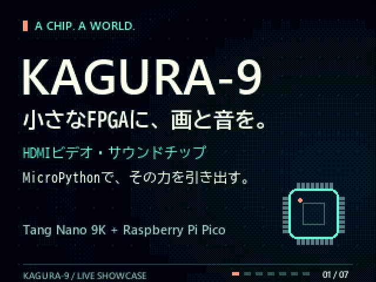 | 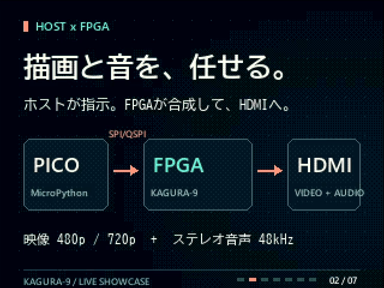 |
| タイトル。日本語は美咲フォントで描いています。 | 構成。Picoが指示し、FPGAが描画・音源を合成してHDMIへ出します。 |
| 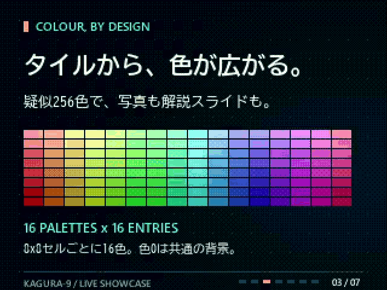 | 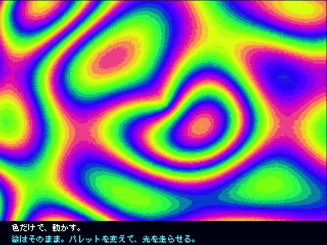 |
| 16パレット×16色。8×8セルごとに16色を選び、疑似256色にしています。 | パレットだけを変えて動かすプラズマ。 |
| 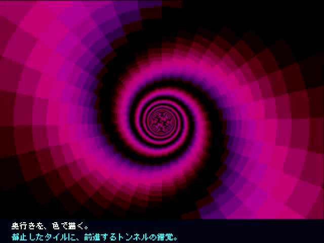 | 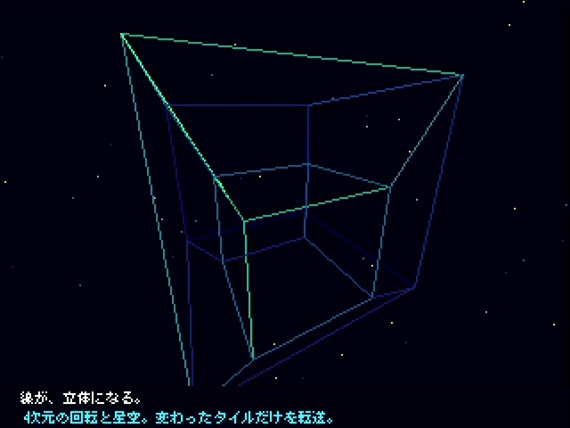 |
| 止まったタイルに、色で奥行きを描くトンネル。 | 4次元の回転と星空。変わったタイルだけを転送しています。 |
| 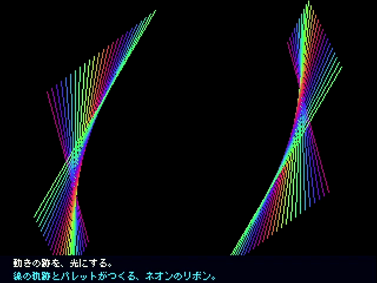 | |
| 線の軌跡とパレットで描くネオンのリボン。 | |

## PROJECT STARFALL

C版を移植した[MicroPythonの横スクロールシューティング](../software/micropython/examples/starfall.md)のアトラクトモードです。背景、スプライト、6音源のBGM・効果音はすべてKAGURA-9が生成しています。35秒の実行で1,251フレーム、スプライトのあふれも音声の異常もありませんでした。

| | |
|---|---|
| 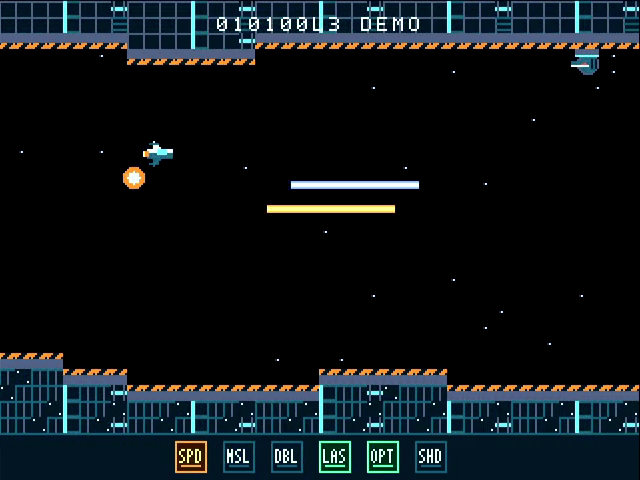 | 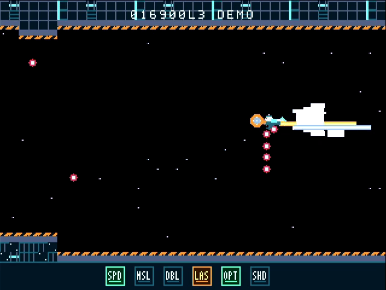 |
| 基地の中で、レーザーと装備ゲージ。 | ボスの弾幕。 |

## 神楽デスクトップ

C言語で合成するGEM風のデスクトップです（[software/desktop](../software/desktop/README.md)）。MicroPythonから操作します。

| | |
|---|---|
| 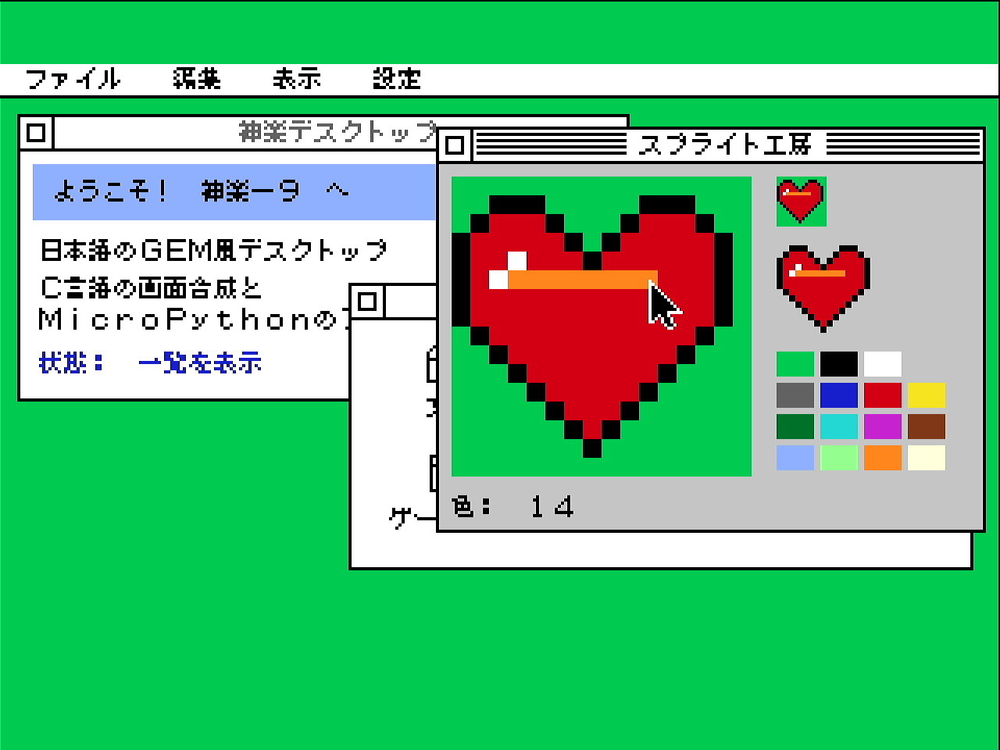 | 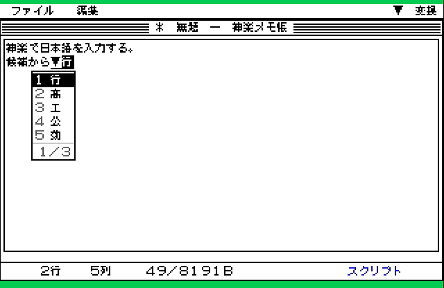 |
| 日本語のウィンドウ、メニュー、スプライト工房。 | 神楽メモ帳でSKKの変換候補を選んでいるところ。ポップアップと、メニューバーの入力モード表示。受入記録の一覧画像から1コマを切り出しています。 |

## 神楽トラッカーと音源

ネイティブ音声HAL、KSNG曲フォーマット、プレイヤー、トラッカーです（[software/audio](../software/audio/README.md)）。音はすべてFPGAの6音源が合成しています。受入時にはHDMI音声も録音して、タイミングと波形を測りました。

| | |
|---|---|
| 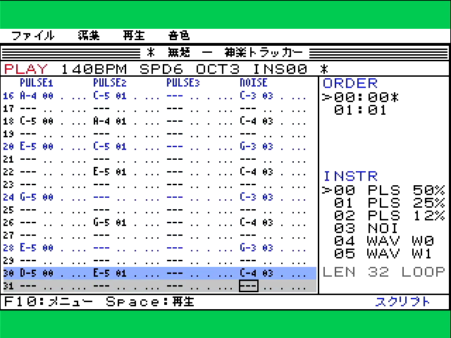 | 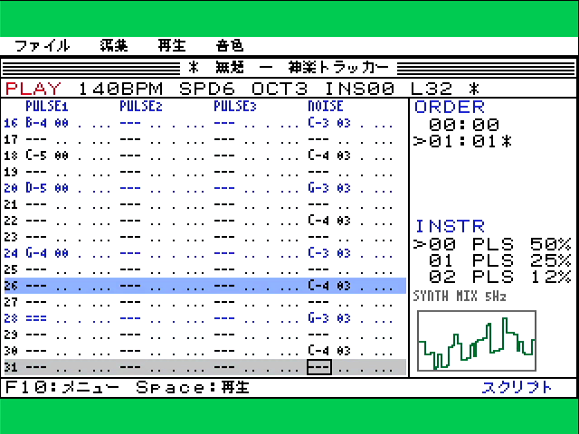 |
| 曲の再生中。再生中の行が青く表示され、表示も再生位置に追従します。 | 右下のスコープ。**SYNTH**の表示どおり、HALに設定した音から計算した推定波形で、出力音声の取込みではありません。 |
| 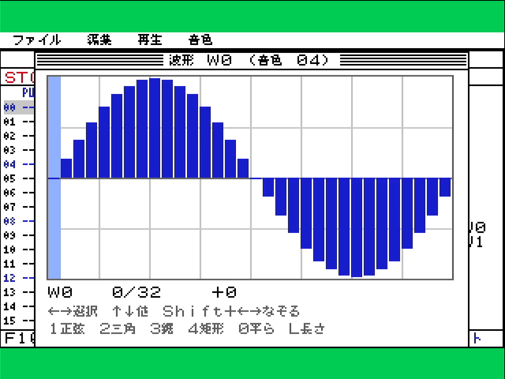 | 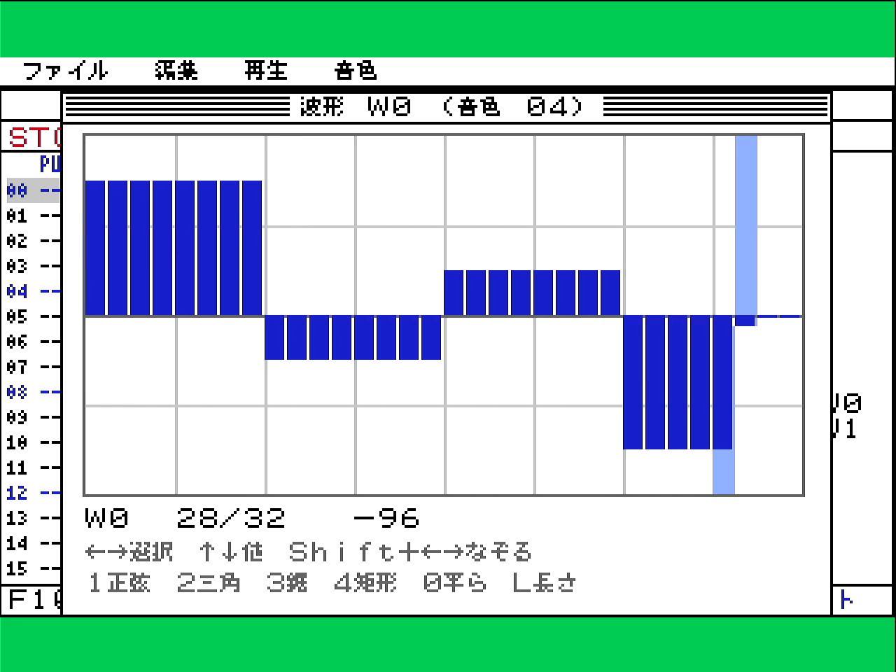 |
| 波形エディタ。32サンプルのサイン波プリセット。 | キーボードだけで描いた階段波。録音した実機の音は、この表と相関0.97以上で一致しました。 |

## 実機

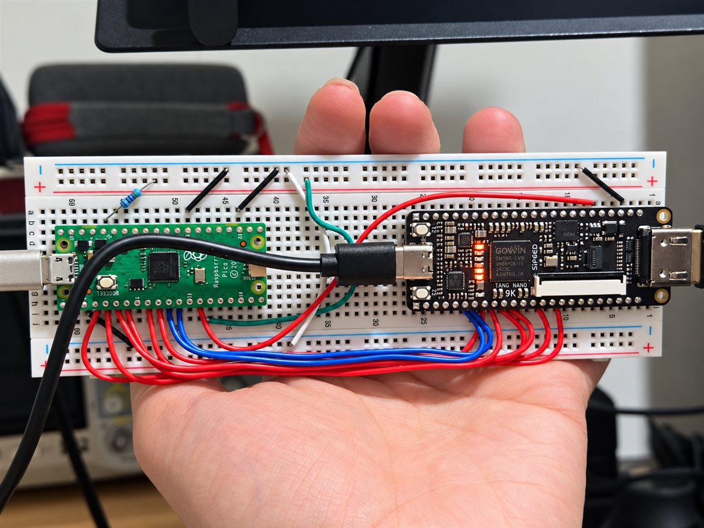

*Raspberry Pi Pico（SPI/QSPIホスト）とTang Nano 9K。配線は[Pico firmware](../software/pico/README.md)を参照。*

## 撮影時の注記

- 紹介プレゼンテーションは、現行ファームウェアでは描画の章までは動きます。しかしSTARFALLの章を読み込むところで、メモリ不足（8,253 byteの確保失敗）で止まります。
  - STARFALLの画像は、単体で起動して撮影しました。
  - 桜吹雪の章（`sakura`）は単体でも開始時にメモリ不足になるため、今回は撮影できていません。
  - 原因の調査は別に行います。
- 撮影はすべてRAMとPCからのmountで行いました。ボードのFlashとファイルシステムは変更していません。
