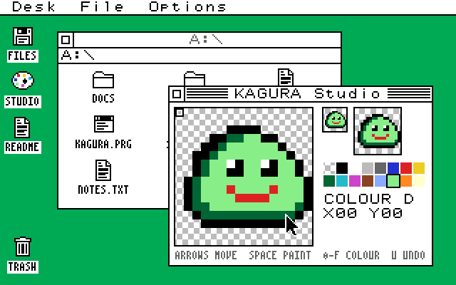
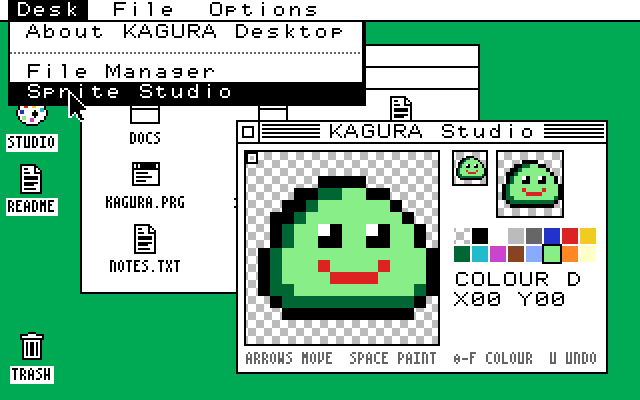
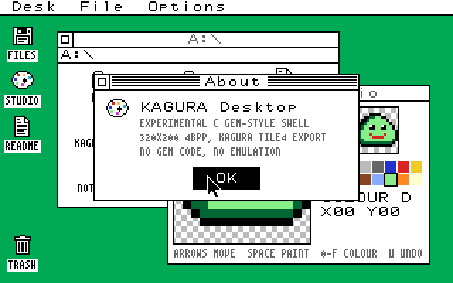
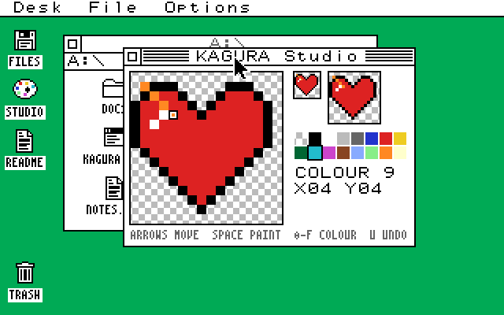
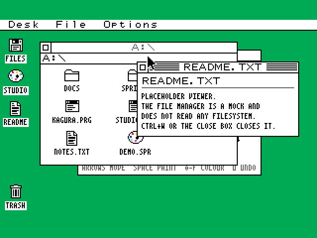

# KAGURA Desktop: C GEM-style GUI prototype (experiment)

An architecture experiment: can a small native C GUI core give KAGURA Desktop a better foundation than the MicroPython KAGURA-UI, with MicroPython kept as the application layer?
**This is not a migration.** Nothing outside this directory is changed or used at run time: no KAGURA-UI, SDK, RTL, ABI, firmware or frozen-manifest changes.



| | |
|---|---|
|  |  |
|  |  |

The pictures are `kd_headless --scenario` output at 2x (PC, not HDMI captures).
The last one below shows the 320x200 plane in KAGURA-9's 320x240 mode, centred, with the 40 border lines in BACKDROP colour:



## Reports

- [ARCHITECTURE.md](ARCHITECTURE.md): the four layers, memory budget, TILE4 placement and the proposed MicroPython boundary.
- [BENCHMARKS.md](BENCHMARKS.md): measured PC timings and counts, Cortex-M0+ instruction counts, comparison with KAGURA-UI.
- [ARCHITECTURE_EVALUATION.md](ARCHITECTURE_EVALUATION.md): the decision report.

## What is here

| Deliverable | Where |
|---|---|
| Layer A: 320x200 4bpp framebuffer, clipping, exact dirty tiles | `src/kd_fb.*`, `src/kd_region.*` |
| TILE4 export adapter and 320x240 placement | `src/kd_tile4.*` |
| Layer B: GEM-style renderer, palette, fonts, icons, cursor | `src/kd_gfx.*`, `src/kd_font*` |
| Layer C: windows, z-order, compositor, damage, events, menus | `src/kd_desktop.*` |
| Layer D: application boundary (future MicroPython windows) | `src/kd_app.*` |
| File Manager mock, KAGURA Studio mock, About, viewer | `apps/` |
| SDL2 display/input adapter (only file that uses SDL) | `host/sdl_main.c` |
| Headless screenshots, TILE4 and linear dumps | `host/headless.c`, `host/image.c` |
| Correctness tests, fault-injection mutants, Python cross-checks | `tests/` |
| Benchmarks (PC timing, Cortex-M0+ instruction counts, KAGURA-UI reference) | `bench/`, `tools/arm_report.sh` |

The core (`src/`, about 2,400 lines) uses only `<string.h>`, has no globals, no allocation, no floating point and no recursion through applications.
All state lives in one caller-owned `kd_desktop` (34,416 bytes on x86-64; the framebuffer is 32,000 of them).

## Build and run: WSL or Linux

Needs a C11 compiler, CMake 3.13 or newer and Python 3 (cross-checks only).
The interactive host needs SDL2 (`sudo apt install libsdl2-dev`); without it everything else still builds.
Run from the repository root.

```sh
cmake -S experiments/c-gem-desktop -B build/c-gem -DCMAKE_BUILD_TYPE=Release
cmake --build build/c-gem -j
ctest --test-dir build/c-gem --output-on-failure   # tests, 13 mutants, scenario, SDK cross-check, SDL smoke
build/c-gem/kd_desktop --scale 3                  # interactive (WSLg opens a window)
build/c-gem/kd_desktop --kagura240 --outline      # 320x240 framing, outline window drag
```

Sanitizer build (as used during development):

```sh
cmake -S experiments/c-gem-desktop -B build/c-gem-asan -DCMAKE_BUILD_TYPE=Debug -DKD_SDL=OFF \
  -DCMAKE_C_FLAGS="-fsanitize=address,undefined -fno-sanitize-recover=all -fno-omit-frame-pointer"
cmake --build build/c-gem-asan -j && build/c-gem-asan/kd_tests
```

If you cannot install packages, `apt-get download libsdl2-dev libsdl2-classic` (plus the runtime libraries it lists as missing) and `dpkg -x` into a local prefix, then configure with `-DCMAKE_PREFIX_PATH=<prefix>/usr -DCMAKE_C_FLAGS="-isystem <prefix>/usr/include/x86_64-linux-gnu"` and set `LD_LIBRARY_PATH` to `<prefix>/usr/lib/x86_64-linux-gnu` and its `sdl2-classic` and `pulseaudio` subdirectories.
That is how the WSL results here were produced (Ubuntu 26.04, no sudo).

## Build and run: native Windows

Visual Studio 2022 with the C++ workload. CMake comes with the optional "C++ CMake tools" component; `uvx --from cmake cmake` also works.
For the interactive host, unpack the SDL2 VC development package ([SDL2-devel-2.32.10-VC.zip](https://github.com/libsdl-org/SDL/releases/tag/release-2.32.10)) and point `SDL2_DIR` at its `cmake` folder. `SDL2.dll` is copied next to `kd_desktop.exe` after the build.
From an "x64 Native Tools Command Prompt for VS 2022", in the repository root:

```bat
cmake -S experiments/c-gem-desktop -B build/c-gem-msvc -G "NMake Makefiles" -DCMAKE_BUILD_TYPE=Release ^
      -DSDL2_DIR=C:/path/to/SDL2-2.32.10/cmake
cmake --build build/c-gem-msvc
cd build/c-gem-msvc && ctest
kd_desktop.exe --scale 3
```

Verified with MSVC 19.44 (`/W4 /WX`): all tests pass and the SDL host works in a real window.
Windows SDL2 has no offscreen video driver, so `ctest` opens the SDL smoke-test window briefly.

## Using the desktop

| Mouse | |
|---|---|
| Click a menu title | open it; hover switches menus; release on an item chooses it |
| Click a background window | raise it (the click is not passed on, as in GEM) |
| Drag a title bar | move the window (Options > Outline drag moves a dotted outline instead) |
| Close box (top left) | press and release inside to close |
| Desktop / File Manager icons | click selects, double-click opens |
| Studio grid / palette | click or drag to paint; click a swatch to pick a colour |

| Keyboard | |
|---|---|
| F10 | open the Desk menu; arrows move, Enter chooses, Esc closes |
| F6 or Ctrl+Tab | cycle windows |
| Ctrl+W | close the active window |
| Ctrl+arrows | move the active window by 8 pixels |
| Arrows, Enter | desktop icons (no window open), File Manager selection and opening; Backspace goes up a folder |
| Studio | arrows move, Space/Enter paint, Del erase (colour 0), 0-9 a-f pick colour, U undo |
| F12 (SDL host) | write `kd-screenshot-N.png` |

File > Import sample loads the next sample sprite; File > Export hex prints the sprite as 256 hex digits on the console (same format as the KAGURA-UI sprite editor's `export_hex()`).
Options > Show dirty tiles flashes each tile the TILE4 export sends.
The SDL window shows a RAM "VRAM" copy that receives only TILE4 exports, decoded per pattern, so the picture has gone through the hardware data path.

## Tests

`kd_tests` (25 tests) checks:
- pixel packing;
- every primitive against an independent per-pixel reference model, including clipping at all four edges and extreme coordinates;
- the exact dirty-tile map;
- the TILE4 layout:
  - against `software/pico/tile_fb.c` (compiled unchanged);
  - against a formula-only reader;
  - and through the 320x240 BG-map/scroll reconstruction;
- flush runs, gaps, staging splits and sink failure;
- damage merging and region subtraction properties;
- sprite layout, hex round trips and bad input;
- z-order, exposure on raise/move/close, targeted invalidation, focus and dispatch, menus, drag modes, the File Manager and Studio;
- three seeded 600-operation random sequences, after every step of which the incremental frame must equal a full region-composed redraw and a full painter's-algorithm redraw.

`mutant_1..13` rebuild the library with one deliberate fault each (`src/kd_fault.h`): nibble order, missing dirty marks, clip overrun, tile row order, no occlusion subtraction, missing exposure on move/raise/close, a dropped damage rect, focus to the wrong window, sprite nibble order, flush clearing failed runs, and an occluded-invalidation bug.
CTest expects each mutant to fail.
`sdk_reference` decodes the exported TILE4 with the SDK test decoder, loads the sprite hex into KAGURA-UI's `Sprite4`, and checks that the font table is up to date.

## Tools

- `tools/gen_font.py [--check]` regenerates `src/kd_font_data.c` from `software/micropython/fonts/misaki8.kfnt` (SHA-256 pinned).
  The system font uses the Misaki full-width Latin forms as an 8x8 font; the small font uses the half-width forms as 4x8.
  The glyphs are unchanged and carry the Misaki licence (see `software/micropython/fonts/README.md`).
- `build/c-gem/kd_bench [--samples N] [--json FILE]`: the PC benchmark.
- `bench/kagura_ui_reference.py`: the same kinds of operations on the unchanged KAGURA-UI.
- `tools/arm_report.sh`: Cortex-M0+/M33 code size, stack frames and Thumb-1 instruction counts under `qemu-arm`.
- RP2040 hardware stages (SRAM-only, no flash writes), with procedures in [pico/README.md](pico/README.md):
  - `tools/rp2040_sram_bench.py`: stage 1, CPU only.
  - `tools/rp2040_hdmi_test.py`, `kd_hdmi_ref` and `tools/hdmi_compare.py`: stage 2, the KAGURA-9 display over HDMI, compared with PC references.

## Scope

This is a PC prototype.
It flashes nothing, touches no FPGA, Pico filesystem or hardware, and has no GEM code, GEM API compatibility or 68k emulation.
The embedded backend, the MicroPython bindings and any optimisation pass are deliberately not started.
