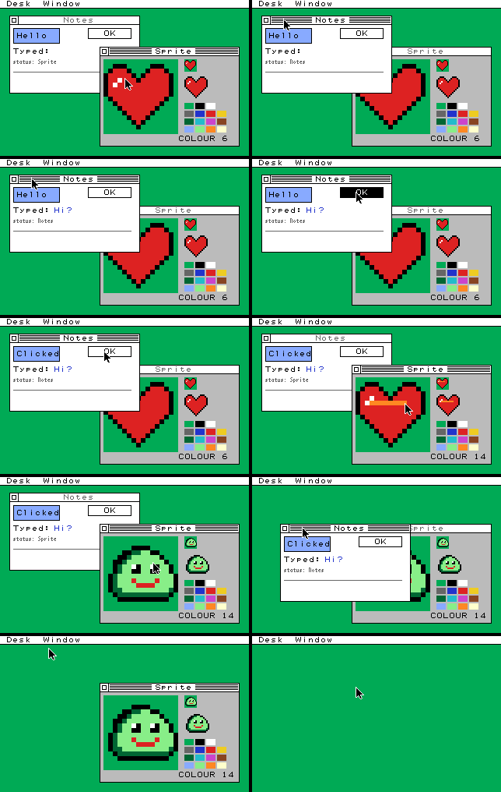

# kagura_desktop: MicroPython binding of the C desktop (stage 3A)

A MicroPython user C module that lets Python applications drive the C desktop core in `../src`.
The core runs unchanged, apart from one bug fix (see [REPORT.md](REPORT.md#4-correctness-and-lifetime-tests)).
This is a feasibility experiment on branch `experiment/c-gem-micropython`, and nothing here is used by KAGURA-UI or the firmware.

- [DESIGN.md](DESIGN.md): the binding design (ownership, lifetimes, API), written before implementation.
- [REPORT.md](REPORT.md): results, performance comparison, RP2040 memory feasibility and the stage 3B recommendation.



## Using it

```python
import kagura_desktop as kd

desk = kd.Desktop(320, 200, menus=(('Desk', ('About', '-', 'Quit')),))
win = desk.create_window('Hello', 20, 30, 180, 100)   # frame rect
win.fill_rect(8, 8, 80, 24, 3)                        # returns an item id
label = win.text(12, 14, 'Hello', 15)
desk.present()                                        # render damage, export dirty TILE4 runs

desk.pointer(kd.POINTER_DOWN, 40, 60, 1000)           # input with explicit ms times
while (ev := desk.poll()) is not None:                # (kind, window, x, y, key, ch, mods, clicks)
    if ev[0] == kd.KEY and ev[1] == win:
        win.set_text(label, chr(ev[5]))
```

Window content is **retained**: each drawing call adds a record to the window's display list in C and returns its id.
The compositor replays the list whenever any part of the window must be redrawn, so Python is never called during composition.
Change content with `set_text`, `set_color`, `set_flags`, `move_item`, `remove` or `clear`; only the changed area is redrawn and exported.
The full API is in [DESIGN.md section 4](DESIGN.md#4-python-api).

## Build and test (WSL or Linux, from the repository root)

Needs the MicroPython v1.26.0 checkout at `build/micropython-src` (as for the repository's other unix tests), gcc, CMake and Python 3.

```sh
bash experiments/c-gem-desktop/micropython/tools/build_unix.sh   # unix port with the module
bash experiments/c-gem-desktop/micropython/tools/run_tests.sh    # everything below
```

`run_tests.sh` runs:

1. `kdm_tests`: 13 C tests of the retained layer, including random sequences checked against a full recomposition.
2. 7 mutants of that layer, each of which the tests must kill.
3. `demo/demo.py` on MicroPython against `tests/ref_demo.c`, the same scenario written with the C API only. All 10 steps must print the same framebuffer CRC, TILE4 mirror CRC and exported tile count.
4. `tests/test_binding.py`: 15 MicroPython tests of the API, handle lifetimes, GC, atomic failures, sinks, events and a heap-locked frame loop.

Other tools:

| | |
|---|---|
| `tools/run_bench.sh` | host benchmarks: C through kdm, MicroPython + binding, KAGURA-UI (3 runs each) |
| `tools/m0count/count.sh` | Cortex-M0+ instruction counts of the same workloads with and without MicroPython (qemu-arm) |
| `tools/build_rp2.sh` | builds (never flashes) KAGURA_PICO firmware without and with the module, for the memory report |
| `tools/fb_to_png.py DIR` | PNGs and a montage from `demo.py --dump DIR` snapshots |

`micropython.cmake` (CMake ports such as rp2) and `kagura_desktop/micropython.mk` (Make ports such as unix) add the module with `USER_C_MODULES`.

## Layout

| | |
|---|---|
| `kagura_desktop/kdm.h`, `kdm.c` | retained layer: record pools, display lists, text arena, sprites, event ring, menus. Plain C, no MicroPython |
| `kagura_desktop/modkagura_desktop.c` | MicroPython glue only: argument checks, handles, errors |
| `tests/` | `test_kdm.c`, `ref_demo.c`, `test_binding.py` |
| `demo/demo.py` | the scripted two-window demo |
| `bench/` | `bench_native.c` (C), `workloads.py` (shared Python workloads) and `bench_binding.py` (timing) |
| `tools/` | build, test, benchmark and count scripts |
| `docs/` | images and recorded outputs |
