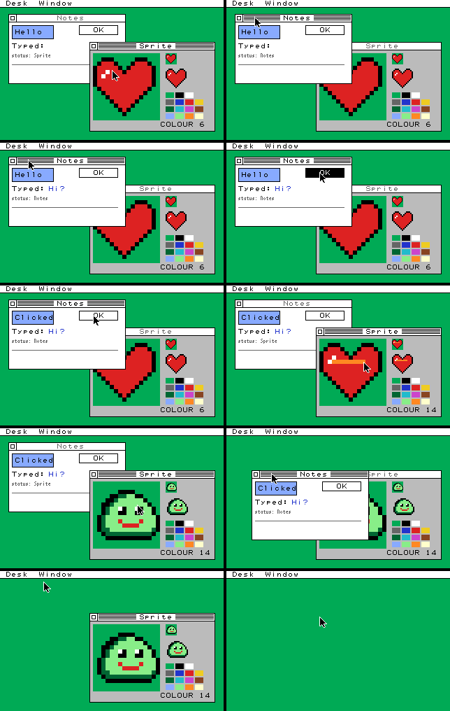

# Stage 3A report: MicroPython controlling the native C desktop

**Decision criterion:** can MicroPython control the native C desktop efficiently and safely enough to justify a hybrid embedded architecture?

**Answer: yes.**

- The binding adds about 0.1–0.8 µs per small update on the PC, against KAGURA-UI's 20–80 µs for the same kinds of updates.
- It keeps every pixel identical to the pure-C path: CRC-checked in 10 demo steps and 20 benchmark workloads.
- It needs no Python-side framebuffer and no C pointer into the GC heap.
- On the RP2040 it costs 32 KB of flash and 45 KB of static RAM, leaving 206 KB of GC heap in the KAGURA_PICO firmware.

The design is in [DESIGN.md](DESIGN.md) and the usage in [README.md](README.md).
Evidence labels:

| Label | Meaning |
|---|---|
| **host** | WSL2, x86-64, MicroPython v1.26.0 unix port |
| **RP2040** | measured on the board |
| **build** | from the real KAGURA_PICO firmware ELF; built, not flashed |
| **estimate** | derived |

## 1. What was built

- `kagura_desktop`, a MicroPython user C module:
  - `Desktop`, `Window` and `Sprite` types;
  - retained display lists;
  - polled events;
  - three `present()` sinks: none, a TILE4 mirror buffer, or a Python callable.
- `kdm`, a retained layer in plain C that also runs without MicroPython. It holds the record pool, text arena, sprites, event ring and menus.
- A deterministic two-window demo (`demo/demo.py`) and a scripted interactive run of it. It covers:
  - focus switching;
  - typing and button press/release;
  - painting a 16x16 sprite;
  - importing a sprite;
  - window drag;
  - a menu command;
  - the close box.

## 2. Ownership and memory

- **One framebuffer, owned by C.** `kd_desktop` (and with it the 32,000 B plane) lives in one static `kdm` state outside the GC heap, together with every pool.
  - Python objects hold `(desktop generation, slot, serial)` handles, never C pointers.
  - C holds no Python object, so the static state needs no GC root and is never scanned.
- **Lifetimes are explicit and checked.**
  - A window closes on `close()`, the close box, Ctrl+W or `desktop.close()`, never on garbage collection.
  - Afterwards its handle and its item ids are dead: every use raises `ValueError`.
  - A new `Desktop()` re-initialises the static state and kills every older handle. This also covers soft reset.
- **Errors are atomic.**
  - A full pool raises `MemoryError` naming the pool, with the native state unchanged.
  - Python handles are allocated before native slots.
  - `poll()` builds its tuple before dropping the event.
  - A Python sink's exception is caught at the C boundary and re-raised after the core returns; unsent runs stay dirty.
- **No allocation in the frame loop:** `pointer`/`key` → `poll_into` → `set_text` / `sprite.set` → `present(mirror)` runs under `micropython.heap_lock()` (tested).

**Static RAM** (`kd.sizes()`, **host** and **build**):

| | x86-64 | Cortex-M0+ |
|---|---:|---:|
| whole module state | 46,552 B | 45,960 B (`state` in `.bss`) |
| of which `kd_desktop` (incl. 32,000 B framebuffer and 1,280 B snapshot) | 34,416 B | 34,160 B |
| records 320 x 18 B, text 2,048 B, sprites 8 x 136 B, events 32 x 28 B, menus 912 B, staging 1,280 B | 12,136 B | 11,800 B |

**Python heap** for the demo scene is the `Desktop`, 2 `Window`s and a `Sprite`: 416 B (**host**, the 32,000 B mirror buffer of the benchmark excluded).
A real display sink needs no mirror (section 6).

## 3. Firmware budget (KAGURA_PICO, MicroPython v1.26.0, **build**)

`tools/build_rp2.sh` built the current tree's KAGURA_PICO firmware twice: without and with the module. Neither was flashed.

| | without | with `kagura_desktop` | difference |
|---|---:|---:|---:|
| firmware image (`firmware.bin`) | 431,384 B | 463,560 B | +32,176 B |
| `.text` / `.rodata` | 278,264 / 147,964 B | 304,168 / 154,236 B | +25,904 / +6,272 B |
| `.bss` | 5,128 B | 51,088 B | +45,960 B |
| GC heap (`__GcHeapStart`..`__GcHeapEnd`) | 252,128 B | 206,168 B | -45,960 B |
| stack (scratch X/Y) | 8 KB | 8 KB | 0 |

Flash: the board reserves 1,408 KB of its 2 MB for the filesystem. The 640 KB below it holds this 463,560 B image with 176 KB to spare; the Japanese font of stage 3B (about 72 KB) also fits.

RAM:
- The desktop costs 46 KB of static RAM whether it is used or not.
- KAGURA-UI's 320x240 framebuffer costs about 40.5 KB of GC heap, but only while it is in use.
- Static allocation is the right trade here. It cannot fail later for lack of a contiguous heap block, and it keeps 32 KB of pixels out of every GC scan.

Smallest useful embedded configuration (**estimate**; all are `kdm.h` macros):

| Setting | Size |
|---|---|
| records | 128 (2,304 B) |
| text | 1,024 B |
| sprites | 4 (544 B) |
| events | 16 (448 B) |
| **total** | about 40.8 KB |

The framebuffer is the floor; shrinking it means a smaller plane, which the core does not support.

## 4. Correctness and lifetime tests

All pass (`tools/run_tests.sh`):

- **`kdm_tests`:** 13 tests.
  - Lifetimes: slot reuse, generations, stale ids.
  - Atomic pool exhaustion and the all-or-nothing batch add.
  - Text-arena compaction against a rebuild without churn.
  - Minimal invalidation, event overflow, the close box and menus.
  - Three 700-step random sequences, after every step of which:
    - the exported TILE4 mirror equals the packed screen;
    - a full recomposition changes no tile.
- **7 mutants of kdm**, all killed:
  - no serial check;
  - wrong text cells;
  - compaction not updating records;
  - no sprite damage;
  - leaking records of closed windows;
  - ring overwrite;
  - no old-box damage on move.
- **The demo** prints the same framebuffer CRC, mirror CRC and exported tile count at all 10 steps as `tests/ref_demo.c`.
  That reference is the same scenario written against `kd_app.h` only, with hand-written window classes, no kdm and no MicroPython.
- **`test_binding.py`**, 15 MicroPython tests: API, closed and replaced handles, slot reuse, GC with dynamically built strings, pool exhaustion, invalid arguments, sinks (exceptions, re-entrancy, read-only memoryview), events, events for reused slots, and the heap-locked frame loop.
- **The existing desktop suite** (17 tests) still passes.

Two defects found and fixed:
- **Core** (`068eba4`): Left/Up on a desktop *without icons* selected icon 0 of an empty table and dereferenced a NULL label. The C shell always has icons; the binding does not. It is fixed with a regression test.
- **Binding:** a button whose label is wider than the button draws the label outside its rect, so the record's damage box is now the union of both. The random tests found it.

## 5. Performance

### 5.1 Host: the same workloads in pure C and from MicroPython

Each iteration is the operation plus `present()` into a TILE4 mirror. Figures are the median of three runs' means, in µs ([bench-summary.md](docs/bench-summary.md); raw runs in `docs/`).
**All 20 workloads produce identical framebuffer and mirror CRCs in C and in MicroPython**, so the two columns do exactly the same work.

| workload | C through kdm | MicroPython + binding | difference | heap B/iter |
|---|---:|---:|---:|---:|
| label, one character | 1.33 | 1.80 | 0.47 | 0 |
| button press | 2.13 | 2.85 | 0.72 | 0 |
| sprite pixel | 1.83 | 2.60 | 0.77 | 0 |
| sprite, 16 pixels, 16 calls | 7.68 | 10.43 | 2.75 | 0 |
| sprite, 16 pixels, one batched call | 7.63 | 9.37 | 1.74 | 0 |
| sprite import | 35.07 | 45.15 | 10.08 | 0 |
| whole window rebuilt (clear + 10 records) | 9.37 | 13.48 | 4.11 | 0 |
| window activate / move 8 px | 21.54 / 51.87 | 28.57 / 69.16 | 7.0 / 17.3 | 0 |
| window open + close | 34.57 | 54.32 | 19.75 | 32 |
| 3 input events, `poll()` / `poll_into()` | 1.47 | 4.01 / 3.12 | 2.5 / 1.7 | 288 / 0 |
| 1 / 16 / 256 rectangles, one call each | 19.1 / 29.8 / 110.8 | 29.1 / 45.0 / 203.3 | 10 / 15 / 93 | 0 |
| 16 / 256 rectangles, one batched call | 27.5 / 109.2 | 42.2 / 164.8 | 15 / 56 | 0 |
| full redraw | 66.97 | 83.39 | 16.4 | 0 |

Per call (loop overhead subtracted):
- `w.is_open()`: 15 ns;
- `set_color` with no change: 56 ns;
- `fill_rect` + `remove`: 179 ns;
- a plain Python function call, for comparison: 52 ns.

GC:
- `gc.collect()` took 10 µs with the scene alive.
- With an extra 38,400 B bytearray alive (a KAGURA-UI-sized heap framebuffer) it took 13 µs.

### 5.2 Against KAGURA-UI on the same unix binary (host)

| comparable operation | C desktop from MicroPython | KAGURA-UI (framebuf backend) p50 |
|---|---:|---:|
| label, one character | 1.8 µs | 28 µs |
| button press | 2.9 µs | 77 µs |
| move a 32x32 panel/rect 4 px | 2.2 µs | 21 µs |
| sprite pixel | 2.6 µs | 42 µs |
| sprite import | 45 µs | 579 µs |

The binding's times include TILE4 export into a mirror; KAGURA-UI's framebuf backend has no export at all. The screens differ: 320x200 with two windows against 320x240 single screens.

### 5.3 RP2040

- The binding was not run on the RP2040 in stage 3A (no flashing); stage 3B measures it in firmware.
- What was measured on the board (`tools/rp2040_vm_calibrate.py`) is the installed MicroPython's own interpreter cost: code from RAM, flash SHA-256 unchanged, console restored. Per iteration at 125 MHz ([raw](docs/rp2040-vm-calibrate.txt)):

  | | µs per iteration |
  |---|---:|
  | empty loop | 3.25 |
  | Python call, 2 arguments | 11.80 |
  | `str.find` (a native method, 3 arguments) | 18.52 |
  | bytearray store | 8.77 |

  So a native method call with a few arguments costs about **15 µs**, and a Python function call about 8.6 µs. That is about 160x the host's cost for the same VM work.
- **Estimate** for the binding on the RP2040: the host's VM-side difference x 160, plus the C work measured in stage 1:
  - small updates (label, button, pixel) add about 75–125 µs to C work of 0.5–1.1 ms;
  - 3 events through `poll_into` cost about 0.3 ms;
  - 256 separate `fill_rect` calls cost about 15 ms of interpreter time, where one batched call costs one call.

  Bulk APIs (`fill_rects`, `set_pixels`, `load`, retained records) are therefore the right shape. The stage 2 transport (1–26 ms per update) stays the larger cost.

## 6. Recommendation for stage 3B

Integrate.

1. Build the module into the KAGURA_PICO firmware, with the core and kdm moved to a shared native library.
2. Drive the display through the existing MicroPython SDK session:
   - `present(sink)` with a sink that calls `Video.tiles` and `fence`;
   - the console's device, `pause()`/`resume()` for ownership.

   This needs no second transport and no second hardware owner. A native C transport for standalone C programs stays in `software/pico`.
3. Make the core's text path UTF-8, with the Misaki glyphs in flash, so that titles, menus, labels, buttons and records show Japanese. Reuse the tested native text engine of PR #71, without Wren.
4. Measure on the board: free heap after desktop start, binding cost, update latency and long runs.

Limitations:
- Event times are milliseconds modulo 2^32.
- Events arrive only by polling.
- There is one desktop at a time.
- Pointer input needs a device source; KAGURA has no mouse yet.
