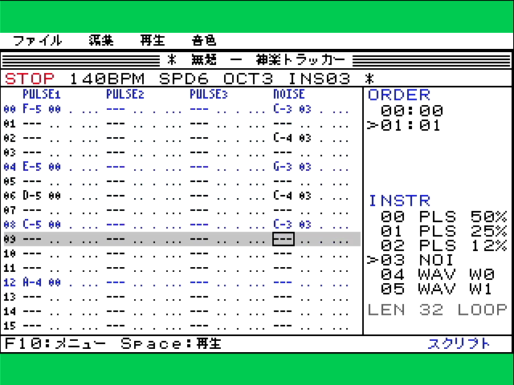
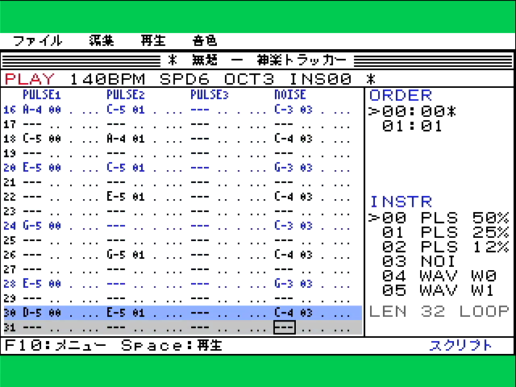
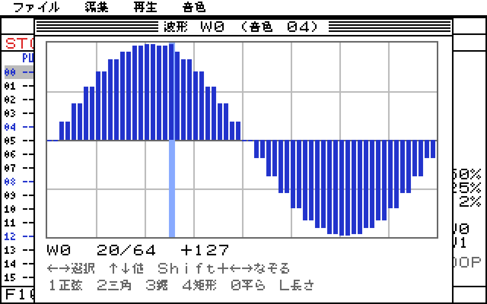

# Audio and 神楽トラッカー on KAGURA-9: hardware acceptance

**Board:** RP2040 Pico and Tang Nano 9K with the KAGURA-9 bitstream, unchanged (ABI 0.6, CAPS 0x5B: HDMI audio, wave, PSRAM). HDMI output is recorded with a UGREEN 15390 capture: 48 kHz PCM audio and 1280×960 video.

**Firmware:** KAGURA_PICO built from commit 9759a49 (`feat/audio-tracker`), UF2 sha256 `b2c1a243…`.
- Flashed over the dev builds with `tools/rp2040-firmware.py flash`, which checks the current firmware, then that the filesystem region is unchanged and the firmware reads back ([flash log](hardware/flash-9759a49.txt)).
- The filesystem hash stayed `7b07b001…` throughout: nothing was written to the board's filesystem.
- **Rollback image:** `build/firmware-known-good/kagura-pico-popup-ca4be0e.uf2`, the previous known-good.

**What everything ran from:**
- The standalone C program ran from SRAM, with the flash verified unchanged.
- The MicroPython measurements ran from the raw REPL.
- The tracker ran as a cross-compiled `.mpy` on a RAM littlefs, with its songs on another RAM littlefs. This was needed because compiling its 40 KB source on the board does not fit in the heap.

| Image | text | bss | Free heap after boot |
|---|---|---|---|
| ca4be0e (before) | 570,436 | 64,244 | 140,672 |
| 9759a49 | 585,136 (+14,700: C module 10.2 KB, `kagura.music` 4.5 KB) | 66,220 (+1,976: `kagura_audio` state) | 138,736 |

## Standalone C (SRAM, C host driver)

`software/audio/pico`, loaded by `experiments/c-gem-desktop/tools/rp2040_sram_bench.py run`: flash unchanged, console restored. [Log](hardware/standalone-c-sram.txt).

- **Test melody:** pulse 0, then the same phrase on wave voice 4 with an uploaded table: 22 notes, 35 frames, 6 wave uploads.
- **Demo song,** 20 s: 1120 of 1120 ticks, lateness at most 8 µs, a frame every 1.4 ticks with 4 register pairs on average. Sending takes 159 µs on average and 419 µs at most; the CPU share is 0.7 %.
- **The click probe** is `songs/click.ksn`: one pulse voice, a click on every row cut after one tick, 150 BPM. Its onsets are measured on the recorded HDMI audio with `tools/kagura-audio-timing.py`:

| 20 s | ticks / exact | late (timer) max | HDMI onset jitter p50 / p95 / max | tempo on the audio |
|---|---|---|---|---|
| transport idle | 1200 / 1200 | 8 µs | 14 / 35 / 73 µs | +15 ppm |
| transport 98 % busy with VRAM reads | 1200 / 1200 | 3.2 ms | 1.25 / 1.65 / 1.67 ms | +16 ppm |

- The tempo offset is the same with and without load, so it is the RP2040 crystal against the 27 MHz FPGA/capture clock, not drift.
- Idle jitter is the 48 kHz sample quantum.
- Under load, the lateness is bounded by the longest transport transaction.

## MicroPython: kagura_audio and kagura.music under desktop load

`tools/kagura-audio-board.py bench` ([log](hardware/bench-9759a49.txt)), with the click song recorded over HDMI.

- **Allocation:** `send()` and `pump()` allocate nothing (checked under `heap_lock` on the board).
- **Send cost on the accelerated link:**

| frame | pairs | p50 | p95 | max |
|---|---|---|---|---|
| gain of one voice | 2 | 1.05 ms | 1.31 ms | 1.46 ms |
| gains of six voices | 12 | 1.32 ms | 1.58 ms | 1.68 ms |
| six gains, three pitches | 20 | 1.55 ms | 1.79 ms | 1.88 ms |

- **Each phase** plays the click song for 15 s while the loop does the load named below, calls `desk.present()`, which pumps the audio between tile runs, and calls `pump()`.
- **Tick count:** every phase ran the exact number of ticks, with no resyncs.
- **FPGA state:** ERROR_CODE 0 and AUDIO_STATUS 0 after every phase.

| Phase | late (timer) mean / max | HDMI onset jitter p50 / p95 / max | present() p50 / max | Notes |
|---|---|---|---|---|
| pump only | 0.91 / 5.6 ms | 0.64 / 3.1 / 4.4 ms | — | |
| desktop idle | 0.64 / 5.8 ms | 0.41 / 2.7 / 4.5 ms | 0.6 / 9.5 ms | |
| window move | 1.9 / 16.4 ms | 0.98 / 5.1 / 8.1 ms | 27 / 57 ms | |
| sprite editing | 0.70 / 9.3 ms | 0.35 / 3.0 / 5.2 ms | 0.6 / 22 ms | |
| Japanese typing (editor) | 1.3 / 9.1 ms | 0.79 / 2.1 / 4.5 ms | 6.1 / 15 ms | |
| SKK candidate popup | 1.1 / 6.9 ms | 0.83 / 2.4 / 3.2 ms | 18 / 28 ms | |
| RAM file I/O, 4 KB at once | 28 / 81 ms | 64 of 150 clicks heard | 2.4 / 4.4 ms | |
| RAM file I/O in 512 B pieces, pumped | 4.9 / 62 ms | 132 of 150 clicks heard | 0.9 / 3.6 ms | |
| `gc.collect()` every loop | 3.7 / 12.8 ms | 4.6 / 9.9 / 11.4 ms | 0.9 / 2.4 ms | |

**Reading the table:**

- **Ordinary desktop work keeps the music in time.** Idle, sprite editing, Japanese typing and the SKK popup stay within 4.5–5.2 ms of the beat at worst, and 3 ms in 95 % of notes.
- **Window moves are the most expensive GUI operation** (8 ms worst case on the audio).
  - Their time is in the C compositor before the first tile run, where nothing can pump.
  - Sending long runs in smaller pieces was tried and measured; it did not help, so it is not in the code.
- **GC pauses** of 6–12 ms are the main source of the remaining maxima.
- **Filesystem operations block.** One littlefs open, close or metadata commit takes tens of ms, and a click shorter than the stall can be lost (its note and cut run in the same catch-up call).
  - The tracker writes and reads songs in 512-byte pieces with the audio pumped between them. That halves the losses, but a save while music plays can still put one or two notes late.
  - This is the known limit of the pumped design. An interrupt-driven design would need the transport to be ownable from C (see the README).

## 神楽トラッカー

`tools/kagura-audio-board.py tracker` ([log](hardware/tracker-9759a49.txt)) runs the scripted session from the HDMI recording:

1. song settings;
2. melody, bass, drums and an echo typed with the piano keys;
3. a second pattern, and the instrument editor;
4. two whole loops of playback while the desktop works;
5. stop, save, new, reopen, export.

- **Scenes:** 11 of 12 scene CRCs equal the host run ([host](hardware/tracker-host-scenes.txt)).
  - Scene 7 is taken while the music keeps playing, so its playback bar differs from the host, which does not play. It is the same on every board run.
- **Files:** the saved song is 725 bytes, as on the host.
- **FPGA:** ERROR_CODE 0 and AUDIO_STATUS 0 at the end.

 

*HDMI stills from the recording: composing pattern 1, and playing pattern 0 with the playback bar on row 30 above the edit cursor.*

## Wave editor on the hardware

`tools/kagura-audio-board.py wave` ([log](hardware/wave-editor-9759a49.txt)) drives the tracker's wave editor with its own keys.

- **What it plays:** the four presets, then a staircase entered with the keyboard (96, −32, 32, −96, carried along with Shift+Right). Each one is held as a C-3 note on WAVE1.
- **How it is checked:** `tools/kagura-audio-wave.py` folds each recorded note onto one period of its exact frequency and correlates it with the table:
  - sine 0.9990, triangle 0.9992, sawtooth 0.9964;
  - square 0.9799, staircase 0.9746 (the edges are band-limited by the audio path).
- **Result:** every table played as drawn, with no FPGA errors.

## Long playback and recovery

**Soak** (`soak --seconds 600`, [log](hardware/soak-9759a49.txt)): the demo song for 10 minutes, with a window moving and a Japanese character typed on every loop.

- **Timing:** 600 s gave 33,601 ticks against 33,600 for the exact tempo: no drift. No folded ticks, no resyncs; the worst lateness was 14.0 ms, from window moves as in the bench.
- **Memory:** free heap swings with the garbage collector (2.9–130.8 KB) and keeps returning to 131 KB: no leak.
- **FPGA:** ERROR_CODE 0 and AUDIO_STATUS 0.

**Resets** ([log](hardware/reset-9759a49.txt)):

- **Soft reset during playback:** `kagura_audio` drops its state, so calls raise until `init()`. `init()` works again, a new session's first frame silences the voices, and the console comes back.
- **Hard reset:** the board comes back with its console.

**Earlier API:** `kagura.audio.Audio` still plays a tone and commits on this firmware, after a session has closed.

## Regressions on 9759a49

- **Desktop** (`tools/kagura-desktop-device.py`, [log](hardware/desktop-regression-9759a49.txt)): desktop_ja's 11 scenes match the ca4be0e acceptance (`software/desktop/docs/hardware/popup-regression-ca4be0e.txt`). Every framebuffer CRC and every VRAM readback CRC is identical. The update soak ran 10,170 updates with 0 failures; soft and hard resets came back.
- **SKK** (`tools/kagura-editor-board.py skk`, [log](hardware/skk-regression-9759a49.txt)): the candidate-popup demo's 22 scenes match the ca4be0e acceptance (`software/desktop/docs/hardware/popup-board.txt`). Framebuffer CRCs, VRAM readback CRCs and ERROR_CODE 0 are all identical.

## Not done in this acceptance

- PCM playback was not exercised. The HAL only stops PCM channels (silence); PCM samples stay with `kagura.audio.Audio`.
- No interrupt-driven scheduler: the measurements above show the pumped design keeps ordinary desktop use in time without one.
