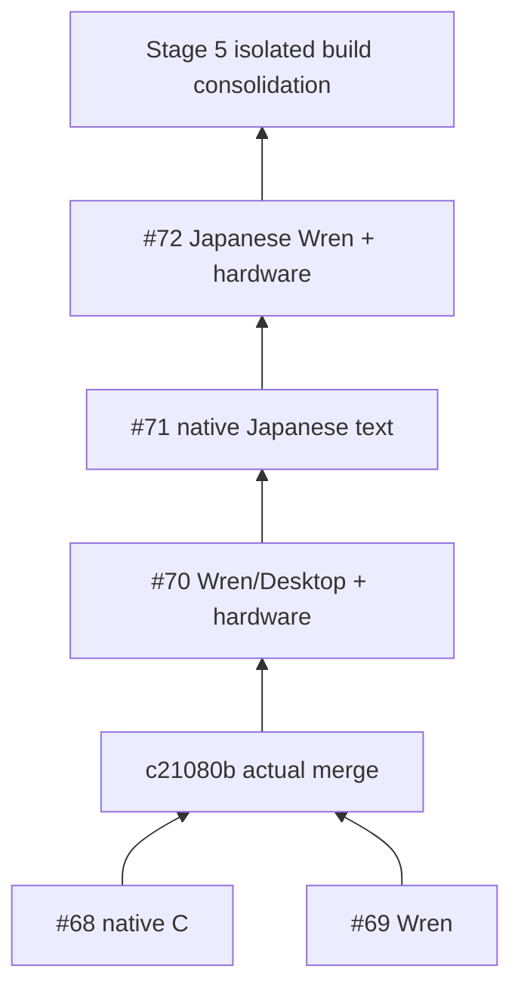
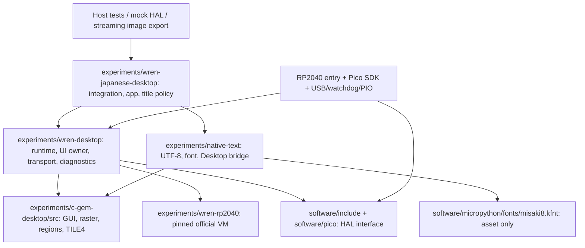
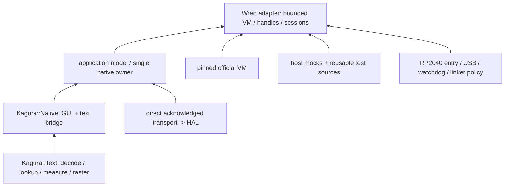

# Stage 5 architecture audit

This audit records the PR #73 starting architecture. Native GUI ownership has
since moved, unchanged, to `core/` and `gfx/`; see
[the follow-up report](native-ownership.md). Historical diagrams below retain
the original dependency paths so the migration remains reviewable.

## Verified starting point

Inspected source, interfaces, CMake/scripts, linker generation and checked-in
physical evidence, not only PR descriptions. These five PRs are Draft and must
remain unmerged pending dependency review:

| PR | Exact inspected head | Actual relationship |
|---|---|---|
| #68 | be344f5c742101f0cff170a29f63d09c0a17c441 | Native Desktop branch |
| #69 | d03912b4339495379302b286383eb40cf8a6d53e | Parallel Wren branch |
| #70 | 1c089f2b5d22c4cded5a87f96c8ad74dd3a55914 | Contains both via merge c21080b |
| #71 | 99c4250f124c0f3c86e5e8fb77554f015744e799 | Built on #70 |
| #72 | e2ff7ead9144136e95096a92e0d024ee051b3f66 | Built on #71; Stage 5 base |

#72 source candidate is 25c7e9c; e2ff7ea adds physical evidence. Its historically
validated ELF SHA-256 is
`af6f1679e7b1e4577bec5eca6d0781aacb3ffa527aa07215cddb04a2bbf456f9`.
Rebuilding a new branch does not confer that artifact's hardware acceptance.

## Current dependencies and concrete boundaries

The text **engine** itself does not depend on the Desktop; only `kj_desktop.c`
does. Font asset residence under `micropython` is a build path dependency, not
a dependency on that runtime. GUI core does not include Wren or MicroPython.
Transport calls `kh_*` and depends on the HAL contract, not on Wren. The current
flat CMake archive obscures these otherwise clean source boundaries.

| Existing interface | Contract and owner |
|---|---|
| `kd_app.h` | Native application-facing draw/event/window operations. Caller-owned application state; window slots owned by `kd_desktop`; draw callback reconstructs any exposed rectangle from retained state. |
| `kd_desktop.h` | Native compositor/owner API; eight fixed window slots and eight icons, no GUI malloc. Trusted native code can inspect the framebuffer; Wren cannot. |
| `kd_fb.h`, `kd_region.h`, `kd_tile4.h` | Packed 4bpp raster, clip/damage regions, bounded export. Hardware-independent. |
| `kj_text.h` | Strict UTF-8 span decoder, validated immutable font, measurement, clipped callback and 4bpp surfaces; no allocation. |
| `kj_desktop.h` | Adapter preserving legacy ASCII glyph metrics and changed-pixel dirty marking. |
| `ui.h` | One native Desktop owner and deterministic application model. Internal integration/test API, not a script ABI. |
| `transport.h` | Direct bounded TILE4 sink. Success requires acknowledged FENCE and checked error state. |
| `runtime.h` | Synchronous VM lifecycle, metrics and failure injection. Not a general production application scheduler. |

Native applications receive `kd_draw` only during draw and copy POD events.
Callbacks may invalidate for the next render but must not reenter rendering.
Menus, icon labels, classes, art and user context are borrowed native objects:
they must outlive their use; not every native label is currently copied.
Only window titles are copied into fixed native storage. This distinction must
survive relocation and future scripting bindings.

### Text and licenses

Existing Misaki `misaki8.kfnt` is 71,718 bytes, 7,171 sorted BMP records:
8-byte KJ8F header, each record little-endian scalar16 plus eight bitmap rows.
SHA-256 `cbfb1071801f7ed3b6637bb6763219e59d86c13bd149169bbbab5bca753d9238`.
The generator verifies it; generated data is `const` in Flash, with a 24-byte ARM
font descriptor. Keep Num Kadoma's 2002–2021 Misaki notice and its permissive
license (`experiments/native-text/NOTICE.md` and font README). Wren revision
`99d2f0b8fc2686134b32b18166e037639f7e9f2c` has its MIT license and source hashes
under the Wren experiment. Native code retains its existing SPDX notices.
No new font is introduced or embedded in the VM heap.

Invalid UTF-8 consumes one byte and yields U+FFFD in the portable renderer;
glyph fallback is U+FFFD, then `?`, then an explicit box. Non-BMP text decodes
but falls back for this BMP font. No normalization, shaping, wrapping or input
method is implied. Wren title input is stricter than rendering: the complete
span (maximum 1,024 bytes) must be valid and contain no NUL/C0/DEL; only after
validation is a whole-scalar prefix copied into 23 payload bytes. Invalid tails
beyond the truncation boundary are still rejected atomically.

## Ownership and simultaneous memory

| Resource | Lifetime / size on ARM | Sharing and cleanup |
|---|---|---|
| `desktop_state` | One static integration owner, 34,284 B | Contains the 34,160-byte `kd_desktop`, including its framebuffer. Never add another owner in the same firmware. |
| `desktop.fb.px` | 32,000 B inside that owner | Sole CPU framebuffer. Overlap/reveal/move recomposition uses it; not a separate 32 KB charge. |
| `desktop.snap` | 1,280 B inside that owner | Snapshot during composition; export scratch only after composition returns. Sink is synchronous; busy guard excludes reentry. No DMA or delayed borrow is allowed. |
| Window/GUI structures | Fixed slots, z-order, regions, dirty map (125 B), icons, stats inside `kd_desktop` | No dynamically allocated native windows; callbacks/users borrowed. Exact dirty detection must retain pre-pass snapshots. |
| UI model / four events | Remainder of `desktop_state` | Retained rectangle/event values, no second display list or object hierarchy. |
| Font / ASCII / app source | Immutable Flash | Shared by all native clients; never copied into Wren as bitmap data. Wren source compilation still creates VM strings/bytecode. |
| Runtime / metrics | Static state, registered VM/receiver/method/session, timing spans | Session checks reject stale call tickets before touching freed handles. See complete linker map for USB/SDK and all globals. |
| Wren arena | 135,168 B reserved, native malloc backing | Payload budget and allocation ledger are separate from arena backing/fragmentation. Every allocation bounds checked. |
| Native stack | 49,152 B, protected | Reserved independently of arena; no overlap/reduction. Core 1 parked. |
| Recovery | 8,192 B, NOLOAD | Reserved headroom; not available for application data. |
| USB/PIO/SDK buffers | Included in `.data`/`.bss` | Real firmware-owned storage; host mock VRAM/SDL images never enter the firmware. |

`wd_ui_present` holds the owner busy across render/export/observer; export
returns success only after the direct transport acknowledges writes/FENCE.
Failed transfer retains dirty tiles and latches a fault; explicit reinit is
required. Never clear dirty state on enqueue. Snapshot/export aliasing is safe
because their lifetimes do not overlap; it would cease to be safe with async
transport, threaded rendering or observers retaining scratch pointers.

Wren's bounded realloc tracks payload live/peak, ledger peak and actual arena
backing separately. Expected OOM discards the whole VM using the existing
longjmp recovery path, closes native ownership, invalidates handles/session and
frees the allocation ledger. It cannot resume the failed VM. There are no
foreign-object finalizers in this restricted integration; adding one requires a
fresh audit of longjmp and cleanup. Shutdown tests require live/blocks zero and
allocations equal frees. Guards, watchdog, native bounds and OOM checks remain.

## Proposed architecture and build step

Arrows mean required providers feed consumers. The desired physical layout is
`software/desktop/{core,gfx,text,runtime/wren,platform/{host,rp2040},apps,tests,cmake}`.
Move GUI ownership/window/events to `core`, raster/regions/TILE4 to `gfx`, native
text/bridge/generators/license to `text`; Wren lifecycle/FFI to `runtime/wren`;
single retained demo application to `apps`; HAL adapters and entry points to
`platform`. Platform-independent interfaces stay C and can link without a VM.

The low-risk Phase B step implements **target boundaries first**, referencing
the original source files once, with no renderer/runtime rewrite or physical
source move. Object modules distinguish core, text bridge, application owner,
transport, Wren, diagnostics and title policy. Aggregate archives preserve the
reference integration member order. Host tests reuse existing C sources; Pico
builds no host test executables. Runtime-free configure does not verify/acquire
or compile Wren. Generation occurs in the build tree (the app generator gains
an optional destination; its old default remains compatible).

The old `integration.cmake`, native-text nested tests and flat archive remain
frozen reference build paths. This is intentional temporary build-policy
duplication, not completion of source consolidation. Next PRs migrate physical
source ownership and shared platform policy in small steps with compatibility
entry points. See the staged plan; do not delete historical test/evidence trees.
