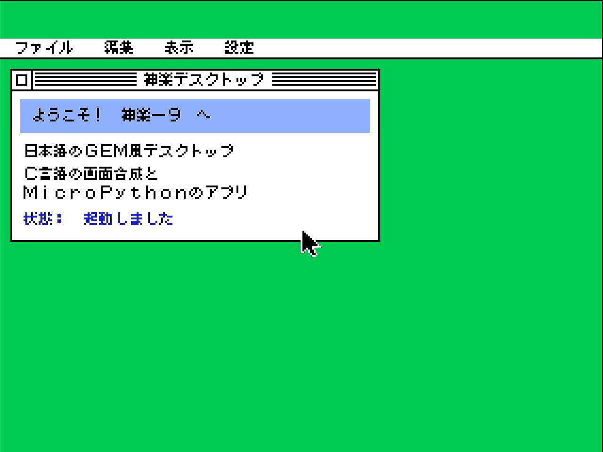
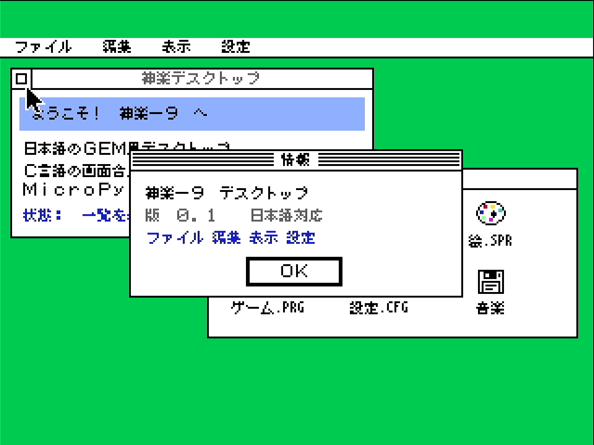
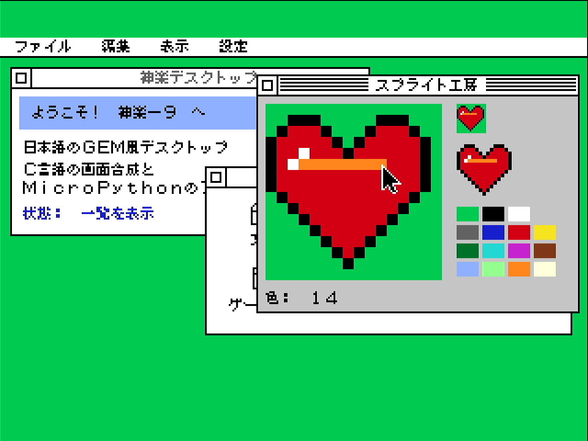

# Hardware acceptance: native desktop firmware on KAGURA-9 (2026-11-03)

**Setup:**
- Raspberry Pi Pico (RP2040, 125 MHz) running KAGURA_PICO MicroPython v1.26.0 with the `kagura_desktop` module. It was built from this tree with `software/desktop/tools/build_firmware.sh` and flashed with `tools/rp2040-firmware.py`.
- KAGURA-9 FPGA unchanged: ABI 0.6, CAPS 0x5b, 320x240, 1,200 patterns, QSPI console as configured in the board's `boot.py`.
- HDMI captured with the UGREEN 15390 at 1280x960.

The run was `tools/kagura-desktop-device.py --soak 600`. Raw output is in [hardware/device-run4.txt](hardware/device-run4.txt).

## Firmware and flashing

| | |
|---|---|
| firmware | `kagura-pico-native-1c9c234.uf2` (source commit `1c9c234`), SHA-256 `53547157e81be0d836391ee25c064de3d69c9a28d76c84b95a3a6f5cdcaab015` |
| image | 537,716 B (2,102 UF2 blocks), `0x10000000`..`0x10083600`, ending 117 KB below the filesystem (`0x100A0000`) |
| RAM | `.bss` 51,280 B (the desktop's static state is 46,152 B of it); GC heap 205,976 B; stack 8 KB |
| free heap after boot and console | 153,216 B (the previous firmware had 196,992 B) |
| font | Misaki, 71,718 B in flash (`kj_misaki8_bytes`) |

Before the first flash:
- **Backup:** the whole 2 MB flash (`d2ccc104…`, the verified backup of 2026-11-02) was confirmed equal to the board.
- **Rollback images:** two rollback UF2s were made and verified. One holds the whole flash; it rebuilds the backup byte for byte. The other holds only the installed firmware, below the filesystem.
- **Filesystem:** its SHA-256 was recorded (`7b07b001…`).

Each flash was then checked in three ways:
- the precondition: the backup hash for the first flash, and the previously flashed image for reflashes;
- the filesystem region was unchanged;
- the flash read back equal to the UF2.

All three flashes (`377e4f1`, `806d1bd`, `1c9c234`) passed; logs are in `hardware/flash-*.log`. The FPGA was not reconfigured.

Rollback, if ever needed:

```
python tools/rp2040-firmware.py rollback --approved --uf2 build/firmware-rollback/kagura-flash-backup-d2ccc104.uf2 --backup-sha d2ccc104c2a14a84e56501632ceb2ef802f3ad39c3493f42eba83c547f14987b
```

This needs a working REPL to enter BOOTSEL; otherwise hold BOOTSEL while plugging in USB and copy the same UF2.

## Results

| check | result |
|---|---|
| normal boot, REPL, console on HDMI, FPGA detection (ABI 0.6) | yes, after every flash and reset |
| `import kagura_desktop`, `kagura.desktop` | yes |
| 11 tour scenes: framebuffer CRC32 equal to the host run | 11 of 11 |
| 11 scenes: CRC32 of the 32,000 B read back from VRAM equal to the host's TILE4 image | 11 of 11 |
| `ERROR_CODE` after every scene | 0 |
| HDMI stills against the host references | 0 unexplained pixels in all 11 scenes; 54–476 chroma-edge pixels each, from 4:2:2 capture ([report](hardware/hdmi-compare-run4.md)) |
| Japanese text: menus ファイル 編集 表示 設定, title 神楽デスクトップ, dialog 情報, file names, status line | rendered, pixel-checked on the host against the font, CRC-equal on hardware |
| windows open/close, menus, dialog with button, sprite studio painting and import, window move | in the tour |
| console after desktop exit | back, not paused, no error |
| soft reset (`machine.soft_reset`), hard reset (`machine.reset`) | REPL, console and module back each time |
| soak, 10 min of mixed updates (labels, sprite pixels, activation, moves, menus, cursor) | 48,346 updates; 241 checks of "a full recomposition changes nothing" and `ERROR_CODE` 0, none failed; free heap after GC steady at 139,104 B |

A power cycle (cold boot) was not done, because it needs someone at the board. The hard reset restarts the RP2040 but not the FPGA.





Each scene shows the reference, the HDMI capture and the difference, in [hardware/hdmi-vs-host-montage.png](hardware/hdmi-vs-host-montage.png).

## Performance on the RP2040 (125 MHz)

Frame times include composition in C, TILE4 export, and the transport through the SDK's accelerated link, with a FENCE per run.

| operation | time |
|---|---:|
| label change (one record), present | 5.5 ms |
| sprite pixel change, present | 0.43 ms |
| window activation, present | 12.9 ms |
| window move 8 px, present | 36.2 ms |
| full recomposition (no tile changes) | 28.1 ms |
| tour scenes (several events, then present; 21–576 tiles) | 11–111 ms |
| `w.is_open()` / `set_color` with no change / `set_text` with no change | 9–15 / 20–30 / 24–33 µs per call |
| `gc.collect()` with the desktop open | 12.4 ms |

Before the transport changes (`806d1bd`), a window move took 152 ms and a label change 8.4 ms. Two changes brought them down:
- the link is written directly, with one `ERROR_CODE` check per present;
- runs separated by up to 32 clean tiles are merged.

The steady update loop leaves about 56 B of garbage per update (event tuples are avoided with `poll_into`; most of it is per-run objects on the transport path). Automatic GC collects it.

## Not done here

- **No native C hardware layer under MicroPython.** The firmware drives the FPGA through the existing MicroPython SDK, so there is one owner and one tested transport. The C transport (`software/pico`) serves standalone C programs. It is not built into the firmware, because two drivers cannot own the same PIO and pins.
- **PSG and PCM** are unchanged: they stay in the SDK.
- **Input on hardware** is scripted pointer events, plus keyboard handling in `desktop_ja.py` (`main(script=False)`: F10 menus, arrows, Enter, F6). There is no pointer device yet.

## State after the session (verified 2026-11-03)

After the acceptance run, a host-side raw-REPL entry left the Pico's USB CDC not accepting writes. Restarting the device on the PC needed administrator rights, so the board was unplugged and replugged. After that, `python tools/rp2040-firmware.py check` reported:
- the firmware build of 2026-11-03, free heap 153,296 B, FPGA ABI 0.6 / CAPS 0x5b / 240 lines, and `kagura_desktop` present;
- **filesystem SHA-256 `7b07b001…`**, identical to the value before the first flash;
- **whole flash SHA-256 `a85cc8a4…`**. This is exactly the original backup (`d2ccc104…`) with two changes: the `1c9c234` firmware image written at `0x10000000`..`0x10083600`, and the rest of its last 4 KB sector (`0x10083600`..`0x10084000`) erased to `0xFF` by the UF2 bootloader.

Nothing else in the flash changed.
