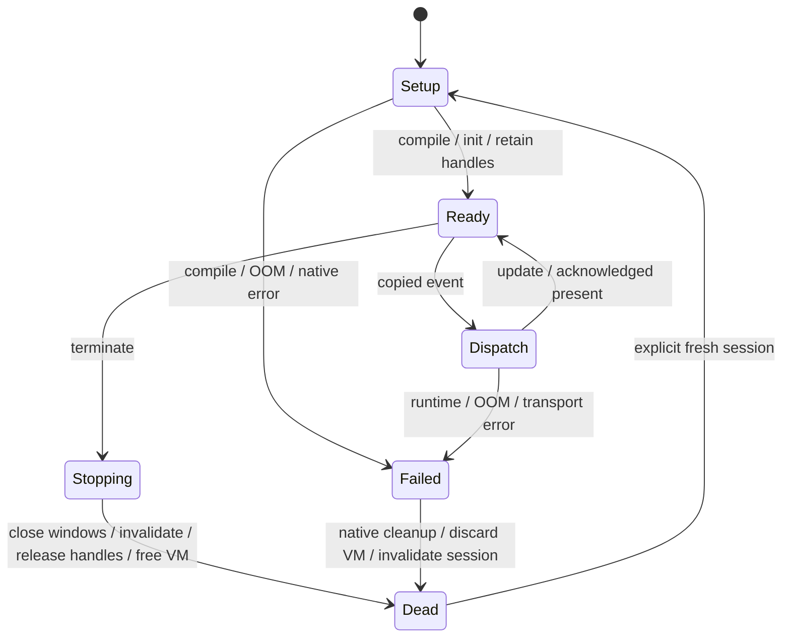

# Japanese GUI specification — design only

No new menu, dialog, input method, editor, scheduler or foreign method is
implemented in Stage 5. Existing Japanese titles and ASCII behavior remain.

## Text layout contract

Use `kj_measure` and the same ASCII override/profile as `kj_desktop_text` for
layout and drawing. Width is pixel advance, never UTF-8 bytes or `strlen*8`.
Keep system/small ASCII advances and baseline exactly as the old renderer.
Misaki glyphs occupy 8x8 cells; mixed strings must use the matching profile.
Clip to existing work rectangles; no drawing outside compositor-provided clip.
Use whole-scalar prefixes when fitting; reserve close-box/title decorations
before measuring the visible title. No automatic normalization or ellipsis in
the initial migration; if truncation is needed, choose an explicit whole-scalar
prefix. Drawing fallback and strict foreign-input rejection remain distinct.

| Role | Proposed behavior and acceptance criteria |
|---|---|
| Menu bar/dropdown | Native menu descriptors and command IDs remain. Measure every label once on mutation, bound width to screen/work area, derive drawing and pointer hit rectangles from the same measured layout. Checked/disabled/shortcut gutters have fixed widths. Recompute dropdown clipping after title changes. Test overlapping windows, open menu reveal, keyboard arrows/Enter/Escape and old ASCII goldens. |
| Window title | Keep current copied 24-byte storage now. Use shared text bridge and existing active/inactive decoration. Preserve close/move hit boxes, partial offscreen clipping, cover/uncover and exact dirty tiles. Longer storage is a separate change with explicit cost. |
| Button/label | Port measurement and drawing together. Existing `kd_label` assumes byte-indexed cells; do not reinterpret it as UTF-8. Add a bounded native UTF-8 label API separately, invalidate union of old/new pixel bounds (including background), and compare full redraw vs incremental dirty tiles. Native ASCII API remains compatible. |
| Dialog | Native window class plus bounded retained state, no second GUI tree. Fixed buttons/command IDs, explicit default/cancel, bounded message lines. First version uses explicit newlines, no paragraph wrapping/scrolling. Clip every line, measure max width, cap dialog to desktop. Existing compositor handles coverage/reveal. |
| Focus/keyboard | Reuse native focus/blur and window activation, add bounded per-window control index and Tab/Shift-Tab order. Enter invokes default/focused button, Escape cancels; never trigger disabled controls. Test pointer focus and window movement with menu open. `kd_event.ch` is one byte: Unicode text input requires a later explicit event representation, not silent ABI reinterpretation. |

These primitives display Japanese; they do not compose Japanese input.

## Bounded native string ownership proposal

24 bytes including NUL allow at most seven three-byte Japanese scalars; mixed
ASCII can fit more (`神楽 Desktop` fits). This is adequate for the current demo,
too small for general dialog messages and many application/menu names.
Inline titles in eight fixed slots cost 192 B already inside the Desktop.
Inline storage is simple, fragmentation-free and lifetime-obvious. Enlarging all
roles wastes RAM even when unused; borrowed Wren string pointers are forbidden.

Propose an optional Desktop-owned pool, initially **2,048 payload bytes plus
240 bytes of slot metadata = 2,288 B**, before any owner/control descriptors or
alignment changes measured by ARM `sizeof`/linker. Four fixed size classes:
16x32, 8x64, 4x128 and 2x256 bytes (30 slots). Each slot has 8-byte metadata:
length16, generation16, owner/session16, flags16. Offset derives from slot index
and class; a checked `{index,generation}` token is used, not a raw pointer.
Only native internals resolve an immutable temporary span. Fixed blocks avoid
external fragmentation/compaction; internal waste is bounded by class size.

Suggested limits: menu/button/name 63 bytes, dialog 255 bytes, titles retain
23 bytes until a separately reviewed migration. The 1,024-byte input validation
limit is not a storage capacity. Reject allocation/class exhaustion atomically;
do not silently truncate messages. For explicit title fitting/truncation,
validate the entire input first. A 256-byte class can hold only two simultaneous
messages; document this limit instead of borrowing unused stack/VM memory.

Mutation is transactional: validate complete span and role limits, reserve a
new block, copy and NUL-terminate, install token/invalidate old+new bounds, then
release the old block. Peak replacement needs two blocks of that class; if no
spare exists, leave the old label intact. Never compact a borrowed span; callbacks
cannot retain spans. Lifetime is control/window/application owner; termination
releases owned slots before VM destruction. A generation rollover must not make
an old token valid: retire the slot until a new application/session epoch, and
prevent epoch wrap from reusing a stale capability. ROM literals can be borrowed
under a separate explicit static-lifetime representation. No allocator is added
to the text engine.

The 2,288-byte estimate is **additive** while inline titles remain. Do not deduct
192 B until title fields are actually replaced and ARM layout measured. Do not
count the unassigned scratch banks as pool space. Reservation would reduce the
current contiguous main margin by at least 2,288 B; no such reservation is made
in this PR. Use a demand/slot exhaustion test before committing to these classes.

## Wren boundary and lifecycle

Freeze the current four-method demo contract for compatibility:
`Desktop.open(title)`, `Desktop.rect(x,y,w,h,color)`, `Desktop.nextEvent()`,
`Desktop.present()`. Validate types, numeric ranges and complete UTF-8 spans in
the native adapter. It exposes no framebuffer address, window pointer, mutable
font, transport register or allocator control. Its event source is four
simulated events; it is not yet a general desktop application API.

Minimal next application protocol (separate PR): host initializes one session;
compile once; retain receiver and `init()`, `event(_)`, `update()` and `close()`
call handles once; invoke `init` for native window creation; deliver copied,
bounded native events outside compositor callbacks; update retained state;
present synchronously on request; close deterministically. Optional handlers
must be detected at compile/setup time, with explicit validation errors.
Termination is a host operation; `close()` is best effort on a healthy VM and
must not run during OOM unwinding. No automatic multitasking or restart loop.

Keep one native owner and explicit window/control slot+generation+session
capabilities; a future multi-window API must not return unchecked integers that
can alias reused slots. New UI APIs should add only `Window`/`Button`/`Label`
operations actually required by a tested application, not duplicate native
state. Pool all transferred strings natively; the font stays in Flash.

On expected OOM, preserve current whole-VM discard and native cleanup. On
transport failure retain dirty state/fault and require explicit recovery. GC
may occur between calls; retained method/receiver handles protect VM objects,
while native copied strings remain independent. After shutdown all handles must
be cleared, registered session idle, native ownership absent and ledger empty.
Future foreign objects/finalizers or asynchronous calls need a separate audit.
