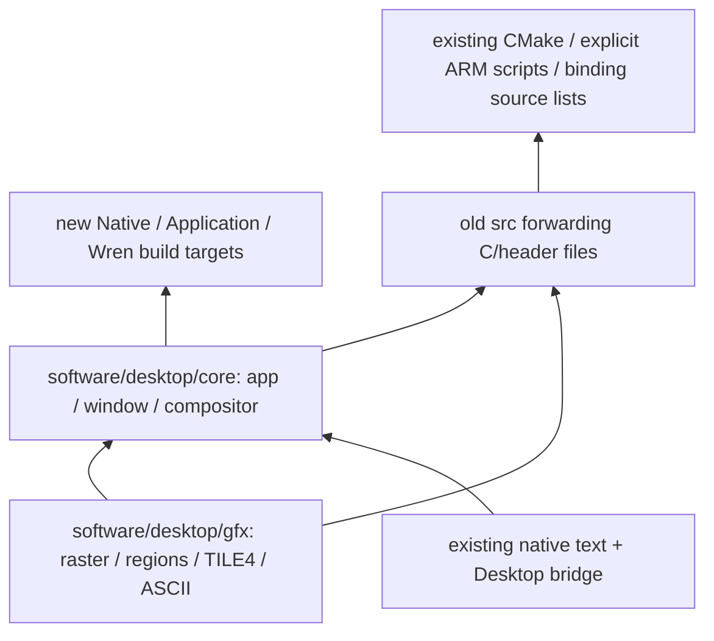

# Native source ownership — follow-up to Draft PR #73

Base: `0214429bd0cde433fab111e7acb78bc1b3f22a3a` (PR #73).
This implements only step 2 of the reviewed consolidation sequence. All
experimental PRs remain Draft and unmerged. No hardware access or Flash
programming is part of this work.

## Canonical source and compatibility

| Canonical directory | Files | Ownership |
|---|---|---|
| `software/desktop/core/` | `kd_app.c/.h`, `kd_desktop.c/.h` | Native application/window/event boundary, owner, compositor |
| `software/desktop/gfx/` | `kd_fb.c/.h`, `kd_region.c/.h`, `kd_tile4.c/.h`, `kd_font.c/.h`, `kd_font_data.c`, `kd_sprite.c/.h`, `kd_gfx.c/.h`, `kd_fault.h` | Packed raster, clipping/damage regions, TILE4 conversion, ASCII glyphs, graphics primitives and existing mutation hooks |

All 18 implementation/header files (nine C and nine headers) retain their exact previous Git blob
contents and SPDX notices. The move introduces no new native API or ABI,
allocator, data fields, renderer logic or framebuffer. Include names remain
unchanged; new consumers use the public target include directories `core/`,
`gfx/` and the existing native text include path.

`cmake/modules.cmake` compiles canonical `.c` files directly, in the original
archive order. `Kagura::Native` and `Kagura::Application` do not require the old
native `src` include directory or a VM. Native text remains the shared engine
from #71; the title/profile selection and font storage have not changed.

Each old file under `experiments/c-gem-desktop/src/` is a small relative-include
forwarder. Header forwarders rely on the canonical header guards. C forwarders
let old CMake projects, explicit compiler scripts, and the existing MicroPython
build source lists compile the same implementation without modifying those
bindings. They contain no alternate implementation or mutable state. **Compile
one route only**: never add both a forwarder and its canonical `.c` file to an
executable. No generated source is written back into the old directory.

This deliberate bridge avoids changing every experiment and binding in one PR.
Two source-reading tools follow the new owner: the existing ASCII generator
writes/checks canonical `gfx/kd_font_data.c` (never overwrites its forwarder),
and the host colour preview reads canonical `gfx/kd_gfx.c`. Generation content,
font hash/license and palette extraction behavior stay unchanged. The default
host suite explicitly checks generated ASCII source reproducibility.
It can be removed only after every source-list consumer migrates and passes its
own checks. It must not become a place for divergent fixes. Future fixes belong
in the canonical files. The MicroPython implementation is unmodified; a complete
MicroPython firmware rebuild is not claimed in this follow-up.

`kd_gfx.c` and `kd_desktop.c` retain their existing optional native-text adapter
calls under `KD_NATIVE_TEXT`. This is not a new source dependency or a second
rendering engine. Core and graphics are source-ownership directories; this step
does not split them into separate link-order-sensitive archives.

## Validation and resource policy

Expected change before measurement: zero persistent SRAM, Flash payload,
application heap, stack reservation and recovery change; source paths/debug
information may change the complete ELF hash. No guard or OOM limit may change.

The offline validation reuses the existing Release and ASan/UBSan suites,
including all thirteen native mutation variants, Japanese/ASCII rendering,
overlap/reveal/move, exact dirty tiles, foreign calls, GC/recreation and expected
OOM. The runtime-free application must still link without VM or allocator
symbols and match the seven Wren reference frame CRCs. Canonical and old-route
builds must match CRCs and pixels; full ELF load ranges and bytes are compared,
not only executable sizes. CPU-only ARM tests exercise bounded native malloc
failure and fresh-VM recovery, not FPGA/USB timing.

`tools/provenance.py` maps each canonical file back to its original PR #73 path
and asserts equal Git blobs, recording both checkout and reference SHA-256.
The remaining selected text/runtime/HAL/app/font inputs are also checked
unchanged. `results/source-provenance.json` is the complete manifest.
`tests/pr73-baseline.json` preserves the unmodified parent PR's checked-in host
CRCs/image hashes and load-segment hashes. Comparisons must match that frozen
baseline as well as the current compatibility builds, avoiding a comparison
only between two routes that both compile the relocated sources.

The historical PR #72 physical numbers remain historical;
neither CPU emulation nor static load-image identity confers physical acceptance.
The HDMI 46-pixel red-outline classification discrepancy remains unresolved,
with original thresholds unchanged.

### Host and ARM results

| Suite | Release | ASan/UBSan |
|---|---:|---:|
| Canonical build, including ASCII source regeneration | 9/9 | 9/9 |
| Legacy #70 GUI/foreign API, including 13 mutation variants | 18/18 | 18/18 |
| Legacy #71 native text/GUI, including mutation variants | 21/21 | 21/21 |
| Legacy #72 Japanese integration | 5/5 | 5/5 |
| Legacy #69 Wren correctness | 1/1 | 1/1 |
| Runtime-free native build | 6/6 | — |

114 CTest invocations passed with original assertions/goldens and sanitizer
settings retained. SDL interactive smoke is not selected. The first legacy
font-source check exposed the generator's old output path; adapting that path
fixed the check without changing generated bytes or the assertion. This is why
both the canonical and compatibility routes remain in the regression matrix.

Seven normal plus ten overlap/move CRCs and fourteen streaming image hashes
match the frozen PR #73 baseline as well as the current legacy builds. Three
native title-demo files also match. The native-only application still executes
four events and seven acknowledged presents without Wren or allocator symbols.
`results/equivalence.json` contains the comparison; no golden was regenerated
from the new renderer as a replacement expectation.

The adapted host preview produces a byte-identical PNG to PR #73's original
preview on the same indexed frame (`results/preview-equivalence.json`). This
optional tool was run with existing Windows Python 3.12/Pillow 13; WSL's global
Python lacks Pillow. No package was installed. The C tests/builds run in WSL
using the recorded GCC/Arm tools.

CPU-only Cortex-M0+ acceptance reuses unchanged tests and OOM assertions:
normal/cover/malloc-recovery/budget-recovery each run twenty VM lifecycles;
successful cycles execute ten rounds and 161 foreign calls, at least 61
collections, Japanese output and zero live ledger blocks after shutdown.
Budget/arena sweeps and minimum searches still pass. Payload peak 91,994 B,
payload+ledger 111,418 B, actual backing 128,640 B, painted stack upper usage
33,648 B: all equal to PR #73 emulation. These are workload-specific CPU/newlib
results, not a general heap minimum, physical timing or interrupt-stack proof.
The unchanged legacy #72 explicit ARM compiler script also builds through the
forwarders and passes its CPU-only integration suite; raw output is retained
in `results/legacy-arm-correctness.txt`.

### Linked resource result

| Resource | Expected delta | PR #73 | Relocated build | Actual delta |
|---|---:|---:|---:|---:|
| Flash load payload | 0 | 227,480 B | 227,480 B | 0 |
| Static SRAM | 0 | 45,596 B | 45,596 B | 0 |
| Native Wren arena | 0 | 135,168 B | 135,168 B | 0 |
| Core 0 stack | 0 | 49,152 B | 49,152 B | 0 |
| Recovery reserve | 0 | 8,192 B | 8,192 B | 0 |
| Unassigned main RAM | 0 | 24,036 B | 24,036 B | 0 |
| Separate scratch X/Y | 0 | 4,096 B each | 4,096 B each | 0 |
| Total unassigned | 0 | 32,228 B | 32,228 B | 0 |

The complete regenerated linker map, program headers, static objects and stack
frames are retained under `results/`. Address layout remains vectors/data/bss
`0x20000000–0x2000b21c`, arena to `0x2002c21c`, unassigned main range to
`0x20032000`, 8 KiB recovery to `0x20034000`, 48 KiB guarded stack to
`0x20040000`, then separate 4 KiB X/Y banks. The `.heap` 2,048-byte marker is
inside the arena, not an extra reservation. No free banks or recovery bytes are
treated as one larger application heap.

Exactly one `desktop_state` remains 34,284 B, already including the 32,000-byte
framebuffer and 1,280-byte shared snapshot/export scratch. No extra owner,
full-screen export buffer, font RAM/cache or native allocation was introduced.
Direct acknowledged transport, dirty retention on failure, reentry exclusion,
bounded allocator, watchdog, stack guards and all reservations are unchanged.

Every PT_LOAD address, size, flags/alignment and initialized byte matches both
the frozen PR #73 load-image hashes and a fresh compatibility-route build.
Full ELF SHA differs due to nonloaded path/debug metadata. The new ELF SHA-256 is
`3a7a578ecfd9c475c0a052b7560ddb2ceeb9641b8d88f5bc615fc8c84976f055`.
This is static image equivalence, not physical acceptance or permission to flash.

## Rollback and next boundary

Revert the canonical copies, forwarding files, source-reading tool paths and
CMake path changes together;
the previous commit restores the original source locations and evidence. Do not
revert only the forwarders while keeping canonical compilation, or vice versa.
The next planned PR relocates the shared text engine/asset/license with explicit
MicroPython asset-path compatibility; it is not included here. Application,
transport, Wren and protected platform policy remain at their verified paths.
